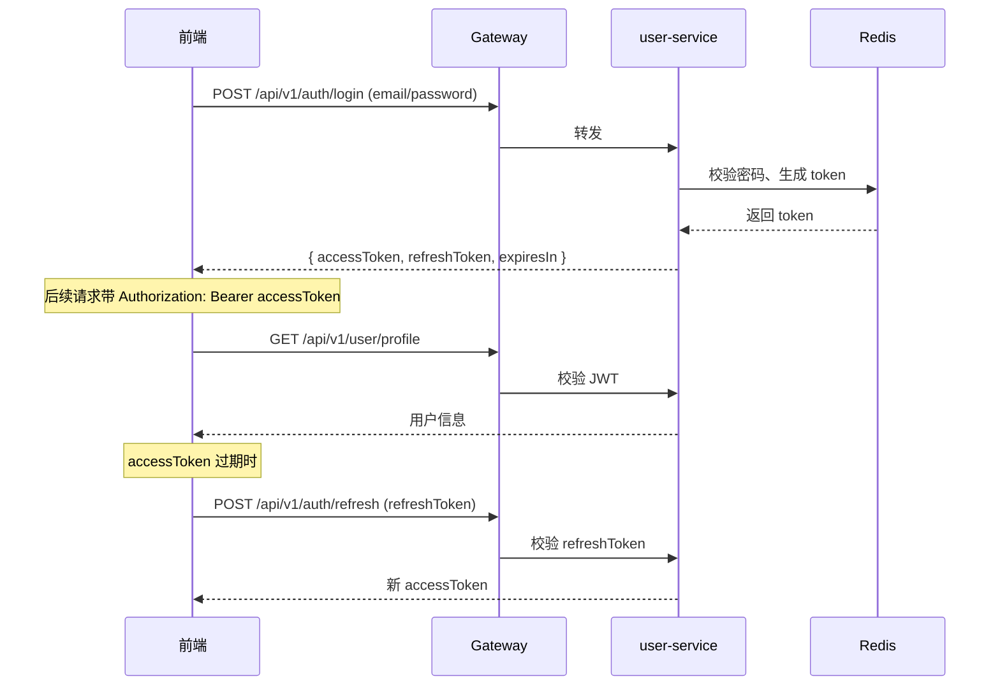

# CareerPilot · API 接口文档

> 文档版本：v1.0 · 2026-06-28
> 文档作者：API 组
> 读者对象：前端开发、后端开发、QA、第三方集成方
> 配套架构文档：[architecture.md](./architecture.md)

---

> ⚠️ **本文档是设计期（v1.0）的目标蓝图，与当前代码实现存在差异。**
>
> 代码里**实际生效**的接口以 **[docs/API-CONTRACT.md](./docs/API-CONTRACT.md)** 为准。
> 主要差异：
>
> | 项 | 本文（设计稿） | 实际实现 |
> |----|---------------|---------|
> | 列表接口返回 | 直接返回数组 | 统一返回 `{ total, page, size, items }` |
> | JD 上传入参 | `title` / `rawText` | `jobTitle` / `companyName` / `rawText` / `sourceType` / `sourceUrl` |
> | 简历解析结果 | 多种候选结构 | 直接透出 Agent 的 `AnalysisResult` 原结构 |
> | JD 解析结果 | 多种候选结构 | 直接透出 Agent 的 `JdChunk` 原结构 |
> | 服务数量 | 含支付 / 通知 / 文件等 | 6 个（gateway / user-center / resume / jd / match / ai-task-scheduler） |
>
> 改接口请先改 `docs/API-CONTRACT.md`，再改代码，最后跑
> `python scripts/verify_contract.py` 做一致性校验。

---

## 目录

1. [文档说明](#1-文档说明)
2. [用户与认证模块（user-service :8001）](#2-用户与认证模块user-service-8001)
3. [简历模块（resume-service :8002）](#3-简历模块resume-service-8002)
4. [JD 模块（jd-service :8003）](#4-jd-模块jd-service-8003)
5. [匹配度模块（ai-orchestrator :9001）](#5-匹配度模块ai-orchestrator-9001)
6. [模拟面试模块（ai-interview :9002）](#6-模拟面试模块ai-interview-9002)
7. [求职信模块（ai-cover-letter :9003）](#7-求职信模块ai-cover-letter-9003)
8. [任务与文件模块（file-service :8004 / task-service :8005）](#8-任务与文件模块file-service-8004--task-service-8005)
9. [会员与订单（order-service :8006）](#9-会员与订单order-service-8006)
10. [管理与统计](#10-管理与统计)
11. [数据模型（DTO 定义）](#11-数据模型dto-定义)
12. [附录](#12-附录)

---

## 1. 文档说明

### 1.1 文档目的

本文档是 CareerPilot 平台前后端联调、第三方接入的接口契约。定义全部 RESTful 接口与 WebSocket 通道，包含请求/响应 Schema、错误码、鉴权方式、典型调用示例。

### 1.2 阅读对象

| 角色 | 关注内容 |
|------|---------|
| 前端工程师 | 接口路径、请求体、响应体、字段约束 |
| 后端工程师 | 接口契约、错误码、分页约定 |
| QA 工程师 | 字段边界、错误码对照、测试用例 |
| 第三方接入方 | 鉴权、限流、SLA |

### 1.3 通用约定

| 项 | 约定值 |
|----|--------|
| 基础路径 | `https://api.careerpilot.com`（生产）/ `https://api-staging.careerpilot.com`（预发）/ `http://localhost:8080`（本地） |
| API 前缀 | 所有业务接口以 `/api/v1/` 开头 |
| 字符编码 | UTF-8 |
| 数据格式 | `application/json; charset=utf-8` |
| 时间格式 | ISO 8601（例：`2026-06-28T10:30:00+08:00`） |
| 时区 | 默认 UTC+8（北京时间），时间戳字段均为 Unix 毫秒 |
| 认证方式 | JWT Bearer Token（`Authorization: Bearer <access_token>`） |
| 请求方法 | `GET` / `POST` / `PUT` / `DELETE` / `PATCH` |
| 分页参数 | `page`（从 1 开始）、`size`（默认 20，最大 100）、`total`（响应中给出总数） |
| 排序参数 | `sort=field:asc` 或 `sort=field:desc`，多字段用 `,` 分隔 |
| 幂等性 | `POST` 创建类接口支持 `Idempotency-Key` 请求头（UUID），24h 内同 Key 仅执行一次 |

### 1.4 统一响应格式

所有接口（除特殊声明外）均返回如下 JSON 结构：

```json
{
  "code": 0,
  "message": "success",
  "data": { ... },
  "traceId": "7f3a4b2c-1e8d-4f5a-9c6b-3d2e1a0f8b9c"
}
```

| 字段 | 类型 | 说明 |
|------|------|------|
| `code` | int | 业务状态码，`0` 表示成功，其他值参考 1.5 错误码体系 |
| `message` | string | 中文提示信息（成功时为 "success"，失败时为人类可读错误） |
| `data` | object / array / null | 业务数据，失败时为 null |
| `traceId` | string | 请求追踪 ID，前端日志上报时必带，便于服务端排查 |

### 1.5 错误码体系

| 一级码段 | 含义 | 范围 | HTTP 状态码 |
|---------|------|------|------------|
| 0 | 成功 | 0 | 200/201/204 |
| 1xxx | 业务错误 | 1000-1999 | 200 |
| 4xxx | 客户端错误 | 4000-4999 | 400/401/403/404/409/422/429 |
| 5xxx | 服务端错误 | 5000-5999 | 500/502/503/504 |

详细错误码见附录 12.1。

### 1.6 鉴权流程



Token 有效期：
- `accessToken`：2 小时
- `refreshToken`：30 天

---

## 2. 用户与认证模块（user-service :8001）

服务名：`user-service` · 端口：`8001` · 技术栈：Spring Boot 3 + Spring Security + MyBatis-Plus + Redis

### 2.1 邮箱注册

**接口路径**：`POST /api/v1/auth/register`

**鉴权**：无需

**请求头**：`Content-Type: application/json`

**请求体**：

| 字段 | 类型 | 必填 | 说明 | 示例 |
|------|------|------|------|------|
| email | string | 是 | 邮箱地址 | `zhangsan@example.com` |
| password | string | 是 | 密码（8-32 位，含大小写字母 + 数字） | `MyP@ssw0rd123` |
| nickname | string | 否 | 昵称，默认邮箱前缀 | `张三` |
| inviteCode | string | 否 | 邀请码 | `INVT-2026-Q2-XK9F` |

**请求示例**：

```json
{
  "email": "zhangsan@example.com",
  "password": "MyP@ssw0rd123",
  "nickname": "张三",
  "inviteCode": "INVT-2026-Q2-XK9F"
}
```

**响应示例（成功 200）**：

```json
{
  "code": 0,
  "message": "success",
  "data": {
    "userId": 1024,
    "email": "zhangsan@example.com",
    "nickname": "张三",
    "avatar": "https://cdn.careerpilot.com/default-avatar.png",
    "createdAt": "2026-06-28T10:30:00+08:00"
  },
  "traceId": "7f3a4b2c-1e8d-4f5a-9c6b-3d2e1a0f8b9c"
}
```

**错误码**：

| code | message | 含义 |
|------|---------|------|
| 1401 | 邮箱已被注册 | 邮箱唯一索引冲突 |
| 1422 | 邮箱格式不正确 | 正则校验失败 |
| 1423 | 密码强度不足 | 不满足 8-32 位+大小写+数字 |
| 1430 | 邀请码无效 | 邀请码过期或不存在 |

---

### 2.2 账号密码登录

**接口路径**：`POST /api/v1/auth/login`

**鉴权**：无需

**请求体**：

| 字段 | 类型 | 必填 | 说明 | 示例 |
|------|------|------|------|------|
| email | string | 是 | 邮箱地址 | `zhangsan@example.com` |
| password | string | 是 | 密码 | `MyP@ssw0rd123` |
| deviceId | string | 否 | 设备指纹（用于多端登录管理） | `web-chrome-1234` |

**响应示例**：

```json
{
  "code": 0,
  "message": "success",
  "data": {
    "accessToken": "eyJhbGciOiJIUzI1NiJ9.eyJ1c2VySWQiOjEwMjQsImV4cCI6MTcyMDk1NjIwMH0.xxx",
    "refreshToken": "rt_3f9a4b2c1e8d4f5a9c6b3d2e1a0f8b9c",
    "tokenType": "Bearer",
    "expiresIn": 7200,
    "user": {
      "userId": 1024,
      "email": "zhangsan@example.com",
      "nickname": "张三",
      "avatar": "https://cdn.careerpilot.com/avatar/1024.png",
      "membershipLevel": "FREE"
    }
  },
  "traceId": "7f3a4b2c-1e8d-4f5a-9c6b-3d2e1a0f8b9c"
}
```

**错误码**：

| code | 含义 |
|------|------|
| 1401 | 账号不存在 |
| 1402 | 密码错误（连续 5 次错误锁定 30 分钟） |
| 1403 | 账号已被封禁 |

---

### 2.3 短信验证码登录

**接口路径**：`POST /api/v1/auth/login/sms`

**请求体**：

| 字段 | 类型 | 必填 | 说明 | 示例 |
|------|------|------|------|------|
| phone | string | 是 | 手机号（11 位） | `13800138000` |
| smsCode | string | 是 | 6 位短信验证码 | `582931` |

**响应**：同 2.2。

---

### 2.4 发送短信验证码

**接口路径**：`POST /api/v1/auth/sms/send`

**请求体**：

| 字段 | 类型 | 必填 | 说明 | 示例 |
|------|------|------|------|------|
| phone | string | 是 | 手机号 | `13800138000` |
| purpose | string | 是 | 用途：`LOGIN` / `REGISTER` / `RESET_PWD` | `LOGIN` |

**响应**：成功后仅返回 `code=0`，无业务数据。同一手机号 60s 内只能发 1 次，每天最多 10 次。

---

### 2.5 登出

**接口路径**：`POST /api/v1/auth/logout`

**鉴权**：需要 accessToken

**请求体**：无

**响应**：将当前 accessToken 加入 Redis 黑名单（TTL = accessToken 剩余有效期）。

---

### 2.6 刷新 Token

**接口路径**：`POST /api/v1/auth/refresh`

**请求体**：

| 字段 | 类型 | 必填 | 说明 |
|------|------|------|------|
| refreshToken | string | 是 | refresh_token |

**响应**：仅返回 `accessToken` + `expiresIn`，`refreshToken` 不变（除非主动轮换）。

---

### 2.7 获取当前用户信息

**接口路径**：`GET /api/v1/user/profile`

**鉴权**：需要 accessToken

**响应示例**：

```json
{
  "code": 0,
  "message": "success",
  "data": {
    "userId": 1024,
    "email": "zhangsan@example.com",
    "phone": "138****8000",
    "nickname": "张三",
    "avatar": "https://cdn.careerpilot.com/avatar/1024.png",
    "gender": "MALE",
    "birthYear": 1998,
    "city": "上海",
    "currentTitle": "后端开发工程师",
    "yearsOfExperience": 3,
    "educationLevel": "BACHELOR",
    "school": "华东师范大学",
    "major": "软件工程",
    "graduationYear": 2022,
    "targetIndustry": "互联网",
    "targetCity": ["上海", "杭州", "深圳"],
    "targetSalaryMin": 25000,
    "targetSalaryMax": 40000,
    "createdAt": "2026-06-28T10:30:00+08:00",
    "updatedAt": "2026-06-28T10:30:00+08:00"
  },
  "traceId": "..."
}
```

---

### 2.8 更新当前用户信息

**接口路径**：`PUT /api/v1/user/profile`

**请求体**：同 2.7 响应字段，全部可选，部分更新。

**响应**：更新后的完整 profile（同 2.7）。

---

### 2.9 上传头像

**接口路径**：`POST /api/v1/user/avatar`

**请求**：`Content-Type: multipart/form-data`，`file` 字段为图片（jpg/png/webp，≤ 2MB）。

**响应**：

```json
{
  "code": 0,
  "message": "success",
  "data": {
    "avatarUrl": "https://cdn.careerpilot.com/avatar/1024_v2.png"
  },
  "traceId": "..."
}
```

---

### 2.10 修改密码

**接口路径**：`POST /api/v1/user/password/change`

**请求体**：

| 字段 | 类型 | 必填 | 说明 |
|------|------|------|------|
| oldPassword | string | 是 | 当前密码 |
| newPassword | string | 是 | 新密码（强度同注册） |

**响应**：成功后强制当前账号所有设备下线（refreshToken 全部失效）。

---

### 2.11 获取会员信息

**接口路径**：`GET /api/v1/user/membership`

**响应示例**：

```json
{
  "code": 0,
  "message": "success",
  "data": {
    "level": "PRO",
    "levelName": "专业会员",
    "expireAt": "2026-09-28T10:30:00+08:00",
    "autoRenew": false,
    "benefits": [
      "每日无限次简历分析",
      "每日 20 次模拟面试",
      "求职信无限生成",
      "高级匹配报告",
      "简历优先 ATS 评分"
    ],
    "usageToday": {
      "resumeAnalysis": 5,
      "interviewMinutes": 32,
      "coverLetterGenerated": 1
    }
  },
  "traceId": "..."
}
```

---

## 3. 简历模块（resume-service :8002）

服务名：`resume-service` · 端口：`8002` · 技术栈：Spring Boot 3 + MyBatis-Plus + MySQL + MinIO + Elasticsearch

### 3.1 上传简历

**接口路径**：`POST /api/v1/resume/upload`

**鉴权**：需要 accessToken

**请求**：`multipart/form-data`

| 字段 | 类型 | 必填 | 说明 |
|------|------|------|------|
| file | binary | 是 | PDF / DOCX / DOC / 图片，≤ 10MB |
| title | string | 否 | 简历标题，默认原文件名去后缀 |
| language | string | 否 | `zh-CN` / `en-US`，默认 `zh-CN` |

**响应示例**：

```json
{
  "code": 0,
  "message": "success",
  "data": {
    "resumeId": 9001,
    "title": "张三-后端开发-2026",
    "fileUrl": "https://cdn.careerpilot.com/resume/1024/9001.pdf",
    "fileSize": 245678,
    "pageCount": 2,
    "parseStatus": "PENDING",
    "parseTaskId": "task-parse-9001",
    "uploadedAt": "2026-06-28T10:30:00+08:00"
  },
  "traceId": "..."
}
```

上传后会异步触发简历解析（OCR + 结构化提取），前端可通过 3.6 查询解析状态。

---

### 3.2 获取简历列表

**接口路径**：`GET /api/v1/resume/list`

**查询参数**：

| 字段 | 类型 | 必填 | 说明 | 示例 |
|------|------|------|------|------|
| page | int | 否 | 默认 1 | 1 |
| size | int | 否 | 默认 20，最大 100 | 20 |
| keyword | string | 否 | 标题/内容模糊搜索 | 后端 |
| sort | string | 否 | `updatedAt:desc`（默认）/ `createdAt:desc` | updatedAt:desc |

**响应示例**：

```json
{
  "code": 0,
  "message": "success",
  "data": {
    "total": 5,
    "page": 1,
    "size": 20,
    "items": [
      {
        "resumeId": 9001,
        "title": "张三-后端开发-2026",
        "fileUrl": "https://cdn.careerpilot.com/resume/1024/9001.pdf",
        "pageCount": 2,
        "parseStatus": "SUCCESS",
        "atsScore": 78,
        "isPrimary": true,
        "updatedAt": "2026-06-28T10:30:00+08:00"
      }
    ]
  },
  "traceId": "..."
}
```

---

### 3.3 获取简历详情

**接口路径**：`GET /api/v1/resume/{id}`

**响应**：返回简历的完整结构化内容（个人信息、教育经历、工作经历、项目经历、技能清单），结构与 [11.2 ResumeDTO](#112-resumedto) 一致。

---

### 3.4 更新简历内容

**接口路径**：`PUT /api/v1/resume/{id}`

**请求体**：完整 ResumeDTO（结构同 11.2），用于前端可视化编辑器保存。

**响应**：更新后的完整 ResumeDTO + 当前版本号 `version`。

---

### 3.5 删除简历

**接口路径**：`DELETE /api/v1/resume/{id}`

**响应**：`code=0` 即删除成功。逻辑删除（30 天后清理），不物理删除。

---

### 3.6 触发简历解析

**接口路径**：`POST /api/v1/resume/{id}/parse`

**请求体**：

| 字段 | 类型 | 必填 | 说明 |
|------|------|------|------|
| force | boolean | 否 | 强制重新解析（默认 false，已有解析结果则跳过） |

**响应**：

```json
{
  "code": 0,
  "message": "success",
  "data": {
    "taskId": "task-parse-9001-rev2",
    "estimatedSeconds": 15
  },
  "traceId": "..."
}
```

---

### 3.7 查询简历解析状态

**接口路径**：`GET /api/v1/resume/{id}/parse/status`

**响应示例**：

```json
{
  "code": 0,
  "message": "success",
  "data": {
    "status": "RUNNING",
    "progress": 65,
    "currentStep": "OCR + 结构化提取",
    "startedAt": "2026-06-28T10:30:00+08:00",
    "estimatedRemaining": 6
  },
  "traceId": "..."
}
```

状态值：`PENDING` / `RUNNING` / `SUCCESS` / `FAILED`

---

### 3.8 获取 ATS 评分

**接口路径**：`GET /api/v1/resume/{id}/ats-score`

**响应示例**：

```json
{
  "code": 0,
  "message": "success",
  "data": {
    "totalScore": 78,
    "grade": "B+",
    "dimensions": [
      { "name": "结构完整性", "score": 90, "weight": 0.15 },
      { "name": "关键词密度", "score": 65, "weight": 0.20 },
      { "name": "项目量化", "score": 80, "weight": 0.25 },
      { "name": "技能匹配", "score": 75, "weight": 0.15 },
      { "name": "格式规范", "score": 95, "weight": 0.10 },
      { "name": "可读性", "score": 70, "weight": 0.15 }
    ],
    "issues": [
      {
        "type": "MISSING_KEYWORD",
        "severity": "HIGH",
        "position": "项目经历-第二条",
        "description": "缺少目标岗位高频词：'微服务'、'高并发'、'Kafka'",
        "suggestion": "在项目描述中适当嵌入这些关键词"
      },
      {
        "type": "QUANTIFICATION",
        "severity": "MEDIUM",
        "position": "工作经历-公司A",
        "description": "3 条工作描述中 2 条缺少量化数据",
        "suggestion": "用 STAR 法则补充：带来 X% 增长 / 处理 Y 万 QPS / 节省 Z 人日"
      }
    ],
    "generatedAt": "2026-06-28T10:30:00+08:00"
  },
  "traceId": "..."
}
```

---

### 3.9 触发简历优化（Agent 异步任务）

**接口路径**：`POST /api/v1/resume/{id}/optimize`

**请求体**：

| 字段 | 类型 | 必填 | 说明 |
|------|------|------|------|
| targetJdId | int | 否 | 关联 JD，关联后优化会针对 JD 做关键词植入 |
| goal | string | 否 | `STAR_REWRITE` / `KEYWORD_OPTIMIZE` / `COMPREHENSIVE`，默认 `COMPREHENSIVE` |
| language | string | 否 | 输出语言 `zh-CN` / `en-US`，默认 `zh-CN` |

**响应**：

```json
{
  "code": 0,
  "message": "success",
  "data": {
    "taskId": "task-opt-9001-z3a4",
    "estimatedSeconds": 30
  },
  "traceId": "..."
}
```

后台会编排：JD 解析 Agent → 匹配 Agent → 简历优化 Agent（LangGraph StateGraph）。

---

### 3.10 获取简历优化结果

**接口路径**：`GET /api/v1/resume/{id}/optimize/result`

**查询参数**：`taskId`（必填）

**响应示例**：

```json
{
  "code": 0,
  "message": "success",
  "data": {
    "taskId": "task-opt-9001-z3a4",
    "status": "SUCCESS",
    "beforeScore": 78,
    "afterScore": 91,
    "rewrittenSections": [
      {
        "section": "工作经历-公司A-2024",
        "before": "负责后端服务开发，参与系统架构优化。",
        "after": "主导订单中心微服务架构重构（Spring Cloud Alibaba），将 QPS 从 800 提升至 4500（+462%），P99 延迟从 850ms 降至 95ms；通过引入 Kafka 消息削峰，大促期间零事故。"
      }
    ],
    "keywordInjections": [
      { "keyword": "微服务", "injectedAt": "工作经历-公司A-2024", "context": "主导订单中心微服务架构重构" },
      { "keyword": "高并发", "injectedAt": "项目经历-电商大促", "context": "..." }
    ],
    "version": "v2",
    "completedAt": "2026-06-28T10:32:30+08:00"
  },
  "traceId": "..."
}
```

---

### 3.11 获取简历历史版本

**接口路径**：`GET /api/v1/resume/{id}/versions`

**响应**：版本列表（倒序），含版本号、ATS 评分、操作类型（创建/优化/手动编辑）、操作时间。可一键切换到任意历史版本。

---
## 4. JD 模块（jd-service :8003）

服务名：`jd-service` · 端口：`8003` · 技术栈：Spring Boot 3 + Elasticsearch（JD 全文检索）+ ChromaDB（JD 向量）

### 4.1 上传 JD

**接口路径**：`POST /api/v1/jd/upload`

**请求**：

| 字段 | 类型 | 必填 | 说明 |
|------|------|------|------|
| sourceType | string | 是 | `TEXT` / `IMAGE` / `URL` / `FILE` |
| textContent | string | sourceType=TEXT 时必填 | JD 全文文本 |
| imageBase64 | string | sourceType=IMAGE 时必填 | 截图 base64 |
| url | string | sourceType=URL 时必填 | JD 链接（自动抓取） |
| file | binary | sourceType=FILE 时必填 | PDF / 图片 |
| companyName | string | 否 | 公司名（用户手动标注） |
| jobTitle | string | 否 | 岗位名 |

**响应**：

```json
{
  "code": 0,
  "message": "success",
  "data": {
    "jdId": 5001,
    "title": "高级后端开发工程师",
    "company": "字节跳动",
    "parseStatus": "PENDING",
    "parseTaskId": "task-jd-parse-5001",
    "uploadedAt": "2026-06-28T10:30:00+08:00"
  },
  "traceId": "..."
}
```

---

### 4.2 获取 JD 列表

**接口路径**：`GET /api/v1/jd/list`

**查询参数**：`page` / `size` / `keyword` / `company` / `industry` / `sort`（默认 `uploadedAt:desc`）

**响应**：

```json
{
  "code": 0,
  "message": "success",
  "data": {
    "total": 23,
    "page": 1,
    "size": 20,
    "items": [
      {
        "jdId": 5001,
        "title": "高级后端开发工程师",
        "company": "字节跳动",
        "industry": "互联网",
        "city": "上海",
        "salaryMin": 30000,
        "salaryMax": 55000,
        "experienceRequired": "3-5 年",
        "educationRequired": "本科",
        "parseStatus": "SUCCESS",
        "uploadedAt": "2026-06-28T10:30:00+08:00"
      }
    ]
  },
  "traceId": "..."
}
```

---

### 4.3 获取 JD 详情

**接口路径**：`GET /api/v1/jd/{id}`

**响应**：返回 JD 完整结构化字段（原文 + 结构化提取结果），结构见 [11.3 JdDTO](#113-jddto)。

---

### 4.4 触发 JD 解析（Agent）

**接口路径**：`POST /api/v1/jd/{id}/parse`

**请求体**：

| 字段 | 类型 | 必填 | 说明 |
|------|------|------|------|
| force | boolean | 否 | 强制重新解析 |

**响应**：

```json
{
  "code": 0,
  "message": "success",
  "data": {
    "taskId": "task-jd-parse-5001",
    "estimatedSeconds": 12
  },
  "traceId": "..."
}
```

后台调用 `jd_parser_agent`（LangGraph 子图）。

---

### 4.5 获取 JD 解析结果

**接口路径**：`GET /api/v1/jd/{id}/parse/result`

**查询参数**：`taskId`（必填）

**响应示例**：

```json
{
  "code": 0,
  "message": "success",
  "data": {
    "taskId": "task-jd-parse-5001",
    "status": "SUCCESS",
    "parsedFields": {
      "title": "高级后端开发工程师",
      "company": "字节跳动",
      "city": ["上海", "杭州"],
      "salaryRange": { "min": 30000, "max": 55000, "currency": "CNY", "months": 14 },
      "experienceRequired": { "min": 3, "max": 5, "unit": "YEAR" },
      "educationRequired": "BACHELOR",
      "hardSkills": ["Java", "Spring Boot", "Spring Cloud", "Kafka", "Redis", "MySQL", "Docker", "Kubernetes", "分布式", "微服务", "高并发"],
      "softSkills": ["跨部门协作", "技术评审", "团队管理"],
      "responsibilities": [
        "负责订单中心微服务架构设计与演进",
        "主导核心链路的性能优化（目标 P99 < 100ms）",
        "Code Review、新人辅导、技术分享"
      ],
      "businessMetrics": ["QPS", "P99 延迟", "可用性 99.99%", "大促 GMV"],
      "niceToHave": ["Rust", "Service Mesh", "OpenTelemetry"]
    },
    "completedAt": "2026-06-28T10:30:15+08:00"
  },
  "traceId": "..."
}
```

---

### 4.6 JD 搜索（全文 + 向量混合检索）

**接口路径**：`GET /api/v1/jd/search`

**查询参数**：

| 字段 | 类型 | 必填 | 说明 |
|------|------|------|------|
| q | string | 否 | 关键词 |
| vectorQuery | string | 否 | 语义搜索（用自然语言描述要找的 JD） |
| city | string | 否 | 城市 |
| industry | string | 否 | 行业 |
| salaryMin | int | 否 | 最低薪资下限 |
| experience | string | 否 | 经验要求范围 |
| page | int | 否 | 默认 1 |
| size | int | 否 | 默认 20 |

**响应**：同 4.2，但 `items` 中多了一个 `relevanceScore`（混合检索打分，0-1）。

---

### 4.7 删除 JD

**接口路径**：`DELETE /api/v1/jd/{id}`

**响应**：成功返回 `code=0`。逻辑删除 + 异步清理向量索引。

---

## 5. 匹配度模块（ai-orchestrator :9001）

服务名：`ai-orchestrator` · 端口：`9001` · 技术栈：FastAPI + LangGraph + Celery + ChromaDB + Redis

> 本模块是 CareerPilot 的核心 AI 能力，由 4 个 Agent 协同：JD 解析 Agent → 匹配评估 Agent → 简历优化 Agent → 结果聚合。详细 Agent 协同图见 [architecture.md §4.2](./architecture.md)。

### 5.1 触发匹配评估

**接口路径**：`POST /api/v1/match/evaluate`

**鉴权**：需要 accessToken（PRO 会员无限次 / FREE 每天 3 次）

**请求体**：

| 字段 | 类型 | 必填 | 说明 |
|------|------|------|------|
| resumeId | int | 是 | 简历 ID |
| jdId | int | 是 | JD ID |
| options.deepAnalysis | boolean | 否 | 是否深度分析（启用 RAG 行业知识），默认 false |
| options.includeRewrite | boolean | 否 | 是否生成改写建议，默认 true |

**响应**：

```json
{
  "code": 0,
  "message": "success",
  "data": {
    "taskId": "task-match-20260628-1030-001",
    "estimatedSeconds": 25,
    "priceQuota": 1
  },
  "traceId": "..."
}
```

后台编排：JD 解析 Agent → 匹配 Agent（语义 + 关键词 + 业务权重三段式打分）→ 简历优化 Agent（如 includeRewrite=true）。

---

### 5.2 获取匹配评估结果

**接口路径**：`GET /api/v1/match/{taskId}`

**响应示例**：

```json
{
  "code": 0,
  "message": "success",
  "data": {
    "taskId": "task-match-20260628-1030-001",
    "status": "SUCCESS",
    "overallScore": 82,
    "grade": "B+",
    "matchDimensions": [
      { "name": "硬技能匹配", "score": 75, "weight": 0.40, "detail": "命中 8/11 个硬技能关键词，缺 Kafka/Redis" },
      { "name": "软技能匹配", "score": 90, "weight": 0.15, "detail": "3 个软技能全部命中" },
      { "name": "经验匹配", "score": 100, "weight": 0.20, "detail": "3 年经验符合 3-5 年要求" },
      { "name": "学历匹配", "score": 100, "weight": 0.10, "detail": "本科符合" },
      { "name": "项目匹配", "score": 70, "weight": 0.15, "detail": "2/3 项目涉及分布式但缺大促场景" }
    ],
    "missingKeywords": [
      { "keyword": "Kafka", "importance": "HIGH", "suggestion": "在项目经历中体现消息队列使用经验" },
      { "keyword": "高并发", "importance": "MEDIUM", "suggestion": "用 QPS/TPS 量化体现" },
      { "keyword": "Kubernetes", "importance": "LOW", "suggestion": "如有接触务必写入" }
    ],
    "rewriteSuggestions": [
      {
        "section": "工作经历-公司A-2024",
        "before": "负责订单系统的后端开发。",
        "after": "主导订单中心日均 8000 万笔交易链路的后端开发，深度参与 Spring Cloud 微服务架构演进，QPS 提升 462%，P99 延迟从 850ms 降至 95ms。",
        "reasoning": "加入量化数据、目标 JD 中的高频词（微服务、QPS、P99）"
      }
    ],
    "trace": [
      { "agent": "jd_parser_agent", "duration": "1.2s", "status": "SUCCESS" },
      { "agent": "match_agent", "duration": "2.8s", "status": "SUCCESS" },
      { "agent": "resume_optimizer_agent", "duration": "12.4s", "status": "SUCCESS" }
    ],
    "completedAt": "2026-06-28T10:31:25+08:00"
  },
  "traceId": "..."
}
```

---

### 5.3 获取匹配评估历史

**接口路径**：`GET /api/v1/match/history`

**查询参数**：`page` / `size` / `sort=createdAt:desc`（默认）

**响应**：历史评估记录列表，含 taskId / 简历 / JD / 总分 / 创建时间。

---

## 6. 模拟面试模块（ai-interview :9002）

服务名：`ai-interview` · 端口：`9002` · 技术栈：FastAPI + WebSocket + LangGraph + Redis Streams

### 6.1 开始面试会话

**接口路径**：`POST /api/v1/interview/start`

**请求体**：

| 字段 | 类型 | 必填 | 说明 |
|------|------|------|------|
| resumeId | int | 否 | 关联简历 |
| jdId | int | 否 | 关联 JD |
| interviewType | string | 是 | `TECHNICAL` / `BEHAVIORAL` / `HR` / `COMPREHENSIVE` |
| difficulty | string | 否 | `JUNIOR` / `MIDDLE` / `SENIOR`，默认根据简历推断 |
| duration | int | 否 | 目标时长（分钟），默认 20 |
| language | string | 否 | `zh-CN` / `en-US` |

**响应**：

```json
{
  "code": 0,
  "message": "success",
  "data": {
    "sessionId": "iv-20260628-1030-001",
    "firstQuestion": "你好，我是 CareerPilot 的 AI 面试官。先做个自我介绍吧，重点讲讲你最近做的最有技术挑战的项目。",
    "websocketUrl": "wss://api.careerpilot.com/ws/interview/iv-20260628-1030-001",
    "estimatedQuestions": 8,
    "startedAt": "2026-06-28T10:30:00+08:00"
  },
  "traceId": "..."
}
```

---

### 6.2 提交面试回答（HTTP 形式）

**接口路径**：`POST /api/v1/interview/{sessionId}/answer`

**请求体**：

| 字段 | 类型 | 必填 | 说明 |
|------|------|------|------|
| answerText | string | 是 | 候选人的回答文本 |
| answerDurationMs | int | 否 | 回答耗时（毫秒） |
| audioUrl | string | 否 | 录音文件 URL（如果有） |

**响应**：

```json
{
  "code": 0,
  "message": "success",
  "data": {
    "nextQuestion": "刚才提到把 QPS 从 800 提升到 4500，能具体讲讲用了哪些优化手段吗？按你的理解这些手段对系统带来了哪些本质变化？",
    "round": 2,
    "realTimeFeedback": {
      "logic": 85,
      "depth": 70,
      "communication": 80,
      "comment": "回答结构清晰但缺乏量化数据支撑，建议补充压测数据和对比基线"
    }
  },
  "traceId": "..."
}
```

---

### 6.3 获取下一题（SSE 流式）

**接口路径**：`GET /api/v1/interview/{sessionId}/next-question`

**响应**：`Content-Type: text/event-stream`

```
event: chunk
data: {"text":"刚才"}

event: chunk
data: {"text":"提到"}

event: chunk
data: {"text":"把 QPS..."}

event: done
data: {"round":2}
```

---

### 6.4 结束面试

**接口路径**：`POST /api/v1/interview/{sessionId}/end`

**响应**：

```json
{
  "code": 0,
  "message": "success",
  "data": {
    "sessionId": "iv-20260628-1030-001",
    "reportId": "rpt-iv-20260628-1030-001",
    "endedAt": "2026-06-28T10:55:00+08:00",
    "durationMinutes": 25
  },
  "traceId": "..."
}
```

---

### 6.5 获取面试评估报告

**接口路径**：`GET /api/v1/interview/{sessionId}/report`

**响应示例**：

```json
{
  "code": 0,
  "message": "success",
  "data": {
    "reportId": "rpt-iv-20260628-1030-001",
    "overallScore": 78,
    "grade": "B+",
    "dimensions": [
      { "name": "技术深度", "score": 75, "comment": "对微服务架构有理解，但对 Kafka 原理掌握较浅" },
      { "name": "项目经验", "score": 85, "comment": "项目描述清晰，有量化数据" },
      { "name": "逻辑表达", "score": 80, "comment": "回答结构化，但偶尔冗长" },
      { "name": "沟通协作", "score": 82, "comment": "能清晰表达跨团队协作场景" },
      { "name": "应变能力", "score": 70, "comment": "追问时偶尔卡顿" }
    ],
    "highlights": [
      "项目量化数据充分（QPS 提升 462%）",
      "微服务架构理解到位"
    ],
    "improvements": [
      "加深 Kafka 消息可靠性原理",
      "追问时先用'我先想一下'再回答，避免冷场",
      "补充系统可用性相关案例"
    ],
    "transcript": [
      { "round": 1, "question": "自我介绍", "answer": "...", "aiComment": "..." }
    ],
    "completedAt": "2026-06-28T10:55:00+08:00"
  },
  "traceId": "..."
}
```

---

### 6.6 获取面试会话列表

**接口路径**：`GET /api/v1/interview/sessions`

**查询参数**：`page` / `size` / `interviewType` / `dateFrom` / `dateTo`

---

### 6.7 WebSocket 实时对话通道

**URL**：`wss://api.careerpilot.com/ws/interview/{sessionId}`

**消息协议**（JSON）：

```json
// 客户端 → 服务端
{ "type": "ANSWER", "payload": { "text": "...", "audioUrl": "..." } }
{ "type": "INTERRUPT", "payload": { "reason": "USER_PAUSE" } }
{ "type": "HEARTBEAT" }

// 服务端 → 客户端
{ "type": "QUESTION_CHUNK", "payload": { "text": "...", "round": 2 } }
{ "type": "QUESTION_END", "payload": { "round": 2 } }
{ "type": "REAL_TIME_FEEDBACK", "payload": { "logic": 85, "depth": 70, "comment": "..." } }
{ "type": "INTERVIEW_END", "payload": { "reportId": "..." } }
```

心跳间隔：30s；超时断开：90s 无心跳。

---

## 7. 求职信模块（ai-cover-letter :9003）

服务名：`ai-cover-letter` · 端口：`9003` · 技术栈：FastAPI + LangChain + Jinja2 + WeasyPrint

### 7.1 生成求职信

**接口路径**：`POST /api/v1/cover-letter/generate`

**请求体**：

| 字段 | 类型 | 必填 | 说明 |
|------|------|------|------|
| resumeId | int | 是 | 简历 ID |
| jdId | int | 是 | JD ID |
| tone | string | 否 | `FORMAL` / `ENTHUSIASTIC` / `CONCISE`，默认 `FORMAL` |
| highlightSkills | string[] | 否 | 重点突出的技能（如 `["分布式", "性能优化"]`） |
| length | string | 否 | `SHORT`（200 字）/ `MEDIUM`（400 字）/ `LONG`（600 字） |
| language | string | 否 | `zh-CN` / `en-US` |

**响应**：

```json
{
  "code": 0,
  "message": "success",
  "data": {
    "coverLetterId": 7001,
    "title": "致字节跳动-高级后端开发工程师",
    "content": "尊敬的招聘负责人：\n\n您好！我是一名拥有 3 年后端开发经验的工程师，在看到贵公司高级后端开发工程师岗位后，深感自身的分布式架构经验与岗位高度匹配。\n\n在最近的公司 A，我主导了订单中心从单体到 Spring Cloud 微服务的全面重构，将 QPS 从 800 提升至 4500（+462%），P99 延迟从 850ms 降至 95ms；通过引入 Kafka 消息削峰与多级缓存体系，在双 11 大促中实现零事故。\n\n我了解到贵团队在订单/支付链路持续追求极致性能与可用性（99.99%），这与我的技术追求高度契合。如有机会，希望进一步沟通。\n\n张三\n13800138000\nzhangsan@example.com",
    "wordCount": 287,
    "generatedAt": "2026-06-28T10:30:00+08:00"
  },
  "traceId": "..."
}
```

---

### 7.2 获取求职信详情

**接口路径**：`GET /api/v1/cover-letter/{id}`

---

### 7.3 编辑求职信

**接口路径**：`PUT /api/v1/cover-letter/{id}`

**请求体**：

| 字段 | 类型 | 必填 | 说明 |
|------|------|------|------|
| content | string | 是 | 编辑后的正文 |
| title | string | 否 | 新标题 |

---

### 7.4 获取求职信列表

**接口路径**：`GET /api/v1/cover-letter/list`

---

### 7.5 导出求职信

**接口路径**：`GET /api/v1/cover-letter/{id}/export`

**查询参数**：

| 字段 | 类型 | 必填 | 说明 |
|------|------|------|------|
| format | string | 是 | `PDF` / `DOCX` / `MARKDOWN` |

**响应**：返回文件二进制流，`Content-Disposition: attachment; filename="..."`

---

## 8. 任务与文件模块（file-service :8004 / task-service :8005）

### 8.1 通用文件上传

**接口路径**：`POST /api/v1/file/upload`

**请求**：`multipart/form-data`

| 字段 | 类型 | 必填 | 说明 |
|------|------|------|------|
| file | binary | 是 | 文件 |
| bizType | string | 是 | `RESUME` / `JD` / `AVATAR` / `INTERVIEW_AUDIO` / `OTHER` |
| bizId | string | 否 | 业务 ID（如简历 ID） |

**响应**：

```json
{
  "code": 0,
  "message": "success",
  "data": {
    "fileId": "file-20260628-1030-uuid",
    "url": "https://cdn.careerpilot.com/files/file-20260628-1030-uuid.pdf",
    "size": 245678,
    "bizType": "RESUME"
  },
  "traceId": "..."
}
```

---

### 8.2 获取文件信息

**接口路径**：`GET /api/v1/file/{id}`

---

### 8.3 删除文件

**接口路径**：`DELETE /api/v1/file/{id}`

---

### 8.4 异步任务状态查询

**接口路径**：`GET /api/v1/task/{taskId}`

**响应示例**：

```json
{
  "code": 0,
  "message": "success",
  "data": {
    "taskId": "task-match-20260628-1030-001",
    "bizType": "MATCH_EVALUATE",
    "status": "RUNNING",
    "progress": 65,
    "currentStep": "resume_optimizer_agent",
    "resultUrl": null,
    "errorMessage": null,
    "startedAt": "2026-06-28T10:30:00+08:00",
    "estimatedRemaining": 8
  },
  "traceId": "..."
}
```

---

### 8.5 获取我的任务列表

**接口路径**：`GET /api/v1/task/list`

**查询参数**：`page` / `size` / `bizType` / `status` / `dateFrom` / `dateTo`

---

## 9. 会员与订单（order-service :8006）

服务名：`order-service` · 端口：`8006` · 技术栈：Spring Boot 3 + MyBatis-Plus + RabbitMQ + 支付宝/微信 SDK

### 9.1 获取套餐列表

**接口路径**：`GET /api/v1/membership/plans`

**响应示例**：

```json
{
  "code": 0,
  "message": "success",
  "data": [
    {
      "planId": "FREE",
      "name": "免费版",
      "price": 0,
      "duration": "永久",
      "quotas": {
        "resumeAnalysisPerDay": 3,
        "matchEvaluationPerDay": 3,
        "interviewMinutesPerDay": 10,
        "coverLetterPerMonth": 5
      },
      "highlights": ["基础简历解析", "3 次/天匹配评估", "10 分钟/天模拟面试"]
    },
    {
      "planId": "PRO_MONTHLY",
      "name": "专业版-月卡",
      "price": 4900,
      "duration": "1 个月",
      "quotas": {
        "resumeAnalysisPerDay": -1,
        "matchEvaluationPerDay": -1,
        "interviewMinutesPerDay": 120,
        "coverLetterPerMonth": -1
      },
      "highlights": ["所有功能无限次", "深度行业知识 RAG", "专属简历优化报告"]
    },
    {
      "planId": "PRO_YEARLY",
      "name": "专业版-年卡",
      "price": 46800,
      "duration": "12 个月",
      "originalPrice": 58800,
      "discount": "8 折",
      "quotas": { "..." : "..." }
    },
    {
      "planId": "ENTERPRISE",
      "name": "企业版",
      "price": null,
      "duration": "按需",
      "contactSales": true
    }
  ],
  "traceId": "..."
}
```

`price` 单位为分（避免浮点精度问题），如 `4900` 表示 ¥49.00；`-1` 表示不限。

---

### 9.2 创建订单

**接口路径**：`POST /api/v1/order/create`

**请求体**：

| 字段 | 类型 | 必填 | 说明 |
|------|------|------|------|
| planId | string | 是 | 套餐 ID |
| payChannel | string | 是 | `ALIPAY` / `WECHAT` / `STRIPE` |
| quantity | int | 否 | 数量（年卡可买多年），默认 1 |

**响应**：

```json
{
  "code": 0,
  "message": "success",
  "data": {
    "orderId": "ORDER-20260628-1024-PRO-M",
    "amount": 4900,
    "payUrl": "https://openapi.alipay.com/gateway.do?...",
    "expireAt": "2026-06-28T11:30:00+08:00"
  },
  "traceId": "..."
}
```

---

### 9.3 支付回调

**接口路径**：`POST /api/v1/order/pay`

**请求体**：支付平台回调的原始参数（不进行业务包装），服务端按各支付平台 SDK 验签后自动激活会员。

---

### 9.4 获取订单列表

**接口路径**：`GET /api/v1/order/list`

**查询参数**：`page` / `size` / `status`（`PENDING` / `PAID` / `REFUNDED` / `CANCELED`）/ `dateFrom` / `dateTo`

---

### 9.5 用量查询

**接口路径**：`GET /api/v1/membership/usage`

**响应**：

```json
{
  "code": 0,
  "message": "success",
  "data": {
    "level": "PRO",
    "quotaResetAt": "2026-06-29T00:00:00+08:00",
    "today": {
      "resumeAnalysis": { "used": 5, "quota": -1 },
      "matchEvaluation": { "used": 8, "quota": -1 },
      "interviewMinutes": { "used": 32, "quota": 120 },
      "coverLetter": { "used": 1, "quota": -1 }
    },
    "month": {
      "coverLetter": { "used": 12, "quota": -1 }
    }
  },
  "traceId": "..."
}
```

---

## 10. 管理与统计

> 以下接口仅 ADMIN 角色可访问，需要 `Authorization: Bearer <admin_token>`

### 10.1 平台概览

**接口路径**：`GET /api/v1/admin/stats/overview`

**响应**：

```json
{
  "code": 0,
  "message": "success",
  "data": {
    "totalUsers": 125430,
    "activeUsersToday": 3214,
    "totalResumes": 287654,
    "totalJdAnalyses": 156789,
    "totalInterviews": 45678,
    "totalRevenueCents": 58934500,
    "llmCostCents": 8923400,
    "agentTaskStats": [
      { "agent": "match_agent", "calls": 234567, "avgDurationMs": 3200 },
      { "agent": "resume_optimizer_agent", "calls": 189012, "avgDurationMs": 12500 }
    ]
  },
  "traceId": "..."
}
```

---

### 10.2 用户管理

**接口路径**：`GET /api/v1/admin/users`

**查询参数**：`page` / `size` / `keyword` / `membershipLevel` / `status`

---

## 11. 数据模型（DTO 定义）

### 11.1 UserDTO

| 字段 | 类型 | 必填 | 说明 | 示例 |
|------|------|------|------|------|
| userId | long | 是 | 用户 ID（主键） | 1024 |
| email | string | 是 | 邮箱 | `zhangsan@example.com` |
| phone | string | 否 | 手机号（脱敏） | `138****8000` |
| nickname | string | 是 | 昵称 | `张三` |
| avatar | string | 否 | 头像 URL | `https://cdn.careerpilot.com/avatar/1024.png` |
| gender | string | 否 | `MALE` / `FEMALE` / `UNKNOWN` | `MALE` |
| birthYear | int | 否 | 出生年 | 1998 |
| city | string | 否 | 当前所在城市 | `上海` |
| currentTitle | string | 否 | 当前职位 | `后端开发工程师` |
| yearsOfExperience | int | 否 | 工作经验年数 | 3 |
| educationLevel | string | 否 | `BACHELOR` / `MASTER` / `PHD` / `OTHER` | `BACHELOR` |
| school | string | 否 | 毕业院校 | `华东师范大学` |
| major | string | 否 | 专业 | `软件工程` |
| graduationYear | int | 否 | 毕业年份 | 2022 |
| targetIndustry | string | 否 | 目标行业 | `互联网` |
| targetCity | string[] | 否 | 目标城市列表 | `["上海", "杭州"]` |
| targetSalaryMin | int | 否 | 期望薪资下限（分） | 2500000 |
| targetSalaryMax | int | 否 | 期望薪资上限（分） | 4000000 |
| membershipLevel | string | 是 | `FREE` / `PRO` / `ENTERPRISE` | `PRO` |
| createdAt | datetime | 是 | 注册时间 | `2026-06-28T10:30:00+08:00` |
| updatedAt | datetime | 是 | 更新时间 | `2026-06-28T10:30:00+08:00` |

---

### 11.2 ResumeDTO

| 字段 | 类型 | 必填 | 说明 | 示例 |
|------|------|------|------|------|
| resumeId | long | 是 | 简历 ID | 9001 |
| userId | long | 是 | 所属用户 ID | 1024 |
| title | string | 是 | 简历标题 | `张三-后端开发-2026` |
| fileUrl | string | 否 | 原文件 URL | `https://cdn.careerpilot.com/resume/9001.pdf` |
| fileSize | long | 否 | 文件大小（字节） | 245678 |
| pageCount | int | 否 | 页数 | 2 |
| language | string | 否 | `zh-CN` / `en-US` | `zh-CN` |
| parseStatus | string | 是 | `PENDING` / `RUNNING` / `SUCCESS` / `FAILED` | `SUCCESS` |
| atsScore | int | 否 | ATS 评分（0-100） | 78 |
| version | string | 否 | 当前版本号 | `v3` |
| isPrimary | boolean | 否 | 是否主简历 | true |
| personalInfo | object | 否 | 个人信息 | `{ name, phone, email, location }` |
| educationList | array | 否 | 教育经历 | `[{ school, major, degree, startYear, endYear }]` |
| workExperienceList | array | 否 | 工作经历 | `[{ company, title, startDate, endDate, responsibilities[], achievements[] }]` |
| projectList | array | 否 | 项目经历 | `[{ name, role, startDate, endDate, description, techStack[], metrics }]` |
| skillList | array | 否 | 技能清单 | `[{ category, skills[] }]` |
| certificateList | array | 否 | 证书 | `[{ name, issueDate, issuer }]` |
| createdAt | datetime | 是 | 创建时间 | `2026-06-28T10:30:00+08:00` |
| updatedAt | datetime | 是 | 更新时间 | `2026-06-28T10:30:00+08:00` |

---

### 11.3 JdDTO

| 字段 | 类型 | 必填 | 说明 | 示例 |
|------|------|------|------|------|
| jdId | long | 是 | JD ID | 5001 |
| title | string | 是 | 岗位名 | `高级后端开发工程师` |
| company | string | 是 | 公司名 | `字节跳动` |
| industry | string | 否 | 行业 | `互联网` |
| cityList | string[] | 否 | 工作城市 | `["上海", "杭州"]` |
| salaryMin | int | 否 | 薪资下限（分） | 3000000 |
| salaryMax | int | 否 | 薪资上限（分） | 5500000 |
| salaryMonths | int | 否 | 几个月 | 14 |
| experienceMin | int | 否 | 经验下限（年） | 3 |
| experienceMax | int | 否 | 经验上限（年） | 5 |
| educationRequired | string | 否 | 学历要求 | `BACHELOR` |
| hardSkills | string[] | 否 | 硬技能列表 | `["Java", "Kafka", "..."]` |
| softSkills | string[] | 否 | 软技能列表 | `["跨部门协作"]` |
| responsibilities | string[] | 否 | 工作职责 | `["..."]` |
| businessMetrics | string[] | 否 | 业务指标 | `["QPS", "P99"]` |
| niceToHave | string[] | 否 | 加分项 | `["Rust"]` |
| rawText | string | 否 | JD 原文 | `字节跳动...` |
| parseStatus | string | 是 | 同 ResumeDTO | `SUCCESS` |
| uploadedAt | datetime | 是 | 上传时间 | `2026-06-28T10:30:00+08:00` |

---

### 11.4 MatchResultDTO

| 字段 | 类型 | 必填 | 说明 |
|------|------|------|------|
| taskId | string | 是 | 评估任务 ID |
| resumeId | long | 是 | 简历 ID |
| jdId | long | 是 | JD ID |
| status | string | 是 | `PENDING` / `RUNNING` / `SUCCESS` / `FAILED` |
| overallScore | int | 否 | 总分（0-100） |
| grade | string | 否 | `A+` / `A` / `B+` / `B` / `C+` / `C` / `D` |
| matchDimensions | array | 否 | 分维度打分（见 5.2 示例） |
| missingKeywords | array | 否 | 缺失关键词列表 |
| rewriteSuggestions | array | 否 | 改写建议列表 |
| trace | array | 否 | Agent 执行 trace |
| completedAt | datetime | 否 | 完成时间 |

---

### 11.5 InterviewSessionDTO

| 字段 | 类型 | 必填 | 说明 |
|------|------|------|------|
| sessionId | string | 是 | 会话 ID |
| userId | long | 是 | 用户 ID |
| resumeId | long | 否 | 关联简历 |
| jdId | long | 否 | 关联 JD |
| interviewType | string | 是 | `TECHNICAL` / `BEHAVIORAL` / `HR` / `COMPREHENSIVE` |
| difficulty | string | 否 | `JUNIOR` / `MIDDLE` / `SENIOR` |
| status | string | 是 | `ACTIVE` / `ENDED` / `TIMEOUT` |
| round | int | 否 | 当前轮次 |
| durationMinutes | int | 否 | 实际持续时长 |
| overallScore | int | 否 | 总分（结束后回填） |
| transcript | array | 否 | 对话记录 |
| startedAt | datetime | 是 | 开始时间 |
| endedAt | datetime | 否 | 结束时间 |

---

### 11.6 CoverLetterDTO

| 字段 | 类型 | 必填 | 说明 |
|------|------|------|------|
| coverLetterId | long | 是 | 求职信 ID |
| userId | long | 是 | 用户 ID |
| resumeId | long | 是 | 关联简历 |
| jdId | long | 是 | 关联 JD |
| title | string | 是 | 求职信标题 |
| content | string | 是 | 求职信正文 |
| tone | string | 否 | `FORMAL` / `ENTHUSIASTIC` / `CONCISE` |
| wordCount | int | 是 | 字数 |
| language | string | 否 | 语言 |
| generatedAt | datetime | 是 | 生成时间 |
| updatedAt | datetime | 是 | 更新时间 |

---

### 11.7 TaskDTO

| 字段 | 类型 | 必填 | 说明 |
|------|------|------|------|
| taskId | string | 是 | 任务 ID |
| userId | long | 是 | 用户 ID |
| bizType | string | 是 | `RESUME_PARSE` / `JD_PARSE` / `MATCH_EVALUATE` / `RESUME_OPTIMIZE` / `INTERVIEW_REPORT` / `COVER_LETTER_GENERATE` |
| status | string | 是 | `PENDING` / `RUNNING` / `SUCCESS` / `FAILED` |
| progress | int | 否 | 进度 0-100 |
| currentStep | string | 否 | 当前步骤 |
| resultUrl | string | 否 | 结果查询 URL |
| errorMessage | string | 否 | 错误信息 |
| startedAt | datetime | 否 | 开始时间 |
| finishedAt | datetime | 否 | 结束时间 |
| estimatedRemaining | int | 否 | 预计剩余秒数 |

---

### 11.8 OrderDTO

| 字段 | 类型 | 必填 | 说明 |
|------|------|------|------|
| orderId | string | 是 | 订单号 |
| userId | long | 是 | 用户 ID |
| planId | string | 是 | 套餐 ID |
| planName | string | 是 | 套餐名称 |
| amount | int | 是 | 金额（分） |
| status | string | 是 | `PENDING` / `PAID` / `REFUNDED` / `CANCELED` |
| payChannel | string | 否 | `ALIPAY` / `WECHAT` / `STRIPE` |
| paidAt | datetime | 否 | 支付时间 |
| expireAt | datetime | 否 | 订单过期时间 |
| createdAt | datetime | 是 | 创建时间 |

---

### 11.9 MembershipDTO

| 字段 | 类型 | 必填 | 说明 |
|------|------|------|------|
| userId | long | 是 | 用户 ID |
| level | string | 是 | `FREE` / `PRO` / `ENTERPRISE` |
| levelName | string | 是 | 中文名 |
| startAt | datetime | 否 | 起始时间（FREE 用户为注册时间） |
| expireAt | datetime | 否 | 过期时间（FREE 用户为 null） |
| autoRenew | boolean | 否 | 是否自动续费 |
| benefits | string[] | 是 | 权益列表 |
| usageToday | object | 是 | 今日用量 |

---

## 12. 附录

### 12.1 完整错误码表

#### 成功

| code | message |
|------|---------|
| 0 | success |

#### 业务错误（1xxx）

| code | message | 说明 |
|------|---------|------|
| 1001 | 简历尚未解析完成 | 请等待 parseStatus=SUCCESS |
| 1002 | JD 尚未解析完成 | 同上 |
| 1003 | 会员配额已用尽 | 当日/当月配额耗尽 |
| 1004 | 任务不存在 | taskId 错误或已过期清理 |
| 1005 | 简历版本冲突 | version 过期，请重新拉取 |
| 1010 | 模拟面试正在进行 | session 活跃，请先结束 |

#### 客户端错误（4xxx）

| code | message | HTTP | 说明 |
|------|---------|------|------|
| 4000 | 请求参数错误 | 400 | 通用 |
| 4001 | 缺少必填参数 | 400 | |
| 4002 | 参数格式不正确 | 400 | |
| 4010 | 未登录 | 401 | 缺少 accessToken |
| 4011 | Token 无效 | 401 | JWT 校验失败 |
| 4012 | Token 已过期 | 401 | |
| 4013 | 权限不足 | 403 | RBAC 拒绝 |
| 4040 | 资源不存在 | 404 | |
| 4090 | 资源冲突 | 409 | 唯一索引冲突 |
| 4221 | 邮箱格式不正确 | 422 | |
| 4222 | 手机号格式不正确 | 422 | |
| 4223 | 密码强度不足 | 422 | |
| 4290 | 请求过于频繁 | 429 | 触发限流 |
| 4291 | 配额已用尽 | 429 | FREE 用户每日限制 |

#### 服务端错误（5xxx）

| code | message | HTTP | 说明 |
|------|---------|------|------|
| 5000 | 服务器内部错误 | 500 | 兜底 |
| 5001 | 服务暂时不可用 | 503 | 熔断 |
| 5002 | 上游服务超时 | 504 | Gateway timeout |
| 5010 | AI 服务异常 | 500 | LLM 调用失败 |
| 5011 | AI 任务超时 | 504 | Agent 任务超过 60s |
| 5020 | 文件上传失败 | 500 | OSS 错误 |
| 5030 | 支付失败 | 500 | 第三方支付回调错误 |

---

### 12.2 curl 调用示例

#### 示例 1：登录

```bash
curl -X POST 'https://api.careerpilot.com/api/v1/auth/login' \
  -H 'Content-Type: application/json' \
  -d '{
    "email": "zhangsan@example.com",
    "password": "MyP@ssw0rd123",
    "deviceId": "web-chrome-1234"
  }'
```

#### 示例 2：上传简历

```bash
curl -X POST 'https://api.careerpilot.com/api/v1/resume/upload' \
  -H "Authorization: Bearer $ACCESS_TOKEN" \
  -F 'file=@"/path/to/resume.pdf"' \
  -F 'title=张三-后端开发-2026' \
  -F 'language=zh-CN'
```

#### 示例 3：触发匹配评估

```bash
curl -X POST 'https://api.careerpilot.com/api/v1/match/evaluate' \
  -H "Authorization: Bearer $ACCESS_TOKEN" \
  -H 'Content-Type: application/json' \
  -d '{
    "resumeId": 9001,
    "jdId": 5001,
    "options": {
      "deepAnalysis": true,
      "includeRewrite": true
    }
  }'
```

#### 示例 4：轮询匹配结果

```bash
curl -X GET "https://api.careerpilot.com/api/v1/match/task-match-20260628-1030-001" \
  -H "Authorization: Bearer $ACCESS_TOKEN"
```

#### 示例 5：开始模拟面试

```bash
curl -X POST 'https://api.careerpilot.com/api/v1/interview/start' \
  -H "Authorization: Bearer $ACCESS_TOKEN" \
  -H 'Content-Type: application/json' \
  -d '{
    "resumeId": 9001,
    "jdId": 5001,
    "interviewType": "TECHNICAL",
    "difficulty": "MIDDLE",
    "duration": 20,
    "language": "zh-CN"
  }'
```

#### 示例 6：创建订单

```bash
curl -X POST 'https://api.careerpilot.com/api/v1/order/create' \
  -H "Authorization: Bearer $ACCESS_TOKEN" \
  -H 'Content-Type: application/json' \
  -d '{
    "planId": "PRO_MONTHLY",
    "payChannel": "ALIPAY",
    "quantity": 1
  }'
```

---

### 12.3 Postman / Apifox 导入

#### Postman

1. 下载 OpenAPI Spec：`GET https://api.careerpilot.com/v3/api-docs`（SpringDoc 生成）
2. Postman → Import → 选择下载的 `openapi.json`
3. 设置 Collection Variable：

```
baseUrl = https://api.careerpilot.com
accessToken = <从 /auth/login 获取>
```

4. Collection → Authorization → Type: Bearer Token，Token: `{{accessToken}}`

#### Apifox

1. 同上导入 OpenAPI Spec
2. 环境变量：

```
BASE_URL = https://api.careerpilot.com
TOKEN = <登录后填入>
```

3. 所有接口前缀 `/api/v1/`

#### 自动生成 OpenAPI Spec

Java 端基于 `springdoc-openapi-starter-webmvc-ui`，访问：

- `http://localhost:8080/v3/api-docs`（JSON）
- `http://localhost:8080/v3/api-docs.yaml`（YAML）
- `http://localhost:8080/swagger-ui.html`（Swagger UI）

Python 端基于 FastAPI 自带 OpenAPI：

- `http://localhost:9001/docs`（Swagger UI）
- `http://localhost:9001/openapi.json`

---

### 12.4 SDK 计划

#### Java SDK（官方）

- 仓库：`github.com/careerpilot/careerpilot-java-sdk`
- 安装：`maven` 或 `gradle`
- 核心类：`CareerPilotClient`（OkHttp + Retrofit + Jackson）
- 示例：

```java
CareerPilotClient client = CareerPilotClient.builder()
    .baseUrl("https://api.careerpilot.com")
    .accessTokenSupplier(() -> tokenRefresher.get())
    .build();

ResumeDTO resume = client.resume().upload(new File("resume.pdf"), "张三-2026", "zh-CN");
MatchResultDTO match = client.match().evaluate(resume.getResumeId(), jdId, MatchOptions.builder().deepAnalysis(true).build());
```

#### Python SDK（官方）

- 仓库：`github.com/careerpilot/careerpilot-python-sdk`
- 安装：`pip install careerpilot`
- 示例：

```python
from careerpilot import CareerPilot

cp = CareerPilot(base_url="https://api.careerpilot.com", access_token=token)
resume = cp.resume.upload(open("resume.pdf", "rb"), title="张三-2026", language="zh-CN")
match = cp.match.evaluate(resume_id=resume.id, jd_id=5001, deep_analysis=True)
```

#### TypeScript / JavaScript SDK

- 仓库：`github.com/careerpilot/careerpilot-js-sdk`
- 安装：`npm install @careerpilot/sdk`
- 同构（Node + 浏览器）
- 示例：

```typescript
import { CareerPilot } from '@careerpilot/sdk';

const cp = new CareerPilot({ baseUrl: 'https://api.careerpilot.com', accessToken: token });
const resume = await cp.resume.upload({ file, title: '张三-2026' });
const match = await cp.match.evaluate({ resumeId: resume.id, jdId: 5001 });
```

#### 版本与兼容性

| SDK 版本 | API 版本 | 状态 |
|---------|---------|------|
| v1.x | /api/v1 | 稳定 |
| v2.x（规划） | /api/v2 | 包含 GraphQL 端点 |

---

## 变更记录

| 版本 | 日期 | 变更内容 | 作者 |
|------|------|---------|------|
| v1.0 | 2026-06-28 | 首版发布，覆盖 8 大模块、60+ 接口 | API 组 |

---

> 本文档配套架构设计见 [architecture.md](./architecture.md)，
> 项目对外介绍见 [project-description.md](./project-description.md)。
