# CareerPilot · 智能求职领航员 — 技术架构设计文档

> 文档版本：v1.0 · 2026-06-28
> 文档作者：架构组
> 读者对象：面试官、资深工程师、跨团队技术评审
> 文档状态：已冻结基线（Baseline Frozen）

---

> ⚠️ **本文档描述的是目标架构蓝图，部分组件尚未落地。**
>
> 当前代码里**已经实现**的架构、端口、启动方式以 **[README.md](./README.md)** 为准，
> 接口形状以 **[docs/API-CONTRACT.md](./docs/API-CONTRACT.md)** 为准。
>
> 本文与实现的主要差异：
>
> | 组件 | 本文的规划 | 当前实现 |
> |------|-----------|---------|
> | 服务注册 / 配置中心 | Nacos（Spring Cloud Alibaba） | 未引入，直接用环境变量 |
> | 限流 / 分布式事务 | Sentinel / Seata | 未引入 |
> | 向量检索 | ChromaDB + bge-reranker + RRF | 关键词 + BM25 轻量检索（Agent 内置知识库） |
> | 对象存储 | MinIO | 本地磁盘（`STORAGE_ROOT`），切 MinIO 只需换一个方法 |
> | 搜索引擎 | Elasticsearch | 未引入 |
> | 可观测 | Prometheus + Grafana + Loki + Jaeger | 仅 Actuator + 应用日志 |
> | CI/CD | GitHub Actions + ArgoCD | 未配置 |
> | 数据库表 | 20 张 | 16 张（支付 / 订阅 / 通知已建表，业务未填充） |
>
> 架构上**确实按本文落地的部分**：多 Agent 分层、LangGraph 编排、Java 业务层与
> Python AI 层职责分离、异步任务 + 回调写回、三段式可解释打分、AI 与业务解耦。

---

## 目录

1. [项目概述](#1-项目概述)
2. [系统总体架构](#2-系统总体架构)
3. [微服务拆分](#3-微服务拆分)
4. [多 Agent 协同架构](#4-多-agent-协同架构核心亮点)
5. [数据库设计](#5-数据库设计)
6. [AI / Agent 技术细节](#6-ai--agent-技术细节)
7. [安全与合规](#7-安全与合规)
8. [性能指标 & SLA](#8-性能指标--sla)
9. [部署架构](#9-部署架构)
10. [附录：术语表 & 变更记录](#10-附录术语表--变更记录)

---

## 1. 项目概述

### 1.1 一句话定位

**CareerPilot 是一款基于多 Agent 协同（Multi-Agent Orchestration）的智能求职助手平台，覆盖"解析 JD → 诊断简历 → 匹配打分 → 优化润色 → 模拟面试 → 求职信 → 职业规划"全链路。**

### 1.2 核心价值主张

- **多 Agent 协同，不是单 LLM 调用**：基于 LangGraph 编排 8 个专业化 Agent，可根据用户当前任务动态组装工作流；每个 Agent 拥有独立 Prompt、独立工具集、独立可观测 Trace。
- **全链路闭环**：从 JD 解析到模拟面试，单一上下文（StateGraph 状态）贯穿，避免用户重复上传与多工具拼接。
- **可解释的匹配机制**：基于"语义相似度 + 关键词覆盖 + 业务权重"三段式加权打分，输出可落地的差距清单（Gap List）。
- **行业知识 RAG**：内置行业知识库（互联网、金融、制造业、外企等十余个垂直领域），职业规划 Agent 检索后给出基于事实的成长建议，避免 LLM 幻觉。
- **流式实时反馈**：简历优化、模拟面试采用 SSE 流式输出，首 Token 延迟 ≤ 1.5s，整体体验逼近 ChatGPT 体感。

### 1.3 目标用户

| 用户画像 | 占比预期 | 核心场景 |
|---------|---------|---------|
| 应届生 / 校招求职者 | 45% | 简历从零搭建、批量投递、模拟面试 |
| 1-3 年社招 / 跳槽者 | 30% | 简历精修、针对性面试准备、谈薪策略 |
| 转行 / 跨岗求职者 | 15% | 行业知识 RAG、JD 关键词反向工程 |
| 高校就业指导老师 / HR | 10% | 批量简历诊断、ATS 模拟筛选 |

### 1.4 解决的痛点

1. **简历无反馈**：传统简历工具只给模板不给评分，CareerPilot 输出 ATS 评分（0-100）+ 7 维问题清单。
2. **JD 不会拆**：求职者看不懂 JD 隐藏要求，本系统 JD 解析 Agent 拆出硬技能 / 软技能 / 业务指标三层。
3. **面试练不了**：模拟面试 Agent 支持多轮追问 + 实时 STAR 法则纠正 + 评分卡。
4. **求职信套模板**：求职信生成 Agent 基于具体 JD + 个人简历生成定制化内容，避免模板化。
5. **职业规划凭感觉**：基于行业知识库 RAG，避免 LLM 幻觉，给出可执行的 3-6 个月行动建议。

### 1.5 与市面产品差异化对比

> 横向对比 4 款主流产品：OfferGoose、AI简历姬、超级简历、ResumeFit

| 维度 | OfferGoose | AI简历姬 | 超级简历 | ResumeFit | **CareerPilot** |
|------|-----------|---------|---------|----------|----------------|
| **架构范式** | 单 LLM 工具 | 单 LLM 工具 | 模板网站 | 单 LLM 工具 | **多 Agent 协同（LangGraph）** |
| **JD 解析能力** | 不支持 | 弱 | 不支持 | 弱 | **硬技能/软技能/业务指标三层结构化提取** |
| **匹配评分** | 不支持 | 简单相似度 | 不支持 | ATS 规则 | **语义+关键词+业务权重三段式加权，输出 Gap List** |
| **简历优化** | 全文重写 | 全文重写 | 模板替换 | 建议式 | **STAR 法则改写 + 关键词植入 + 量化建议** |
| **模拟面试** | 一次性 | 一次性 | 不支持 | 不支持 | **多轮追问 + 实时反馈 + 评分卡 + 行业定制** |
| **求职信** | 不支持 | 模板化 | 模板化 | 不支持 | **基于具体 JD + 个人简历的定制化生成** |
| **职业规划** | 不支持 | 不支持 | 不支持 | 不支持 | **基于 RAG 行业知识库**（**独有**） |
| **可解释性** | 黑盒 | 黑盒 | 不涉及 | 部分 | **每个 Agent 独立 Trace + 决策可回放** |
| **数据所有权** | 云端 | 云端 | 云端 | 云端 | **支持本地部署 + 数据脱敏导出** |
| **技术深度（给面试官）** | Prompt + 微调 | Prompt | 前端为主 | Prompt | **Spring Cloud + LangGraph + RAG + ES + K8s** |

> **5 个最关键的差异化点**：
> 1. **多 Agent 协同 vs 单 LLM 调用**：OfferGoose / AI简历姬 / ResumeFit 都是"一个 Prompt 包打天下"，CareerPilot 用 LangGraph 编排 8 个专业化 Agent，状态可追溯、工具可插拔。
> 2. **结构化 JD 解析**：业界普遍只做关键词抽取，我们做到"硬技能 / 软技能 / 业务指标"三层结构化 + 业务画像（行业、职级、风格）。
> 3. **可解释的匹配打分**：ResumeFit 的 ATS 评分黑盒，我们的三段式加权 + Gap List 让用户清楚"差在哪里、怎么补"。
> 4. **多轮追问的模拟面试**：其他产品的模拟面试是"一次性提问一次性回答"，我们支持基于用户回答动态追问，最长 8 轮 + 每轮评分卡。
> 5. **RAG 行业知识库支撑职业规划**：其他产品没有这一项，是真正的差异化护城河。

---

## 2. 系统总体架构

### 2.1 分层架构总览

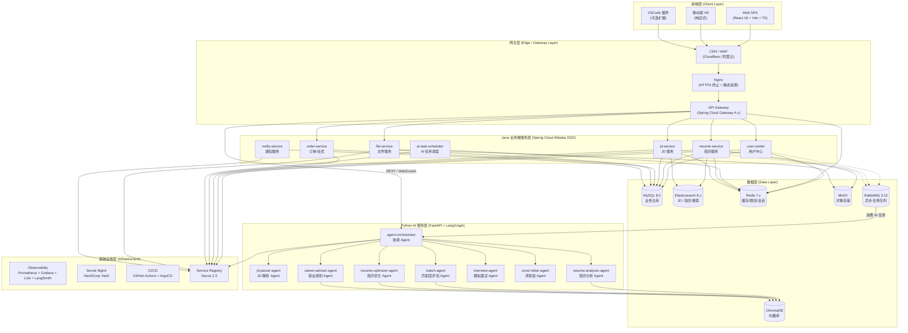

### 2.2 各层职责 & 选型理由

| 层级 | 核心职责 | 选型 | 选型理由 |
|------|---------|------|---------|
| **前端层** | 简历编辑器、JD 看板、模拟面试实时对话、工作流进度可视化 | React 18 + Vite + TypeScript + Ant Design 5 + Zustand | 生态成熟、流式渲染友好（SSE/WS）、TS 强类型降低联调成本 |
| **CDN / WAF** | 静态资源加速、SQL 注入/XSS 防护、Bot 过滤 | Cloudflare / 阿里云 WAF | 抗 DDoS、自动 HTTPS、地理加速 |
| **Nginx** | HTTPS 终止、负载均衡、静态资源服务 | Nginx 1.24+ | 性能稳定、配置灵活 |
| **API Gateway** | 路由、限流、鉴权、灰度、聚合 | Spring Cloud Gateway 4.x | 与 Java 生态无缝、响应式非阻塞、WebFlux 性能强 |
| **Java 业务微服务层** | 业务 CRUD、事务一致性、订单/会员/支付 | Spring Boot 3.2 + Spring Cloud Alibaba 2022 + Nacos + Seata | 国内生态成熟、分布式事务完善、招聘市场人才充足 |
| **Python AI 服务层** | 多 Agent 协同、LLM 调用、工具执行、流式输出 | FastAPI 0.110 + LangGraph 0.1 + LangChain 0.2 + Pydantic v2 | 异步原生支持、Python AI 生态最丰富、LangGraph 状态图表达力强 |
| **数据层** | 关系数据、搜索、缓存、向量、对象、消息 | MySQL 8 + ES 8 + Redis 7 + ChromaDB + MinIO + RabbitMQ | 各组件各司其职，避免"用 ES 存订单"反模式 |
| **基础设施层** | 可观测、密钥、CI/CD、注册中心 | Prometheus + Grafana + Loki + LangSmith + Vault + Nacos | 开源可控、与 K8s 原生集成、LangSmith 对 Agent 调试极友好 |

### 2.3 部署拓扑图

#### 2.3.1 本地单机部署（开发 / Demo）

> 不使用容器编排。所有进程直接跑在开发机上：Java 微服务是 JVM 进程，
> Python Agent 是 uvicorn 进程，MySQL / Redis 是本机服务实例。
> 启动与停止统一由 `scripts/local/` 下的 PowerShell 脚本负责。

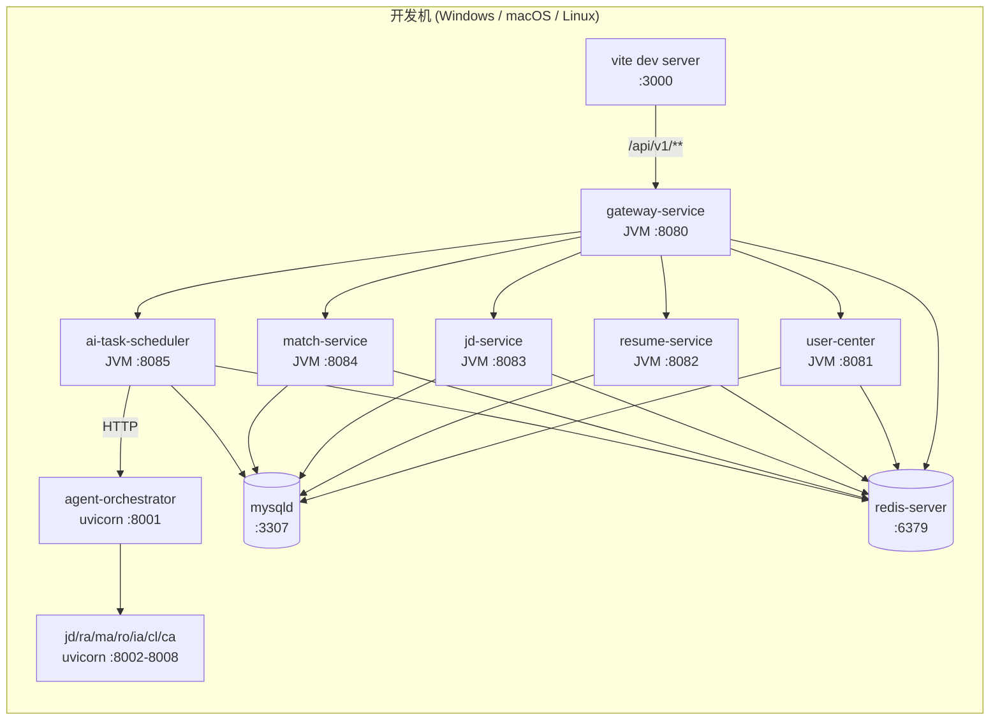

> **关键设计点**：
> - **端口规划**：网关 8080，Java 微服务 8081-8085，Python AI 8001-8008，中间件使用标准端口。
> - **MySQL 端口**：本地默认用 **3307**（项目专用实例），避免与开发机上已有的 3306 冲突；
>   想复用现有实例，改 `scripts/local/.env` 里的 `MYSQL_PORT` 即可。
> - **数据目录**：MySQL 数据文件、Redis 持久化文件、简历附件统一落在 `CAREERPILOT_DATA_DIR`（默认 `D:\CareerPilotData`），
>   不进仓库。
> - **进程管理**：`scripts/local/start-all.ps1` 一键拉起，`stop-all.ps1` 一键停止；
>   日志与 PID 落在 `.runtime/`。
> - **互通方式**：全部走 `127.0.0.1`，不需要自定义网络与内部 DNS。

#### 2.3.2 K8s 演进（生产）

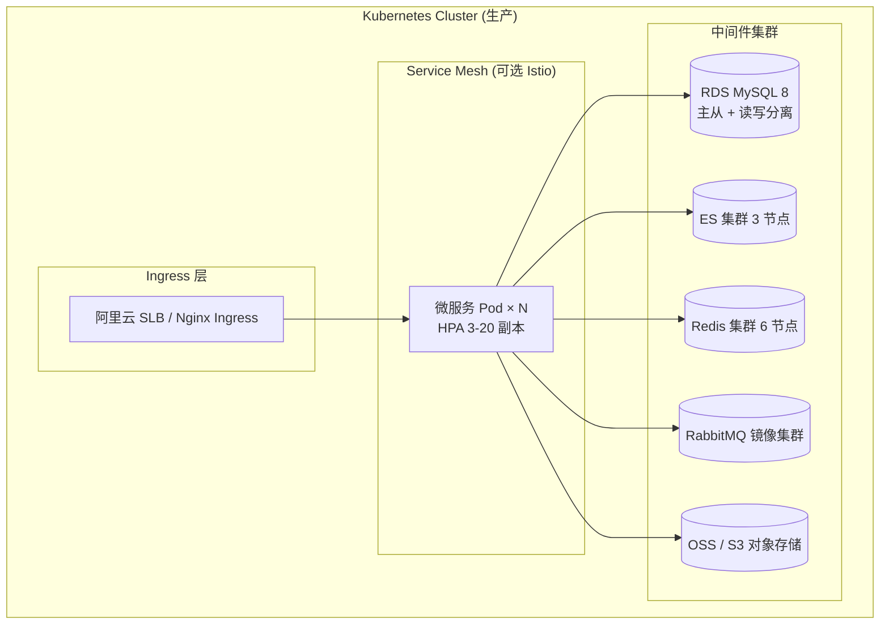

> **演进路径**：Phase 1 单机 → Phase 2 阿里云 ACK 标准集群 → Phase 3 多区域 + Service Mesh + 多活。

---

## 3. 微服务拆分

### 3.1 服务全景表

| 服务名 | 端口 | 职责 | 核心表 | 关键依赖 |
|-------|------|------|-------|---------|
| **gateway-service** | 8080 | 路由、限流、鉴权、聚合 | — | Nacos、Redis |
| **user-center** | 8081 | 注册/登录/会员/画像 | `t_user`、`t_user_profile`、`t_membership` | MySQL、Redis |
| **resume-service** | 8082 | 简历 CRUD、版本管理、解析 | `t_resume`、`t_resume_version`、`t_resume_section` | MySQL、ES、MinIO |
| **jd-service** | 8083 | JD CRUD、解析、搜索 | `t_jd`、`t_jd_skill`、`t_jd_parse_result` | MySQL、ES |
| **order-service** | 8084 | 订单、支付、会员权益 | `t_order`、`t_payment`、`t_subscription` | MySQL、Redis、支付宝/微信 |
| **ai-task-scheduler** | 8085 | 接收业务侧 AI 任务、分发、状态跟踪 | `t_ai_task`、`t_agent_invocation` | MySQL、RabbitMQ、Python |
| **file-service** | 8086 | 文件上传/下载/转换（PDF/DOCX） | `t_file`、`t_file_chunk` | MinIO、Redis |
| **notify-service** | 8087 | 短信/邮件/站内信 | `t_notification` | MySQL、阿里云短信、SendGrid |

### 3.2 服务间通信

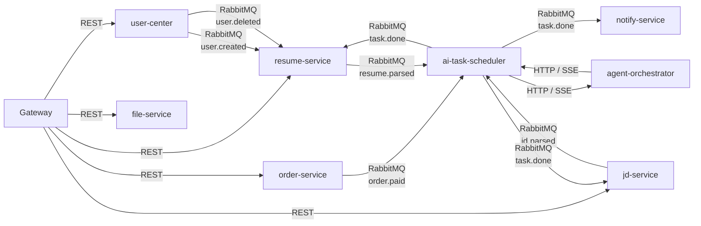

> **通信原则**：
> - **同步用 REST**（HTTP/2 + JSON），只用于"必须立即拿到结果"的链路（如登录、查询）。
> - **异步用 RabbitMQ**，用于"耗时 + 失败可重试 + 削峰"场景（如 AI 任务、文件转换、通知）。
> - **流式用 SSE**（Server-Sent Events），AI 长任务必须用 SSE 推送中间结果，详见 §6.4。

### 3.3 各服务核心 API（精选）

#### 3.3.1 user-center

| Method | Path | 说明 |
|--------|------|------|
| POST | `/api/v1/auth/register` | 邮箱/手机号注册 |
| POST | `/api/v1/auth/login` | 登录（返回 JWT） |
| POST | `/api/v1/auth/refresh` | 刷新 Token |
| GET | `/api/v1/users/me` | 当前用户信息 |
| PUT | `/api/v1/users/me/profile` | 更新画像（行业、职级、目标岗位） |
| GET | `/api/v1/membership` | 查询会员等级与到期时间 |

#### 3.3.2 resume-service

| Method | Path | 说明 |
|--------|------|------|
| POST | `/api/v1/resumes` | 创建简历（JSON Schema） |
| GET | `/api/v1/resumes/{id}` | 获取简历详情 |
| PUT | `/api/v1/resumes/{id}` | 更新简历 |
| GET | `/api/v1/resumes/{id}/versions` | 版本列表 |
| POST | `/api/v1/resumes/{id}/versions` | 创建新版本（快照） |
| GET | `/api/v1/resumes/{id}/export?format=pdf\|docx` | 导出 |
| POST | `/api/v1/resumes/import` | 从文件导入（PDF/DOCX） |

#### 3.3.3 jd-service

| Method | Path | 说明 |
|--------|------|------|
| POST | `/api/v1/jds` | 录入 JD（粘贴文本 / URL 抓取） |
| GET | `/api/v1/jds/{id}` | JD 详情（含解析结果） |
| GET | `/api/v1/jds/{id}/parse-result` | 结构化解析结果 |
| GET | `/api/v1/jds/search?q=&industry=&level=` | ES 搜索 |

#### 3.3.4 ai-task-scheduler（核心枢纽）

| Method | Path | 说明 |
|--------|------|------|
| POST | `/api/v1/ai-tasks` | 创建 AI 任务（含 task_type: jd_parse/resume_analyze/match/optimize/interview/cover_letter/career_plan） |
| GET | `/api/v1/ai-tasks/{id}` | 任务状态查询 |
| GET | `/api/v1/ai-tasks/{id}/stream` | **SSE 流式订阅**（首 Token 推送） |
| POST | `/api/v1/ai-tasks/{id}/cancel` | 取消任务 |

#### 3.3.5 file-service

| Method | Path | 说明 |
|--------|------|------|
| POST | `/api/v1/files/upload` | 初始化分片上传 |
| PUT | `/api/v1/files/{id}/chunk` | 上传分片 |
| POST | `/api/v1/files/{id}/complete` | 合并分片 |
| GET | `/api/v1/files/{id}/download` | 下载（签名 URL 302 跳转） |

### 3.4 Java 侧技术栈一致性

| 维度 | 选型 | 版本 |
|------|------|------|
| JDK | Eclipse Temurin | 21 LTS |
| 框架 | Spring Boot | 3.2.x |
| 微服务 | Spring Cloud Alibaba | 2022.0.0.0 |
| 注册/配置 | Nacos | 2.3.x |
| 网关 | Spring Cloud Gateway | 4.x（WebFlux） |
| 分布式事务 | Seata | 1.8 |
| 限流 | Sentinel | 1.8 |
| ORM | MyBatis-Plus | 3.5.x |
| 工具库 | Hutool | 5.8.x |
| 日志 | Logback + MDC + Loki | — |
| 测试 | JUnit 5 + Mockito + Testcontainers | — |
| 构建 | Maven 3.9 + 多模块 | — |

### 3.5 Python 侧技术栈

| 维度 | 选型 | 版本 |
|------|------|------|
| Runtime | CPython | 3.11 |
| Web | FastAPI | 0.110.x |
| ASGI | Uvicorn | 0.27.x |
| Agent 框架 | LangGraph + LangChain | 0.1 / 0.2 |
| 数据验证 | Pydantic | v2 |
| 异步 HTTP | httpx | 0.27 |
| 向量库客户端 | chromadb | 0.4 |
| 任务队列 | aio-pika（RabbitMQ 异步） | 9.4 |
| 可观测 | LangSmith + OpenTelemetry | — |
| 工具沙箱 | RestrictedPython + 独立子进程 | — |

---


## 4. 多 Agent 协同架构（核心亮点）

### 4.1 设计哲学

> **"一个 Agent 解决一类问题，Orchestrator 解决问题之间的衔接。"**

我们没有选择"一个超大的 Prompt 让 GPT-4o 包打天下"，而是将求职全链路拆解为 **8 个专业化 Agent** + **1 个协调 Agent (Orchestrator)**，使用 **LangGraph 的 StateGraph** 编排。每个 Agent：

- 拥有**独立 System Prompt**（人设 + 输出 Schema）
- 拥有**独立工具集**（Tools，如 `es_search`、`chroma_query`、`pdf_render`）
- 拥有**独立可观测 Trace**（LangSmith 单独项目）
- 拥有**独立超时与降级策略**（详见 §8.2）

### 4.2 LangGraph StateGraph 完整图

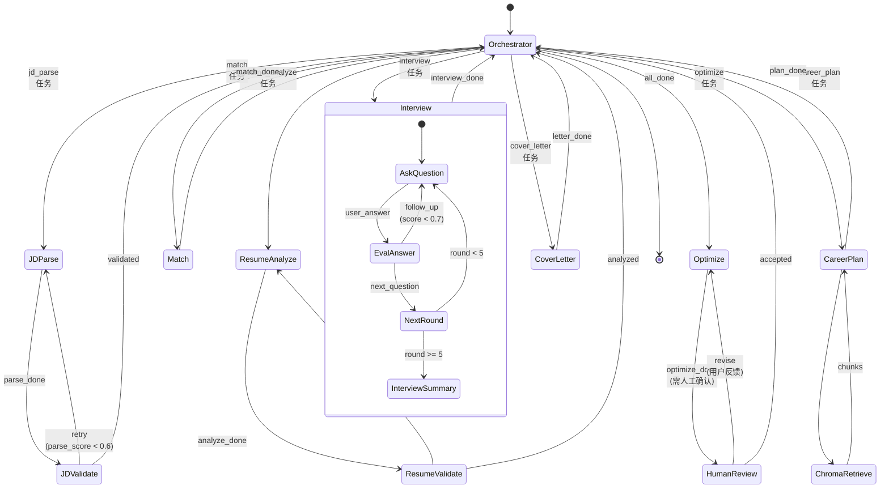

### 4.3 状态机流转时序图（以"匹配 + 优化"组合任务为例）

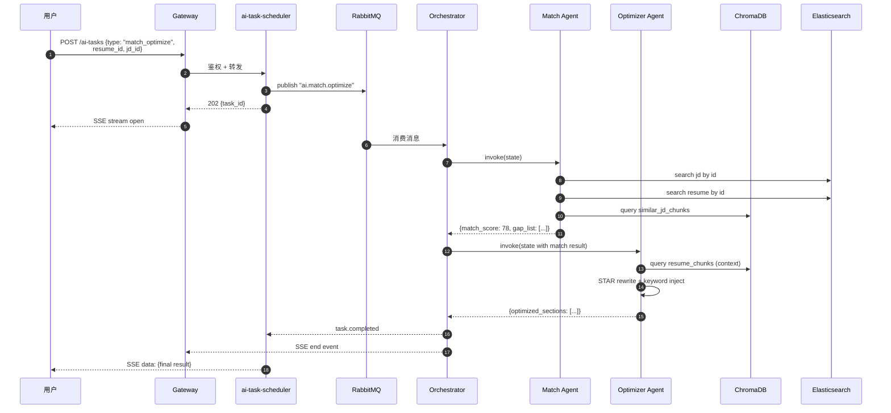

### 4.4 State 数据结构定义（Python TypedDict）

```python
from typing import TypedDict, List, Dict, Optional, Literal
from typing_extensions import Annotated
from langgraph.graph.message import add_messages

class ResumeChunk(TypedDict):
    section: Literal["summary", "experience", "project", "skill", "education"]
    text: str
    embedding_id: str

class JDChunk(TypedDict):
    raw_text: str
    hard_skills: List[str]      # 硬技能
    soft_skills: List[str]      # 软技能
    biz_metrics: List[str]      # 业务指标（如"日活百万"、"GMV 千万"）
    seniority: Literal["intern", "junior", "mid", "senior", "lead"]
    industry: str

class MatchResult(TypedDict):
    semantic_score: float       # 0-100, 语义相似度
    keyword_score: float        # 0-100, 关键词覆盖率
    business_score: float       # 0-100, 业务指标匹配
    final_score: float          # 0-100, 加权总分
    gap_list: List[Dict]        # [{type, severity, suggestion}]

class InterviewTurn(TypedDict):
    round: int
    question: str
    user_answer: Optional[str]
    score: Optional[float]      # 0-10
    feedback: Optional[str]

class AgentState(TypedDict):
    # === 元信息 ===
    task_id: str
    user_id: str
    task_type: Literal[
        "jd_parse", "resume_analyze", "match",
        "optimize", "interview", "cover_letter", "career_plan"
    ]
    trace_id: str               # LangSmith trace

    # === 输入 ===
    resume_id: Optional[str]
    jd_id: Optional[str]
    user_query: Optional[str]   # 职业规划时为自然语言问题

    # === 中间产物 ===
    resume_chunks: Annotated[List[ResumeChunk], "resume parser output"]
    jd_chunks: Annotated[List[JDChunk], "jd parser output"]
    match_result: Optional[MatchResult]

    # === 模拟面试专属 ===
    interview_history: Annotated[List[InterviewTurn], "interview turns"]
    current_round: int

    # === 输出 ===
    final_output: Optional[Dict]

    # === 控制流 ===
    retry_count: int
    error: Optional[str]
    messages: Annotated[list, add_messages]  # LLM 消息历史
```

### 4.5 Agent 间通信协议

#### 4.5.1 三种通信模式

| 模式 | 场景 | 协议 |
|------|------|------|
| **State 共享** | 同一次 StateGraph 内部，Agent 间传值 | Python TypedDict（内存） |
| **HTTP 调用** | Orchestrator 与远程独立服务（业务侧） | REST + JSON，SSE 流式 |
| **MQ 异步** | 跨服务、跨任务的"完成通知" | RabbitMQ + JSON 消息 |

#### 4.5.2 Agent 调用消息体（MQ）

```json
{
  "task_id": "tsk_20260628_abc123",
  "task_type": "match",
  "trace_id": "01HXY...ULID",
  "user_id": "usr_001",
  "payload": {
    "resume_id": "res_001",
    "jd_id": "jd_001"
  },
  "context": {
    "industry": "互联网",
    "seniority": "mid"
  },
  "callback": {
    "queue": "ai.task.result",
    "routing_key": "match.done"
  },
  "deadline_ts": 1719567000
}
```

#### 4.5.3 Agent 结果回调消息体

```json
{
  "task_id": "tsk_20260628_abc123",
  "status": "success",
  "result": { /* Agent 特定输出 */ },
  "trace_id": "01HXY...",
  "duration_ms": 4231,
  "tokens": { "prompt": 1234, "completion": 567, "total": 1801 }
}
```

### 4.6 各 Agent 详解

#### 4.6.1 JD 解析 Agent (jd_parser_agent)

| 项 | 内容 |
|----|------|
| **职责** | 将非结构化 JD 拆解为"硬技能 / 软技能 / 业务指标 / 职级 / 行业"五维结构 |
| **System Prompt 要点** | "你是一个资深 HR，分析 JD 文本，输出严格 JSON..." |
| **核心工具** | `regex_extractor`（正则抽取数字、年限）、`industry_classifier`（行业分类）、`llm_structurer`（LLM 结构化） |
| **输出 Schema** | `JDChunk`（见 §4.4） |
| **超时** | 8s（降级：返回原文 + 简易分词） |
| **重试** | 最多 2 次（`parse_score < 0.6` 触发） |

#### 4.6.2 简历分析 Agent (resume_analyzer_agent)

| 项 | 内容 |
|----|------|
| **职责** | ATS 评分（0-100）、7 维度问题诊断（结构 / 关键词 / 量化 / 时长 / 错别字 / 排版 / 表达） |
| **核心工具** | `ats_scorer`（规则引擎 + LLM 评注）、`section_segmenter`（章节切分）、`keyword_coverage`（关键词覆盖率） |
| **输出 Schema** | `{ats_score, dimensions: {structure: 85, keyword: 62, ...}, issues: [...], suggestions: [...]}` |
| **超时** | 12s（降级：仅返回规则引擎分数） |

#### 4.6.3 匹配度评估 Agent (match_agent)

| 项 | 内容 |
|----|------|
| **职责** | 三段式加权打分，输出 Gap List |
| **核心工具** | `embedding_similarity`（cosine）、`keyword_coverage`、`business_metric_align`、`gap_suggester` |
| **打分公式** | `final = 0.4 * semantic + 0.35 * keyword + 0.25 * business` |
| **输出 Schema** | `MatchResult`（见 §4.4） |
| **超时** | 15s（降级：仅返回 semantic + keyword） |

#### 4.6.4 简历优化 Agent (resume_optimizer_agent)

| 项 | 内容 |
|----|------|
| **职责** | STAR 法则改写、关键词植入、量化建议 |
| **核心工具** | `star_rewriter`、`keyword_injector`、`quantifier_advisor`、`section_template` |
| **关键策略** | "保守改写"——保留用户原意 + 局部润色，不大刀阔斧重写（避免用户不认账） |
| **输出 Schema** | `{rewritten_sections: [...], change_log: [...], confidence: 0.0-1.0}` |
| **人机协同** | 改写后默认进入"人工复核"节点，用户可一键 Reject/Accept/微调 |
| **超时** | 25s（流式输出，用户可中途停止） |

#### 4.6.5 模拟面试 Agent (interview_agent)

| 项 | 内容 |
|----|------|
| **职责** | 多轮对话、动态追问、实时反馈 |
| **核心工具** | `question_generator`（基于 JD + 简历）、`answer_evaluator`（STAR 评分）、`followup_decider`（追问判定） |
| **追问判定** | 若本轮评分 < 0.7，针对薄弱点追问；>= 0.9 进入下一题 |
| **轮数** | 5-8 轮（可在配置中调整） |
| **输出** | `{turns: [...], final_scorecard: {overall: 78, dimension_scores: {...}, top_strengths: [...], top_weaknesses: [...]}}` |
| **超时** | 单轮 30s，整场 8 分钟 |

#### 4.6.6 求职信生成 Agent (cover_letter_agent)

| 项 | 内容 |
|----|------|
| **职责** | 基于 JD + 简历生成定制化求职信 |
| **核心工具** | `tone_selector`（正式/友好/激情）、`hook_generator`、RAG 检索公司信息 |
| **输出** | `{letter: "..." (Markdown), tone: "...", word_count: 350}` |
| **约束** | 字数 250-500、首段必含 hook、末段必含 CTA |

#### 4.6.7 职业规划 Agent (career_advisor_agent)

| 项 | 内容 |
|----|------|
| **职责** | 基于 RAG 行业知识库，给出 3-6 个月可执行规划 |
| **核心工具** | `chroma_query`（industry_kb）、`gap_analyzer`、`roadmap_generator` |
| **RAG 流程** | Query → Embedding → Top-K=8 → Rerank → Prompt 注入 |
| **输出** | `{summary: "...", roadmap: [{month, goal, actions: [...], resources: [...]}], risks: [...]}` |
| **可解释** | 每个建议必须引用 1-2 条 industry_kb 文档 ID |

#### 4.6.8 协调 Agent (Orchestrator)

| 项 | 内容 |
|----|------|
| **职责** | 任务路由、状态管理、Agent 调用编排、超时与重试 |
| **实现** | LangGraph `Pregel` 引擎，状态持久化到 Redis |
| **路由策略** | 基于 `task_type` 决定入口节点；组合任务按 DAG 调度 |
| **持久化** | 每次节点执行后 `checkpointer` 写入 Redis，支持中断恢复 |
| **超时** | 整图 60s（可配置） |

### 4.7 工具调用清单（汇总）

| Agent | 工具 | 实现 | 备注 |
|-------|------|------|------|
| **JD Parser** | regex_extractor | Python `re` | 抽取年限/学历/数字 |
| | industry_classifier | Prompt + 候选列表 | Few-shot |
| | llm_structurer | LLM（JSON mode） | GPT-4o-mini / Qwen2.5 |
| **Resume Analyzer** | ats_scorer | 规则引擎 + LLM | 7 维度 |
| | section_segmenter | LLM | 章节切分 |
| **Match** | embedding_similarity | text-embedding-3-small | cosine |
| | keyword_coverage | ES `term` 查询 | 覆盖度 = 命中/总数 |
| | business_metric_align | Prompt | 业务指标对齐 |
| **Resume Optimizer** | star_rewriter | LLM（Claude/GPT-4o） | 高质量 |
| | quantifier_advisor | Prompt | "X% 增长"等 |
| **Interview** | question_generator | LLM + 模板 | 按难度梯度 |
| | answer_evaluator | LLM-as-a-Judge | 多维评分 |
| | followup_decider | 规则 + LLM | 追问判定 |
| **Cover Letter** | tone_selector | 枚举 | 用户可选 |
| | company_info_rag | ChromaDB | 公司知识库 |
| **Career Advisor** | chroma_query | Top-K 检索 | industry_kb |
| | reranker | bge-reranker-large | 精排 |
| | roadmap_generator | LLM | 思维链 |
| **Orchestrator** | task_router | LangGraph | 状态机 |

---

## 5. 数据库设计

### 5.1 MySQL 表全景（12+ 张）

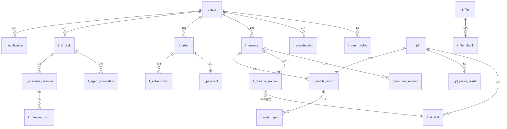

### 5.2 核心表详细字段

#### 5.2.1 `t_user`（用户表）

| 字段 | 类型 | 约束 | 说明 |
|------|------|------|------|
| id | BIGINT | PK, AUTO_INCREMENT | 主键 |
| user_id | VARCHAR(32) | UNIQUE, NOT NULL | 业务 ID（`usr_xxx`） |
| email | VARCHAR(128) | UNIQUE | 邮箱 |
| phone | VARCHAR(20) | UNIQUE | 手机号 |
| password_hash | VARCHAR(128) | NOT NULL | BCrypt |
| nickname | VARCHAR(64) | | 昵称 |
| avatar_url | VARCHAR(256) | | 头像 |
| status | TINYINT | DEFAULT 1 | 1=正常 0=封禁 |
| last_login_at | DATETIME | | |
| created_at | DATETIME | NOT NULL | |
| updated_at | DATETIME | NOT NULL | |
| 索引 | idx_email(phone), idx_phone(phone), idx_created_at | | |

#### 5.2.2 `t_user_profile`（用户画像）

| 字段 | 类型 | 约束 | 说明 |
|------|------|------|------|
| id | BIGINT | PK | |
| user_id | VARCHAR(32) | UNIQUE, FK | |
| target_industry | VARCHAR(32) | | 目标行业 |
| target_position | VARCHAR(64) | | 目标岗位 |
| target_seniority | VARCHAR(16) | | 职级 |
| years_of_experience | INT | | 经验年数 |
| education_level | VARCHAR(16) | | |
| skills_json | JSON | | 技能标签 |
| preferences_json | JSON | | 偏好（城市/薪资/远程） |
| created_at, updated_at | DATETIME | | |

#### 5.2.3 `t_membership`（会员权益）

| 字段 | 类型 | 约束 | 说明 |
|------|------|------|------|
| id | BIGINT | PK | |
| user_id | VARCHAR(32) | FK | |
| level | TINYINT | NOT NULL | 0=免费 1=Pro 2=Enterprise |
| expire_at | DATETIME | | 到期时间 |
| ai_quota_remaining | INT | DEFAULT 0 | AI 调用剩余次数 |
| created_at, updated_at | DATETIME | | |
| 索引 | idx_user_level(user_id, level) | | |

#### 5.2.4 `t_resume`（简历主表）

| 字段 | 类型 | 约束 | 说明 |
|------|------|------|------|
| id | BIGINT | PK | |
| resume_id | VARCHAR(32) | UNIQUE | 业务 ID |
| user_id | VARCHAR(32) | FK | |
| title | VARCHAR(128) | | 简历标题 |
| current_version_id | VARCHAR(32) | | 当前激活版本 |
| ats_score | INT | DEFAULT 0 | 最新 ATS 评分 0-100 |
| is_primary | TINYINT | DEFAULT 0 | 是否主简历 |
| created_at, updated_at | DATETIME | | |
| 索引 | idx_user(user_id), idx_primary(user_id, is_primary) | | |

#### 5.2.5 `t_resume_version`（简历版本）

| 字段 | 类型 | 约束 | 说明 |
|------|------|------|------|
| id | BIGINT | PK | |
| version_id | VARCHAR(32) | UNIQUE | |
| resume_id | VARCHAR(32) | FK | |
| version_no | INT | | 版本号 |
| snapshot_json | JSON | NOT NULL | 完整快照 |
| ats_score | INT | | 该版本评分 |
| change_note | VARCHAR(256) | | 变更说明 |
| created_at | DATETIME | | |
| 索引 | idx_resume(resume_id, version_no) | | |

#### 5.2.6 `t_resume_section`（简历段落，反范式便于检索）

| 字段 | 类型 | 约束 | 说明 |
|------|------|------|------|
| id | BIGINT | PK | |
| resume_id | VARCHAR(32) | FK | |
| version_id | VARCHAR(32) | FK | |
| section_type | VARCHAR(32) | | summary/experience/project/skill/education |
| section_order | INT | | 排序 |
| content_text | TEXT | | 段落文本 |
| created_at | DATETIME | | |
| 索引 | idx_resume_version(resume_id, version_id) | | |

#### 5.2.7 `t_jd`（JD 主表）

| 字段 | 类型 | 约束 | 说明 |
|------|------|------|------|
| id | BIGINT | PK | |
| jd_id | VARCHAR(32) | UNIQUE | |
| user_id | VARCHAR(32) | FK | 创建人 |
| source | VARCHAR(32) | | "manual" / "url" / "import" |
| source_url | VARCHAR(512) | | 原始 URL |
| company_name | VARCHAR(128) | | |
| position_name | VARCHAR(128) | | |
| salary_range | VARCHAR(64) | | |
| raw_text | MEDIUMTEXT | | JD 全文 |
| status | TINYINT | | 0=解析中 1=已解析 2=失败 |
| created_at, updated_at | DATETIME | | |
| 索引 | idx_user(user_id), idx_company(company_name) | | |

#### 5.2.8 `t_jd_skill`（JD 技能清单）

| 字段 | 类型 | 约束 | 说明 |
|------|------|------|------|
| id | BIGINT | PK | |
| jd_id | VARCHAR(32) | FK | |
| skill_type | VARCHAR(16) | | hard/soft/biz_metric |
| skill_name | VARCHAR(128) | | |
| weight | DECIMAL(3,2) | | 重要性 0-1 |
| created_at | DATETIME | | |
| 索引 | idx_jd_type(jd_id, skill_type) | | |

#### 5.2.9 `t_jd_parse_result`（JD 解析结果）

| 字段 | 类型 | 约束 | 说明 |
|------|------|------|------|
| id | BIGINT | PK | |
| jd_id | VARCHAR(32) | UNIQUE, FK | |
| hard_skills_json | JSON | | 硬技能列表 |
| soft_skills_json | JSON | | 软技能 |
| biz_metrics_json | JSON | | 业务指标 |
| seniority | VARCHAR(16) | | |
| industry | VARCHAR(32) | | |
| parse_score | DECIMAL(3,2) | | 解析置信度 |
| parse_model | VARCHAR(64) | | 使用的 LLM |
| created_at | DATETIME | | |

#### 5.2.10 `t_match_record`（匹配记录）

| 字段 | 类型 | 约束 | 说明 |
|------|------|------|------|
| id | BIGINT | PK | |
| record_id | VARCHAR(32) | UNIQUE | |
| user_id | VARCHAR(32) | FK | |
| resume_id | VARCHAR(32) | FK | |
| jd_id | VARCHAR(32) | FK | |
| semantic_score | INT | | |
| keyword_score | INT | | |
| business_score | INT | | |
| final_score | INT | | 0-100 |
| task_id | VARCHAR(32) | FK | 关联 AI 任务 |
| created_at | DATETIME | | |
| 索引 | idx_user_resume_jd(user_id, resume_id, jd_id), idx_final_score(final_score) | | |

#### 5.2.11 `t_match_gap`（匹配差距项）

| 字段 | 类型 | 约束 | 说明 |
|------|------|------|------|
| id | BIGINT | PK | |
| record_id | VARCHAR(32) | FK | |
| gap_type | VARCHAR(32) | | "missing_skill"/"weak_metric" |
| gap_content | VARCHAR(256) | | 差距内容 |
| severity | TINYINT | | 1-5 |
| suggestion | TEXT | | 建议 |
| created_at | DATETIME | | |
| 索引 | idx_record(record_id, severity) | | |

#### 5.2.12 `t_ai_task`（AI 任务主表）

| 字段 | 类型 | 约束 | 说明 |
|------|------|------|------|
| id | BIGINT | PK | |
| task_id | VARCHAR(32) | UNIQUE | |
| user_id | VARCHAR(32) | FK | |
| task_type | VARCHAR(32) | | jd_parse/... |
| status | TINYINT | | 0=pending 1=running 2=success 3=failed 4=cancelled |
| input_payload | JSON | | 输入 |
| output_payload | JSON | | 输出 |
| error_msg | TEXT | | 错误信息 |
| trace_id | VARCHAR(64) | | LangSmith |
| retry_count | INT | DEFAULT 0 | |
| duration_ms | INT | | |
| started_at, finished_at | DATETIME | | |
| created_at | DATETIME | | |
| 索引 | idx_user_status(user_id, status), idx_created_at(created_at) | | |

#### 5.2.13 `t_agent_invocation`（Agent 调用日志）

| 字段 | 类型 | 约束 | 说明 |
|------|------|------|------|
| id | BIGINT | PK | |
| task_id | VARCHAR(32) | FK | |
| agent_name | VARCHAR(64) | | jd_parser/match/... |
| invocation_no | INT | | 调用序号 |
| input_tokens | INT | | |
| output_tokens | INT | | |
| duration_ms | INT | | |
| model_name | VARCHAR(64) | | |
| status | TINYINT | | |
| error_msg | TEXT | | |
| created_at | DATETIME | | |
| 索引 | idx_task(task_id, invocation_no) | | |

#### 5.2.14 `t_interview_session`（面试会话）

| 字段 | 类型 | 约束 | 说明 |
|------|------|------|------|
| id | BIGINT | PK | |
| session_id | VARCHAR(32) | UNIQUE | |
| user_id | VARCHAR(32) | FK | |
| resume_id | VARCHAR(32) | FK | |
| jd_id | VARCHAR(32) | FK | |
| mode | VARCHAR(16) | | text/voice |
| total_rounds | INT | | |
| final_score | INT | | 0-100 |
| scorecard_json | JSON | | 评分卡 |
| created_at, finished_at | DATETIME | | |

#### 5.2.15 `t_interview_turn`（面试轮次）

| 字段 | 类型 | 约束 | 说明 |
|------|------|------|------|
| id | BIGINT | PK | |
| session_id | VARCHAR(32) | FK | |
| round_no | INT | | |
| question | TEXT | | |
| user_answer | TEXT | | |
| score | INT | | 0-10 |
| feedback | TEXT | | |
| followup_of | INT | | 追问自哪个 turn |
| created_at | DATETIME | | |
| 索引 | idx_session(session_id, round_no) | | |

#### 5.2.16 `t_order`（订单）

| 字段 | 类型 | 约束 | 说明 |
|------|------|------|------|
| id | BIGINT | PK | |
| order_id | VARCHAR(32) | UNIQUE | |
| user_id | VARCHAR(32) | FK | |
| product_type | VARCHAR(32) | | membership_pro/credits |
| amount_cents | BIGINT | | 分 |
| status | TINYINT | | 0=待支付 1=已支付 2=已退款 |
| pay_channel | VARCHAR(16) | | alipay/wechat |
| created_at, paid_at | DATETIME | | |
| 索引 | idx_user_status(user_id, status) | | |

#### 5.2.17 `t_payment`（支付记录）

| 字段 | 类型 | 约束 | 说明 |
|------|------|------|------|
| id | BIGINT | PK | |
| payment_id | VARCHAR(32) | UNIQUE | |
| order_id | VARCHAR(32) | UNIQUE, FK | |
| channel_trade_no | VARCHAR(64) | | 渠道流水号 |
| paid_amount_cents | BIGINT | | |
| paid_at | DATETIME | | |
| raw_response | JSON | | 渠道回调原文 |

#### 5.2.18 `t_subscription`（订阅/会员实例）

| 字段 | 类型 | 约束 | 说明 |
|------|------|------|------|
| id | BIGINT | PK | |
| sub_id | VARCHAR(32) | UNIQUE | |
| user_id | VARCHAR(32) | FK | |
| order_id | VARCHAR(32) | FK | |
| plan | VARCHAR(32) | | pro_monthly/pro_yearly |
| start_at, expire_at | DATETIME | | |
| auto_renew | TINYINT | | |
| status | TINYINT | | active/expired/cancelled |

#### 5.2.19 `t_file`（文件元信息）

| 字段 | 类型 | 约束 | 说明 |
|------|------|------|------|
| id | BIGINT | PK | |
| file_id | VARCHAR(32) | UNIQUE | |
| user_id | VARCHAR(32) | FK | |
| filename | VARCHAR(256) | | |
| content_type | VARCHAR(64) | | |
| size_bytes | BIGINT | | |
| storage_key | VARCHAR(256) | | MinIO key |
| upload_status | TINYINT | | uploading/completed |
| md5 | VARCHAR(64) | | 秒传 |
| created_at | DATETIME | | |
| 索引 | idx_user(user_id), idx_md5(md5) | | |

#### 5.2.20 `t_notification`（通知）

| 字段 | 类型 | 约束 | 说明 |
|------|------|------|------|
| id | BIGINT | PK | |
| notif_id | VARCHAR(32) | UNIQUE | |
| user_id | VARCHAR(32) | FK | |
| channel | VARCHAR(16) | | email/sms/in_app |
| template | VARCHAR(64) | | |
| payload | JSON | | |
| status | TINYINT | | pending/sent/failed |
| sent_at | DATETIME | | |
| 索引 | idx_user_status(user_id, status) | | |

### 5.3 Elasticsearch 索引设计

#### 5.3.1 `jd_index`（JD 搜索）

```json
{
  "settings": {
    "number_of_shards": 3,
    "number_of_replicas": 1,
    "analysis": {
      "analyzer": {
        "ik_smart_pinyin": {
          "type": "custom",
          "tokenizer": "ik_smart",
          "filter": ["pinyin_filter"]
        }
      }
    }
  },
  "mappings": {
    "properties": {
      "jd_id":         { "type": "keyword" },
      "user_id":       { "type": "keyword" },
      "company_name":  { "type": "text", "fields": { "raw": { "type": "keyword" } } },
      "position_name": { "type": "text", "analyzer": "ik_smart" },
      "salary_range":  { "type": "keyword" },
      "industry":      { "type": "keyword" },
      "seniority":     { "type": "keyword" },
      "hard_skills":   { "type": "keyword" },
      "soft_skills":   { "type": "keyword" },
      "biz_metrics":   { "type": "keyword" },
      "raw_text":      { "type": "text", "analyzer": "ik_smart" },
      "embedding":     { "type": "dense_vector", "dims": 1536, "index": true, "similarity": "cosine" },
      "created_at":    { "type": "date" }
    }
  }
}
```

#### 5.3.2 `resume_index`（简历搜索）

字段与 jd_index 类似，额外包含 `user_id`（用于权限过滤）、`ats_score`（用于排序）。

### 5.4 Redis 使用场景

| 场景 | Key 模式 | TTL | 示例 |
|------|---------|-----|------|
| JWT 黑名单 | `jwt:blacklist:{jti}` | Token 剩余有效期 | |
| 用户会话 | `session:{user_id}:{device_id}` | 7d | Hash |
| 限流计数器 | `rl:{api}:{user_id}:{minute}` | 60s | INCR |
| JD 详情缓存 | `jd:detail:{jd_id}` | 10m | String+JSON |
| AI 任务结果缓存 | `ai:result:{task_id}` | 1h | String+JSON |
| LangGraph Checkpointer | `lg:state:{thread_id}` | 24h | Hash |
| 分布式锁 | `lock:{resource}` | 30s | SETNX |
| Bloom 过滤器（敏感词） | `bf:sensitive_words` | 1d | 启动加载 |
| 排行榜 | `rank:match:{period}` | 30d | ZSET |

### 5.5 ChromaDB 向量集合

| Collection | 维度 | 距离 | 文档结构 | 来源 |
|------------|------|------|---------|------|
| `resume_chunks` | 1536 | cosine | `{resume_id, version_id, section, text, chunk_index}` | 简历解析 |
| `jd_chunks` | 1536 | cosine | `{jd_id, section, text, chunk_index}` | JD 解析 |
| `industry_kb` | 1536 | cosine | `{doc_id, title, content, source, version}` | 行业知识库（人工+爬虫） |
| `company_kb` | 1536 | cosine | `{company, position, content}` | 公司信息 |
| `interview_qa` | 1536 | cosine | `{question, answer, jd_type}` | 面试题库 |

> **chunking 策略**：按"语义段落"切分，每块 200-500 字，重叠 50 字。embedding 用 `text-embedding-3-small`，reranker 用 `bge-reranker-large`。

---


## 6. AI / Agent 技术细节

### 6.1 LLM 选型策略

#### 6.1.1 选型矩阵

| Agent | 主用模型 | 备选模型 | 理由 |
|-------|---------|---------|------|
| **JD Parser** | Qwen2.5-72B（自部署） | GPT-4o-mini | 结构化抽取性价比高 |
| **Resume Analyzer** | GPT-4o-mini | Claude-3.5-Sonnet | 7 维评分要求稳定性 |
| **Match** | Qwen2.5-7B（Embedding） | text-embedding-3-small | Embedding 自托管 |
| **Resume Optimizer** | Claude-3.5-Sonnet | GPT-4o | 改写质量优先 |
| **Interview** | GPT-4o | Claude-3.5-Sonnet | 多轮对话能力 |
| **Cover Letter** | Claude-3.5-Sonnet | GPT-4o-mini | 文笔优秀 |
| **Career Advisor** | Claude-3.5-Sonnet + RAG | GPT-4o | 引用准确 |

#### 6.1.2 主备路由与成本控制

```mermaid
graph LR
    REQ[Agent 请求] --> RATE{限流 &<br/>成本检查}
    RATE -->|超限| DENY[拒绝 + 排队]
    RATE -->|通过| PRIMARY{主模型<br/>可用?}
    PRIMARY -->|是| P[主模型调用]
    PRIMARY -->|否<br/>(熔断/超时)| FALLBACK{降级<br/>策略}
    FALLBACK -->|降级到便宜模型| S[备选模型]
    FALLBACK -->|降级到规则引擎| R[规则化输出]
    P --> LOG[埋点 & 记账]
    S --> LOG
    R --> LOG
    LOG --> M[Prometheus + 计费]
```

> **熔断阈值**（基于滑动窗口）：
> - 5xx 错误率 > 30% 持续 1 分钟 → 熔断 30s
> - P99 延迟 > 2x 基线 持续 1 分钟 → 熔断 30s
> - 单用户 1 分钟 > 10 次 → 限流 60s

#### 6.1.3 Prompt 模板示例

**Prompt 1：JD 解析 Agent（结构化抽取）**

```
You are a senior technical recruiter with 10 years of experience.
Analyze the following job description and output STRICT JSON.

JD:
"""
{{ jd_text }}
"""

Output schema (no extra text, no markdown code block):
{
  "hard_skills": ["skill1", ...],          // 硬技能（编程语言、框架、工具）
  "soft_skills": ["teamwork", ...],        // 软技能
  "biz_metrics": ["日活百万", ...],         // 业务指标（数字 + 业务名词）
  "seniority": "intern|junior|mid|senior|lead",
  "industry": "互联网|金融|...",
  "min_years": 0,
  "education": "bachelor|master|phd|any"
}

Rules:
- Use Chinese skill names when possible.
- Only include skills explicitly mentioned or strongly implied.
- Output ONLY the JSON object.
```

**Prompt 2：简历优化 Agent（STAR 改写）**

```
You are a resume writing coach trained in the STAR method
(Situation, Task, Action, Result).

Input:
- Original bullet: "{{ original_bullet }}"
- Target JD skills: {{ jd_hard_skills | tojson }}
- Desired tone: "professional_impactful"

Rewrite the bullet so that:
1. The action is a strong verb at the beginning.
2. Include at least 1 quantifiable result (use "X%" or "X万" placeholder if unknown).
3. Naturally inject 1-2 skills from the JD's hard skills.
4. Keep length between 80-150 Chinese characters.

Output JSON:
{
  "rewritten": "...",
  "injected_skills": ["..."],
  "change_log": "Action verb upgraded; added 30% metric; injected 'Kafka'."
}
```

### 6.2 RAG 架构

#### 6.2.1 文档处理流水线

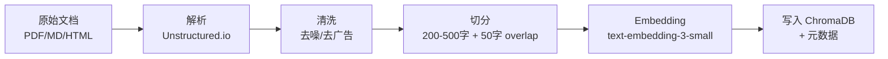

#### 6.2.2 检索策略

```mermaid
graph TB
    Q[用户 Query] --> E[Query Embedding]
    E --> VEC[向量召回 Top-50]
    Q --> KW[关键词召回<br/>ES BM25]
    KW --> CAND[候选集]
    VEC --> CAND
    CAND --> RR[Reciprocal Rank Fusion<br/>k=60]
    RR --> RERANK[Rerank<br/>bge-reranker-large]
    RERANK --> TOP[Top-8 注入 Prompt]
    TOP --> LLM[LLM 生成]
    LLM --> CITE[引用标注<br/>[doc_id §chunk]]
```

#### 6.2.3 Embedding 模型选型

| 候选 | 维度 | 中文表现 | 成本 | 选择 |
|------|------|---------|------|------|
| text-embedding-3-small | 1536 | 中 | $0.02/1M token | ✅ 主选 |
| text-embedding-3-large | 3072 | 良 | $0.13/1M token | 高质量场景 |
| bge-large-zh-v1.5 | 1024 | 优 | 自托管 | 中文为主场景 |
| m3e-large | 1024 | 良 | 自托管 | 备选 |

### 6.3 向量检索流程（Match Agent 内部）

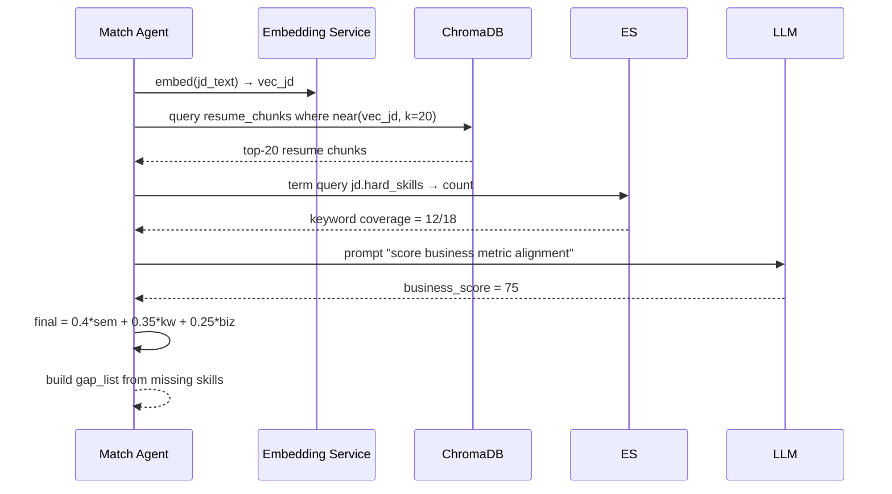

### 6.4 流式响应（SSE）实现

#### 6.4.1 为什么不用 WebSocket

- SSE 是单向（服务端 → 客户端），恰好匹配"AI 输出"场景
- SSE 基于 HTTP/1.1 透传，**无需额外协议升级**，**断线重连由浏览器自动处理**
- 大部分网关（Spring Cloud Gateway）原生支持，配置简单

#### 6.4.2 实现时序

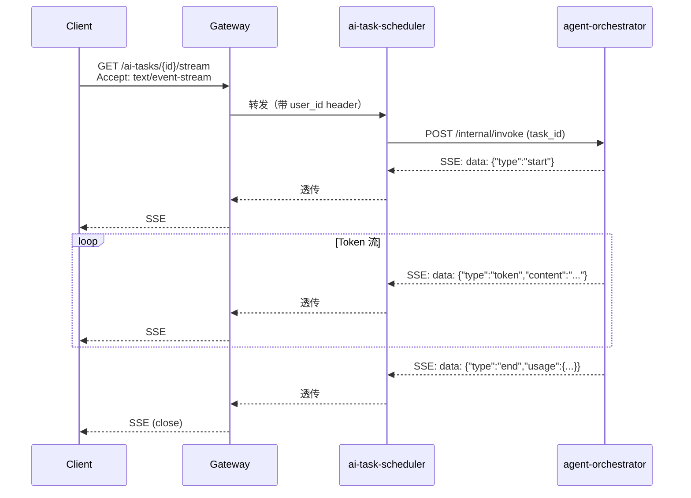

#### 6.4.3 前端 EventSource 使用要点

```typescript
const es = new EventSource(`/api/v1/ai-tasks/${taskId}/stream`, {
  withCredentials: true,
});

es.addEventListener('token', (e) => {
  const { content } = JSON.parse(e.data);
  appendToUI(content);
});
es.addEventListener('error', (e) => {
  if (es.readyState === EventSource.CLOSED) {
    // 重连 or 提示用户
  }
});
es.addEventListener('end', () => es.close());
```

### 6.5 Agent 可观测性

#### 6.5.1 三层 Trace 体系

| 层 | 工具 | 用途 |
|----|------|------|
| **L1: 业务 Trace** | LangSmith | Agent 内部 LLM 调用的输入输出、Token、耗时 |
| **L2: 链路 Trace** | OpenTelemetry + Jaeger | 跨服务（Java ↔ Python）调用链 |
| **L3: 指标 Trace** | Prometheus + Grafana | QPS、错误率、P99、Token 用量、成本 |

#### 6.5.2 LangSmith 集成（Python Agent）

```python
import os
os.environ["LANGCHAIN_TRACING_V2"] = "true"
os.environ["LANGCHAIN_API_KEY"] = "lsv2_..."
os.environ["LANGCHAIN_PROJECT"] = "careerpilot-prod"

from langgraph.graph import StateGraph
# 之后所有 LLM/Agent 调用自动上报到 LangSmith
```

#### 6.5.3 自建 Trace（兜底）

- 每个 Agent 在 `state["trace_id"]` 写入 ULID
- 所有日志通过 MDC 注入 `trace_id`
- Loki 通过 `trace_id` 聚合日志
- 异常时自动 dump `state` 到 S3（`s3://careerpilot-traces/{date}/{task_id}.json`）用于事后回放

---

## 7. 安全与合规

### 7.1 鉴权（JWT + OAuth2）

#### 7.1.1 JWT 结构

```
Header:  { "alg": "RS256", "typ": "JWT", "kid": "2026-q2" }
Payload: {
  "sub": "usr_001",
  "iss": "careerpilot",
  "aud": "careerpilot-web",
  "exp": 1719567000,
  "iat": 1719563400,
  "jti": "01HXY...",
  "scopes": ["resume.read", "ai.invoke"],
  "membership_level": 1
}
```

- **签名算法**：RS256（非对称），私钥在 Vault，公钥下发给网关
- **Access Token 有效期**：2h
- **Refresh Token 有效期**：30d，存 Redis，支持单设备踢出
- **吊销**：JTI 写入 Redis 黑名单，TTL = 剩余有效期

#### 7.1.2 OAuth2（第三方登录）

| Provider | Scope | 备注 |
|----------|-------|------|
| GitHub | `user:email` | 开发者友好 |
| Google | `openid email profile` | 海外 |
| 微信开放平台 | `snsapi_login` | 国内 |

### 7.2 简历数据脱敏

| 场景 | 脱敏策略 | 实现 |
|------|---------|------|
| **日志** | 邮箱、手机、身份证正则替换为 `***` | Logback `MaskingPatternLayout` |
| **第三方 LLM 调用** | 发送前剥离地址/电话/身份证/真实姓名 | Python `presidio-analyzer` |
| **数据库导出** | 物理脱敏（哈希） | `t_user.phone = SHA256(phone + salt)` |
| **截图分享** | 前端检测身份证/银行卡并打码 | Tesseract + Canvas |
| **ES 索引** | 简历原始文本不索引 `email/phone` 字段 | mapping 排除 |

### 7.3 API 限流（Sentinel）

#### 7.3.1 限流规则（精选）

| 资源 | QPS 限流 | 并发限流 | 自适应 |
|------|---------|---------|--------|
| `/api/v1/auth/login` | 5 QPS/IP | — | ✅ |
| `/api/v1/ai-tasks` | 10 QPS/user | 3 并发/user | ✅ |
| `/api/v1/jds/search` | 50 QPS/user | 10 并发/user | — |
| `/api/v1/files/upload` | 20 QPS/user | 5 并发/user | — |
| 全局 | 5000 QPS | — | — |

#### 7.3.2 限流算法

- **令牌桶**（默认）：突发流量友好
- **滑动窗口**：防瞬时尖刺
- **漏桶**：保护下游（如 LLM API）
- **自适应**：基于 CPU/响应时间动态调整阈值

### 7.4 敏感词过滤

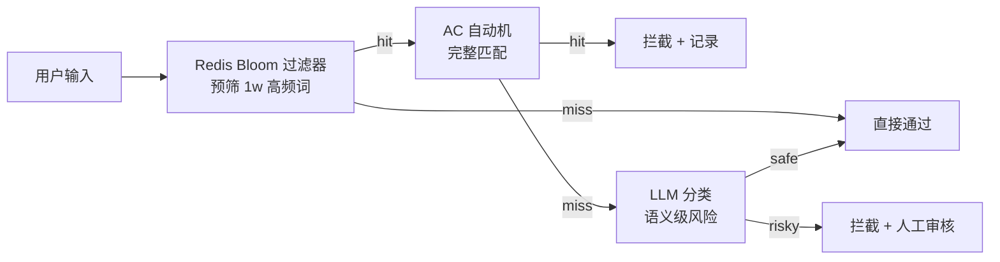

- **AC 自动机**：10w 词库，启动加载到内存
- **LLM 分类**：兜底，处理"上下文型违规"（如逐步引导提问）
- **人工审核**：命中 LLM 风险的请求进入审核队列

### 7.5 数据加密

| 维度 | 方案 | 备注 |
|------|------|------|
| **传输加密** | TLS 1.3 | 强制 HTTPS，HSTS |
| **存储加密（DB）** | TDE（Transparent Data Encryption） | MySQL 8 企业版 |
| **存储加密（对象）** | SSE-S3（服务端加密） | MinIO 同样 |
| **字段加密** | AES-256-GCM | 敏感字段（手机/身份证） |
| **密钥管理** | HashiCorp Vault | 动态密钥、轮转 |
| **备份加密** | GPG 加密后归档 OSS | 异地灾备 |

### 7.6 合规清单

| 合规项 | 状态 | 说明 |
|--------|------|------|
| **个人信息保护法（PIPL）** | ✅ | 脱敏、用户可导出/删除 |
| **数据安全法（DSL）** | ✅ | 分级分类、加密存储 |
| **网络安全法** | ✅ | 实名认证、留存日志 180 天 |
| **GDPR（海外）** | ✅ | Data Subject Access Request 流程 |
| **等保 2.0 三级** | 计划中 | 2026 Q4 取证 |
| **ISO 27001** | 计划中 | 2027 Q2 |

---

## 8. 性能指标 & SLA

### 8.1 核心接口 P99 延迟目标

| 接口 | 目标 P99 | 降级方案 | 备注 |
|------|---------|---------|------|
| `POST /auth/login` | 300ms | 验证码 + 排队 | |
| `GET /resumes/{id}` | 200ms | 缓存命中 50ms | |
| `POST /jds` | 500ms | 同步落库 + 异步解析 | |
| `GET /ai-tasks/{id}/stream`（首 token） | 1500ms | 超时 → 规则化结果 | |
| `GET /ai-tasks/{id}/stream`（整段） | 30s | 流式 + 可中断 | |
| `GET /jds/search` | 400ms | ES 缓存 | |
| `POST /files/upload/complete` | 2s | 分片并行 | |
| `POST /orders` | 1s | 异步支付回调 | |

### 8.2 Agent 任务超时与降级策略

| Agent | 超时 | 重试 | 降级 |
|-------|------|------|------|
| JD Parser | 8s | 2 | 返回原文 + 简单分词 |
| Resume Analyzer | 12s | 1 | 仅返回规则引擎分数 |
| Match | 15s | 1 | 仅返回 semantic + keyword |
| Resume Optimizer | 25s | 1 | 返回 "AI 繁忙，请稍后重试" |
| Interview | 单轮 30s / 整场 8min | 0 | 提前结束 + 给出已完成的评分 |
| Cover Letter | 20s | 1 | 模板化版本 |
| Career Advisor | 20s | 1 | 仅返回知识库摘要（不生成建议） |
| Orchestrator | 60s | — | 持久化到 Redis，等待用户重连 |

### 8.3 容量规划

#### 8.3.1 估算假设

- DAU = 10w（上线 6 个月目标）
- 人均日 AI 调用 = 3 次
- 峰值 QPS = 平均 QPS × 5

#### 8.3.2 资源清单

| 服务 | 副本数（生产） | 单副本规格 | 总资源 |
|------|---------------|----------|--------|
| gateway-service | 4 | 2C4G | 8C16G |
| user-center | 3 | 2C4G | 6C12G |
| resume-service | 4 | 2C4G | 8C16G |
| jd-service | 3 | 2C4G | 6C12G |
| order-service | 2 | 2C4G | 4C8G |
| ai-task-scheduler | 6 | 4C8G | 24C48G |
| file-service | 2 | 2C4G | 4C8G |
| notify-service | 2 | 1C2G | 2C4G |
| agent-orchestrator | 6 | 4C8G | 24C48G |
| 各 Agent | 8 | 2C4G | 16C32G |
| MySQL 主 | 1 | 8C16G | 8C16G |
| MySQL 从 | 2 | 8C16G | 16C32G |
| ES 集群 | 3 | 8C16G | 24C48G |
| Redis 集群 | 6 | 4C8G | 24C48G |
| RabbitMQ 集群 | 3 | 4C8G | 12C24G |
| ChromaDB | 2 | 8C16G | 16C32G |
| MinIO | 4 | 4C8G | 16C32G |
| **合计** | — | — | **~218C ~430G** |

> **预估月成本**（阿里云按量）：约 ¥45,000；包年折扣后约 ¥380,000/年。

### 8.4 SLA 承诺

| 指标 | 目标 | 测量方式 |
|------|------|---------|
| **可用性** | 99.9%（月停机 < 43min） | Prometheus + UptimeRobot |
| **数据持久性** | 99.999999% | 对象存储多副本 |
| **RTO（恢复时间目标）** | 30 分钟 | 灾备演练 |
| **RPO（恢复点目标）** | 5 分钟 | MySQL binlog + Redis AOF |
| **首 Token 延迟 P99** | 1.5s | LangSmith + Grafana |
| **AI 任务成功率** | ≥ 98% | t_ai_task.status |

---

## 9. 部署架构

### 9.1 本地服务清单

> 本地不跑容器编排，所有进程由 `scripts/local/` 的脚本拉起。
> 下面这份清单与 `scripts/local/status.ps1` 的输出一一对应。

| 组件 | 形态 | 端口 | 启动脚本 |
|------|------|------|----------|
| gateway-service | JVM | 8080 | `start-services.ps1` |
| user-center | JVM | 8081 | `start-services.ps1` |
| resume-service | JVM | 8082 | `start-services.ps1` |
| jd-service | JVM | 8083 | `start-services.ps1` |
| match-service | JVM | 8084 | `start-services.ps1` |
| ai-task-scheduler | JVM | 8085 | `start-services.ps1` |
| agent-orchestrator | uvicorn | 8001 | `start-agents.ps1` |
| jd-parser-agent | uvicorn | 8002 | `start-agents.ps1` |
| resume-analyzer-agent | uvicorn | 8003 | `start-agents.ps1` |
| match-agent | uvicorn | 8004 | `start-agents.ps1` |
| resume-optimizer-agent | uvicorn | 8005 | `start-agents.ps1` |
| interview-agent | uvicorn | 8006 | `start-agents.ps1` |
| cover-letter-agent | uvicorn | 8007 | `start-agents.ps1` |
| career-advisor-agent | uvicorn | 8008 | `start-agents.ps1` |
| web (vite) | node | 3000 | `start-frontend.ps1` |
| mysqld | 本机服务 | 3307 | `init-db.ps1` / `start-infra.ps1` |
| redis-server | 本机服务 | 6379 | `start-infra.ps1` |

关键环境变量（统一由 `scripts/local/.env` 提供）：

```dotenv
MYSQL_HOST=127.0.0.1
MYSQL_PORT=3307          # 项目专用实例，避开已有的 3306
MYSQL_USER=careerpilot
MYSQL_PASSWORD=cp123456

REDIS_HOST=127.0.0.1
REDIS_PORT=6379
REDIS_PASSWORD=redis123456

AI_ORCHESTRATOR_URL=http://localhost:8001
AI_SCHEDULER_URL=http://localhost:8085
RESUME_SERVICE_URL=http://localhost:8082
JD_SERVICE_URL=http://localhost:8083
```

### 9.2 环境分层

| 环境 | 用途 | 域名 | 资源 | 数据 |
|------|------|------|------|------|
| **dev** | 开发自测 | dev.careerpilot.local | 单机本地进程 | 脱敏样例 |
| **staging** | 集成测试 + 预发验证 | staging.careerpilot.com | 1 套简化 K8s | 脱敏副本 |
| **pre** | 灰度（5% 流量） | pre.careerpilot.com | K8s（和生产同规格） | 脱敏 |
| **prod** | 生产 | api.careerpilot.com | K8s 多 AZ | 真实数据 |

### 9.3 CI/CD 流程

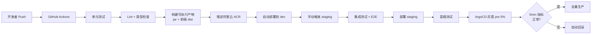

> **关键规范**：
> - 镜像 tag = `git_sha + 构建时间`
> - 任何 PR 必须通过 80% 行覆盖 + ESLint/Checkstyle/Pyright 通过
> - 数据库变更必须先提交 Flyway/Liquibase 脚本，CI 校验兼容性
> - 生产部署需 2 人审批 + ArgoCD 同步窗口（避开业务高峰）

### 9.4 监控告警（Prometheus + Grafana）

#### 9.4.1 监控分层

| 层级 | 关注指标 | 工具 |
|------|---------|------|
| **业务层** | DAU、新增简历数、AI 任务数、付费转化 | Prometheus + 业务埋点 |
| **应用层** | QPS、错误率、P50/P99、GC、线程池 | Micrometer + Prometheus |
| **中间件层** | MySQL QPS/慢查询、ES JVM、Redis 命中率、RabbitMQ 积压 | 各 Exporter |
| **AI 层** | LLM Token 用量、Agent P99、LangSmith 失败率 | 自研 exporter + LangSmith API |
| **基础设施** | CPU/内存/磁盘/网络/带宽 | node_exporter |

#### 9.4.2 告警分级

| 级别 | 触发条件 | 通知方式 | 响应时间 |
|------|---------|---------|---------|
| **P0** | 全站不可用、数据库主从全挂、核心 AI 任务成功率 < 50% | 电话 + 短信 + 钉钉 @所有人 | 5 分钟 |
| **P1** | 单服务错误率 > 5%、P99 > SLA 2x、磁盘 > 85% | 钉钉 + 短信 | 15 分钟 |
| **P2** | 慢查询 > 1s、消息积压 > 1k、Token 用量超预算 80% | 钉钉群 | 1 小时 |
| **P3** | 资源使用率 > 70%、证书 30 天内过期 | 邮件 | 次日 |

#### 9.4.3 核心 Dashboard（Grafana）

- **Overview**：全站 QPS、错误率、P99、活跃用户
- **AI Tasks**：各 Agent 调用量、Token 成本、成功率、P99
- **Java Services**：JVM、GC、慢 SQL、线程池
- **中间件**：MySQL/ES/Redis/RabbitMQ 健康
- **LangSmith 镜像**：任务 Trace 数量、LLM 成本

---

## 10. 附录：术语表 & 变更记录

### 10.1 术语表

| 术语 | 解释 |
|------|------|
| **Agent** | 在 LangGraph 中执行特定任务的 LLM 驱动节点 |
| **Orchestrator** | 协调 Agent，负责任务路由与状态管理 |
| **StateGraph** | LangGraph 的状态机图，节点 + 边 + 条件 |
| **RAG** | Retrieval-Augmented Generation，检索增强生成 |
| **ATS** | Applicant Tracking System，简历自动筛选系统 |
| **SSE** | Server-Sent Events，服务端推送事件 |
| **STAR** | Situation, Task, Action, Result（简历改写法则） |
| **Gap List** | 匹配差距清单，用户可据此改进 |
| **P99** | 99 分位延迟（去掉最高 1%） |

### 10.2 变更记录

| 版本 | 日期 | 变更人 | 变更内容 |
|------|------|--------|---------|
| v0.5 | 2026-05-10 | 架构组 | 初稿 |
| v0.8 | 2026-06-01 | 架构组 | 加入 LangGraph 状态图、SLA |
| v1.0 | 2026-06-28 | 架构组 | 基线冻结（含 8 Agent、12+ 表、部署拓扑） |

---

> **本文档配套交付**：
> - `docs/project-brief.md` — 项目说明文档（产品视角）
> - `docs/api-spec.md` — OpenAPI 3.1 接口规范
> - `scripts/local/` — 本地一键启动编排（无容器）
> - `agents/agent-orchestrator/app/graph.py` — Agent 编排核心实现
> - `db/migrations/` — Flyway 数据库迁移脚本
