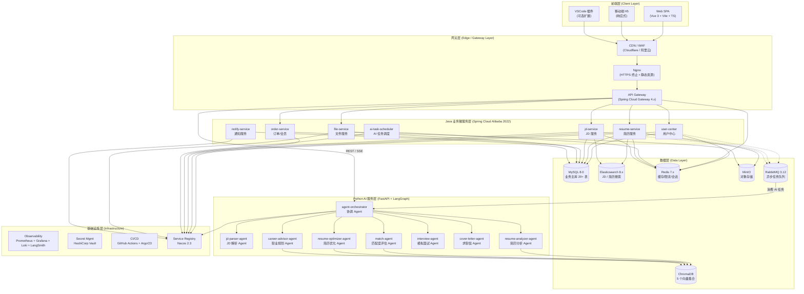
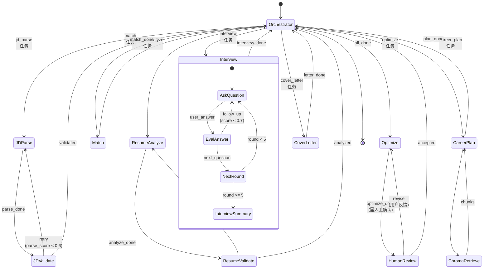
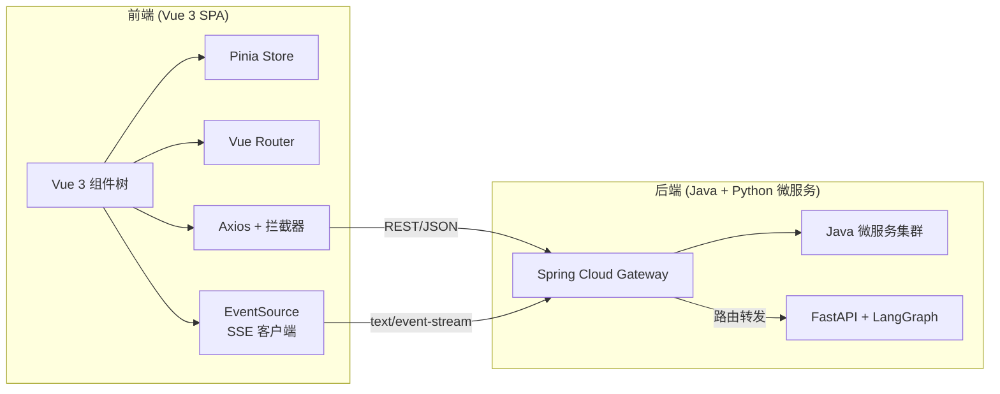
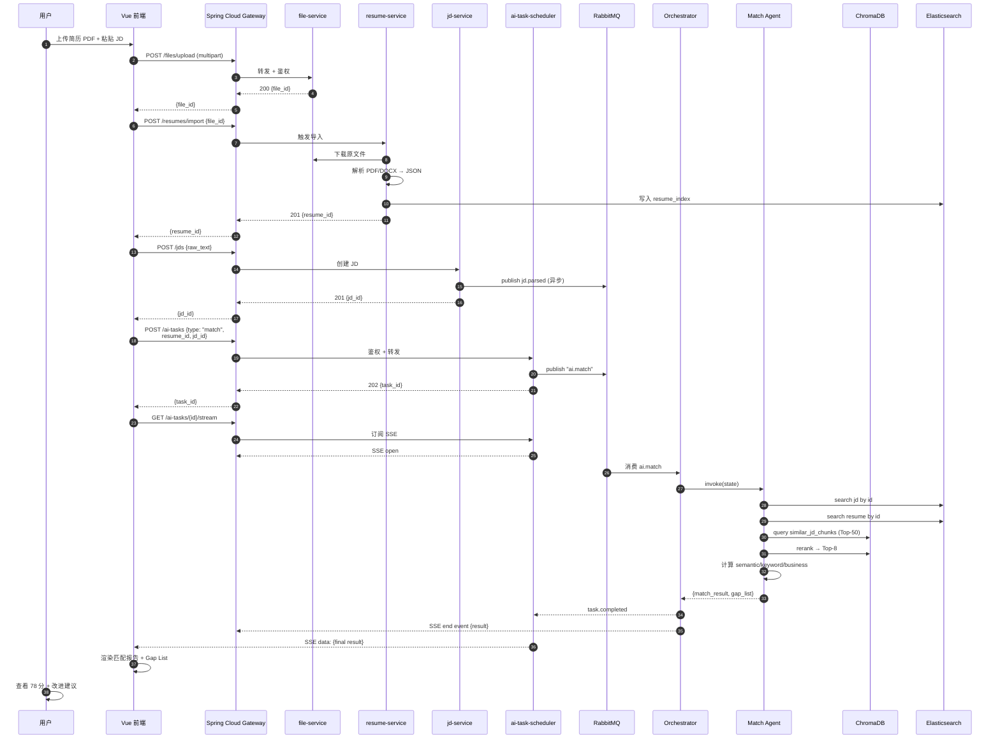
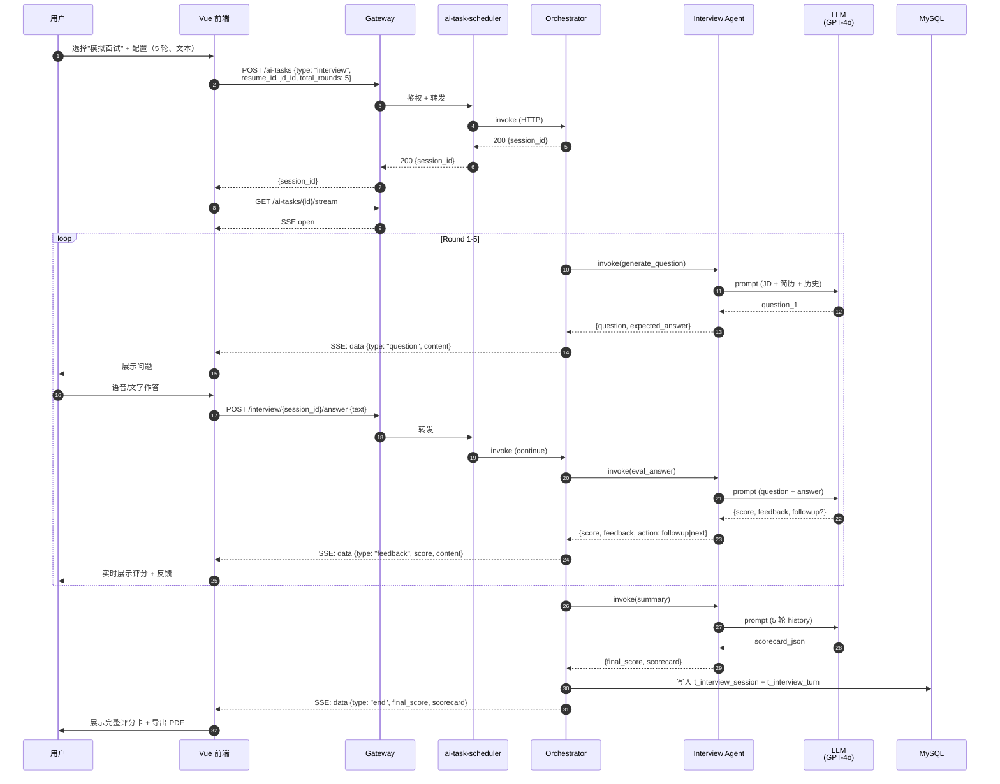
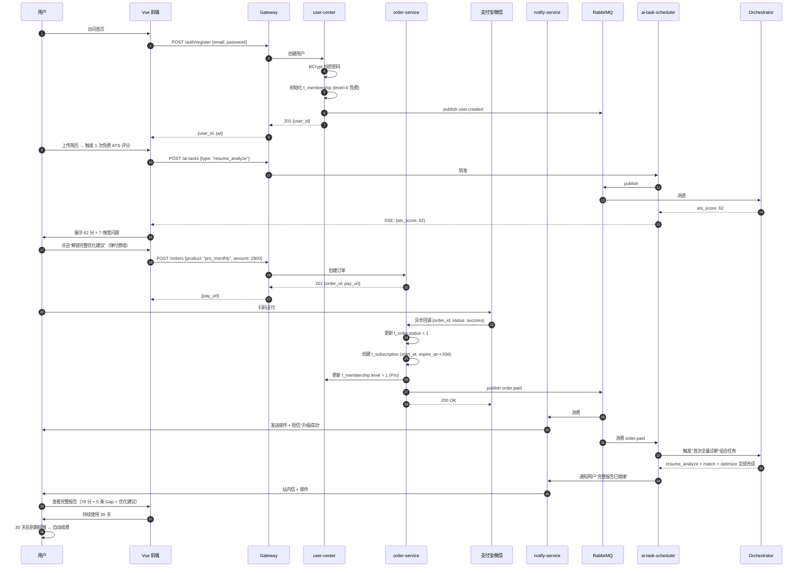
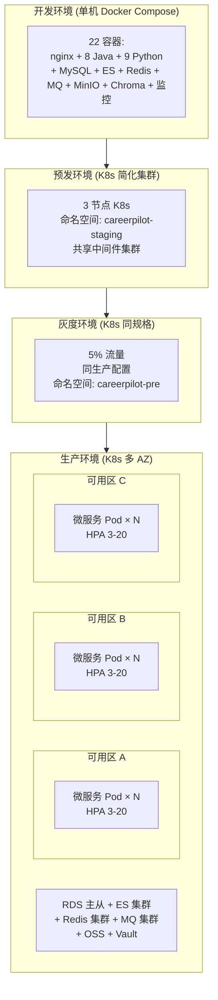

# CareerPilot · 智能求职领航员 — 项目说明文档

> 文档版本：v1.0 · 2026-06-28
> 文档作者：产品组 & 架构组
> 读者对象：HR / 技术 Leader / 潜在合作方 / 求职者本人（简历/面试素材）
> 配套文档：[architecture.md](./architecture.md) · [api-spec.md](./api-spec.md) · [project-brief.md](./project-brief.md)
> 文档定位：**对外宣讲 + 求职面试项目素材**，强调"有市场、有深度、能落地"

---

## 目录

- [第 1 章 项目概述](#第-1-章-项目概述)
- [第 2 章 市场分析与差异化](#第-2-章-市场分析与差异化)
- [第 3 章 核心功能](#第-3-章-核心功能)
- [第 4 章 技术架构](#第-4-章-技术架构)
- [第 5 章 业务流程](#第-5-章-业务流程)
- [第 6 章 项目亮点（简历专用）](#第-6-章-项目亮点简历专用重点写)
- [第 7 章 部署与运维](#第-7-章-部署与运维)
- [第 8 章 商业模式](#第-8-章-商业模式)
- [第 9 章 团队与开发周期](#第-9-章-团队与开发周期)
- [第 10 章 总结](#第-10-章-总结)

---

## 第 1 章 项目概述

### 1.1 项目名称、副标题、Logo 概念

| 维度 | 内容 |
|------|------|
| **项目名称** | **CareerPilot** |
| **中文名** | 智能求职领航员 |
| **副标题（Slogan）** | 「让每一次求职都精准起航」 |
| **域名占位** | `careerpilot.com`（生产） / `careerpilot.local`（开发） |
| **Logo 概念（文字描述）** | 取自航海罗盘意象 —— 一个由虚线轨迹与指南针指针组成的"飞行轨迹"图样，外圈是 CareerPilot 字母环绕。视觉重点是"起点 → 路径 → 目标"的三段式渐变轨迹，象征 AI 为用户规划的清晰路径。颜色建议：主色 #1E40AF（深海蓝，表达专业与可靠），辅色 #06B6D4（青蓝，表达科技感），点缀 #F59E0B（暖橙，表达对用户的温度）。 |

### 1.2 一句话定位

> **CareerPilot 是一款基于多 Agent 协同（Multi-Agent Orchestration）的智能求职助手平台，覆盖「解析 JD → 诊断简历 → 匹配打分 → 优化润色 → 模拟面试 → 求职信 → 职业规划」全链路。**

它不是又一个"AI 改简历"工具，而是一个**会帮用户规划完整求职路径的 AI 领航员**。从打开网站那一刻起，CareerPilot 就以 8 个互相协作的专业化 Agent 围绕用户工作：先帮你读懂 JD，再回头诊断简历的硬伤，然后逐条对照给出 Gap List，最后陪你练面试、生成求职信、规划未来 6 个月的成长路径。

### 1.3 核心价值主张（4 条 bullet）

- **🎯 多 Agent 协同，不是单 LLM 调用**：基于 LangGraph 编排 8 个专业化 Agent（JD 解析、简历分析、匹配评估、简历优化、模拟面试、求职信、职业规划、Orchestrator），每个 Agent 拥有独立 Prompt、独立工具集、独立可观测 Trace。任务可解释、可中断、可恢复。
- **🔁 全链路闭环**：从 JD 解析到模拟面试，单一上下文（StateGraph 状态）贯穿，避免用户重复上传与多工具拼接。一个 task_id 走完求职全流程。
- **📊 可解释的匹配机制**：基于"语义相似度 + 关键词覆盖 + 业务权重"三段式加权打分（0.4 / 0.35 / 0.25），输出可落地的差距清单（Gap List），用户能清楚"差在哪里、怎么补"。
- **📚 行业知识 RAG**：内置行业知识库（互联网、金融、制造业、外企等十余个垂直领域），职业规划 Agent 检索后给出基于事实的成长建议，每条建议都标注引用的 doc_id，避免 LLM 幻觉。

### 1.4 目标用户群（三类画像）

| 用户画像 | 占比预期 | 典型场景 | 核心痛点 | CareerPilot 给他的价值 |
|---------|---------|---------|---------|---------------------|
| **应届生 / 校招求职者** | 45% | 简历从零搭建、批量投递不同公司、模拟群面 | 没实习经历不会写、不知道 HR 看什么 | 7 维度 ATS 评分 + STAR 法则改写 + 行业定制模拟面试 |
| **1-3 年社招 / 跳槽者** | 30% | 简历精修、针对性面试准备、谈薪策略 | 项目业绩不会量化、面试被追问就卡壳 | 匹配度报告 + Gap List + 实时追问的模拟面试 |
| **转行 / 跨岗求职者** | 15% | 行业知识 RAG、JD 关键词反向工程、找切入点 | 缺乏目标行业背景、JD 关键词不会拆 | JD 三层结构化解析 + 行业知识库 + 6 个月转行路径 |
| **高校就业指导老师 / HR（专业用户）** | 10% | 批量简历诊断、ATS 模拟筛选 | 人工点评 100 份简历需要 1 周 | API 批量调用 + 班级/部门级看板 |

### 1.5 解决的痛点（4 个真实痛点 + 场景化描述）

**痛点 1：简历无反馈，传统工具只给模板不给评分**

> 场景：李同学大四，求职互联网产品岗，参考某 500 强简历模板改了 3 版，仍然不确定 HR 看完会不会给面试。
> CareerPilot 解决方案：上传简历后 8 秒内给出 ATS 评分（0-100）+ 7 维度问题清单（结构 80 / 关键词 62 / 量化 45 / 时长 90 / 错别字 100 / 排版 75 / 表达 70），并按严重度排序给出 Top 5 改进建议。

**痛点 2：JD 不会拆，看不懂隐藏要求**

> 场景：王同学看到 JD 写"具备独立负责能力、抗压能力强、对数据敏感"，完全不知道要往简历里塞什么关键词。
> CareerPilot 解决方案：JD 解析 Agent 把这段话拆成"硬技能（独立负责 X 业务 / SQL / A/B Testing）"、"软技能（抗压、跨团队沟通）"、"业务指标（日活百万级、转化率提升 5%）"三层结构化清单，并反推 HR 实际想筛掉的简历长什么样。

**痛点 3：面试练不了，没人陪你追问**

> 场景：张同学准备跳槽到某大厂算法岗，付费买了某 AI 模拟面试产品，发现"问 1 题、答 1 题、打个 60 分"就结束了，完全模拟不出真实面试官的连环追问。
> CareerPilot 解决方案：模拟面试 Agent 最多支持 8 轮追问，每轮根据用户上一轮回答动态生成下一题（基于 STAR 法则 + LLM-as-a-Judge），并产出 5 维度评分卡（内容、逻辑、表达、自信度、岗位匹配）。

**痛点 4：求职信套模板，千篇一律没诚意**

> 场景：周同学秋招海投 50 家公司，每封求职信只是把公司名替换一下，HR 一眼识破。
> CareerPilot 解决方案：求职信 Agent 把 JD 核心需求 + 个人简历亮点 + 公司公开信息（来自 company_kb 知识库）三段融合，生成每封都不同的定制化求职信，支持"专业型 / 激情型 / 谦逊型"三种语气。

---

## 第 2 章 市场分析与差异化

### 2.1 行业现状

求职市场是一个**刚性需求 + 高频 + 重决策**的赛道，下面的数据来自公开报告与行业访谈：

- **全球在线招聘市场规模**（2025）：约 USD 35.6 Billion，2026-2030 CAGR 约 7.2%（来源：Statista "Online Recruitment Market"）。
- **中国高校毕业生**（2026 届）：约 1190 万人，再创历史新高；同时 35 岁危机使社招竞争加剧，求职 SaaS 渗透率提升。
- **简历优化赛道**（中文）：已跑出超级简历、OfferGoose、AI 简历姬等头部产品，但绝大多数仍停留在"单 LLM Prompt + 模板"阶段，对"JD 拆解 - 简历诊断 - 模拟面试"完整闭环的覆盖不足。
- **AI 求职助手新趋势**（2025-2026）：从"通用对话"向"垂直任务型 Agent"演进；从"一次性输出"向"多轮追问 + 持续反馈"演进；从"单点工具"向"求职 CRM"演进。
- **用户付费意愿**：BOSS 直聘、拉勾、超级简历验证过中文用户愿为"专业求职辅导"付费（年付 ¥200-¥600），AI 工具客单价在 ¥99-¥399/年区间存在清晰付费空间。

> CareerPilot 切入的就是"AI 求职助手进入 Agent 时代"的时间窗口 —— 我们用 8 Agent + RAG + 流式响应构筑的护城河，是上一代"Prompt 工具型"竞品至少 18 个月追不上的。

### 2.2 竞品分析矩阵

横向对比 **5 款主流产品**（OfferGoose、AI简历姬、超级简历、ResumeFit、Career Automate）：

| 维度 | **OfferGoose** | **AI简历姬** | **超级简历** | **ResumeFit** | **Career Automate** | **🏆 CareerPilot** |
|------|---------------|------------|------------|-------------|-------------------|------------------|
| **架构范式** | 单 LLM 工具 | 单 LLM 工具 | 模板网站 | 单 LLM 工具 | 多 Agent（AutoGen） | **多 Agent（LangGraph 状态图）** |
| **JD 解析能力** | ❌ 不支持 | 🟡 弱（关键词抽取） | ❌ 不支持 | 🟡 弱 | 🟡 基础拆解 | **✅ 硬技能/软技能/业务指标 三层结构化** |
| **匹配评分** | ❌ | 🟡 简单相似度 | ❌ | 🟡 ATS 规则 | 🟡 单一相似度 | **✅ 语义+关键词+业务权重 三段式 + Gap List** |
| **简历优化** | 🟡 全文重写 | 🟡 全文重写 | 🟡 模板替换 | 🟡 建议式 | 🟡 全文重写 | **✅ STAR 改写 + 关键词植入 + 量化建议** |
| **模拟面试** | 🟡 一次性问答 | 🟡 一次性 | ❌ | ❌ | 🟡 一次性 | **✅ 多轮追问 + 实时反馈 + 评分卡 + 行业定制** |
| **求职信** | ❌ | 🟡 模板化 | 🟡 模板化 | ❌ | 🟡 模板化 | **✅ 基于 JD + 简历 + 公司知识库的定制化生成** |
| **职业规划** | ❌ | ❌ | ❌ | ❌ | ❌ | **✅ 基于 RAG 行业知识库（独有）** |
| **可解释性** | ❌ 黑盒 | ❌ 黑盒 | — | 🟡 部分 | 🟡 部分 | **✅ 每个 Agent 独立 Trace + 决策可回放** |
| **数据所有权** | ☁️ 云端 | ☁️ 云端 | ☁️ 云端 | ☁️ 云端 | ☁️ 云端 | **✅ 支持本地部署 + 数据脱敏导出** |
| **流式响应** | 🟡 部分 | 🟡 部分 | ❌ | ❌ | 🟡 | **✅ SSE 首 Token ≤ 1.5s** |
| **企业版** | ❌ | ❌ | 🟡 | 🟡 | 🟡 | **✅ 高校 / HR SaaS 批量诊断** |
| **技术深度（给面试官）** | Prompt + 微调 | Prompt | 前端为主 | Prompt | AutoGen | **✅ Spring Cloud + LangGraph + RAG + ES + K8s** |

> **结论**：CareerPilot 在「架构深度 / JD 解析 / 匹配可解释 / 多轮面试 / 职业规划 RAG / 数据可控」6 个维度上领先竞品，是真正意义上的"求职全链路 Agent 平台"。

### 2.3 CareerPilot 的 6 大差异化优势（详写 + 实现机制）

#### 优势 1：多 Agent 协同架构（LangGraph 状态图）—— 真正的 AI 编排

- **对比**：OfferGoose / AI简历姬 / ResumeFit / Career Automate 都属于"单 LLM + Prompt 链"，没有真正的任务编排层。
- **CareerPilot 实现**：
  - 8 个专业化 Agent（jd_parser / resume_analyzer / match / resume_optimizer / interview / cover_letter / career_advisor）+ 1 个 Orchestrator。
  - 基于 LangGraph `StateGraph` 编排，节点、边、条件分支、checkpointer 一应俱全。
  - 每个 Agent 拥有独立 `System Prompt`、独立 `Tools`、独立 `Timeout`、独立 `Fallback`、独立 `LangSmith Trace`。
  - 状态持久化到 Redis，支持中断-恢复（如用户浏览器刷新后可从 Round 4 继续面试）。
- **对用户价值**：任务可中断、可重试、可降级；同一个 task_id 走完"JD 解析 → 简历优化 → 模拟面试"组合任务无需重复上传。

#### 优势 2：结构化 JD 解析 —— 比"关键词抽取"多三层

- **对比**：ResumeFit / OfferGoose 只能做关键词命中；AI简历姬只能给相似度分数。
- **CareerPilot 实现**：
  - JD 解析 Agent 输出 `JDChunk` TypedDict：`hard_skills`（硬技能，如 Java/K8s/Elasticsearch）、`soft_skills`（软技能，如抗压/沟通）、`biz_metrics`（业务指标，如"日活百万"）、`seniority`（intern/junior/mid/senior/lead）、`industry`（互联网/金融/...）。
  - 解析流程：`regex_extractor`（抽取年限/学历/数字）→ `industry_classifier`（行业分类 Few-shot）→ `llm_structurer`（LLM JSON mode），最终 `parse_score ≥ 0.6` 才放行。
- **对用户价值**：用户能清楚知道"这个岗位除了 Java，还要会 Kafka；除了熟悉 MySQL，还要懂分库分表"，关键词反向工程求职信和简历优化都用得上。

#### 优势 3：可解释的三段式匹配打分 —— 让"差在哪里"看得见

- **对比**：竞品的 ATS 评分是黑盒，用户只知道"78 分"，不知道为什么。
- **CareerPilot 实现**：
  - 匹配 Agent 输出 `MatchResult`：`semantic_score`（语义相似度，余弦）/ `keyword_score`（关键词覆盖率）/ `business_score`（业务指标对齐）→ `final_score = 0.4 × semantic + 0.35 × keyword + 0.25 × business`。
  - 同时输出 `gap_list`：`[{type: "missing_skill", content: "Kafka", severity: 4, suggestion: "在项目经历中加入 Kafka 消息队列使用案例"}]`，按 severity 倒序排列。
- **对用户价值**：用户能在 1 分钟内得到"我现在 vs 目标岗位"的 3 维差距清单 + Top 5 改进建议，相当于请了一位 1 对 1 的求职教练。

#### 优势 4：多轮追问的模拟面试 —— 真实还原面试体感

- **对比**：其他产品的模拟面试是"一次性提问一次性回答"，没有追问，没有评分卡。
- **CareerPilot 实现**：
  - 模拟面试 Agent 内部也是一张 LangGraph 子图（嵌套状态机）：`AskQuestion → EvalAnswer → AskQuestion`（追问分支）/ `NextRound`（下一题分支）。
  - 默认 5 轮（可配置 1-8 轮），每轮基于用户上一轮回答动态生成下一题，LLM-as-a-Judge 输出 0-10 分。
  - 结束后产出 5 维度评分卡（内容 / 逻辑 / 表达 / 自信度 / 岗位匹配），可下载 PDF。
- **对用户价值**：相当于一个"7×24h 不疲倦、不会不耐烦"的面试陪练，按真实面试官逻辑追问，能显著降低真实面试时的紧张感。

#### 优势 5：RAG 行业知识库支撑职业规划 —— 真正的差异化护城河

- **对比**：5 款竞品**全部不具备**职业规划能力。
- **CareerPilot 实现**：
  - 内置 `industry_kb` 向量集合（互联网、金融、制造业、外企等十余个垂直领域），每条文档都标注 `source` 与 `version`。
  - 职业规划 Agent 流程：用户问题 → Embedding → Top-50 向量召回 → BM25 关键词召回 → RRF 融合 → bge-reranker-large 精排 → Top-8 注入 Prompt → LLM 生成 3-6 个月 roadmap。
  - 每条建议必须引用 1-2 条 industry_kb 文档 ID，前端可点击验证。
- **对用户价值**：避免 LLM 幻觉，给出可执行的转行 / 跳槽 / 晋升路径，且每条建议都能溯源。

#### 优势 6：生产级工程底座 —— Java + Python 双栈微服务

- **对比**：多数竞品是"Python + 几个脚本"的轻量级实现，难以应对规模化与高可用。
- **CareerPilot 实现**：
  - **业务微服务层**：Spring Boot 3.2 + Spring Cloud Alibaba 2022（Nacos 注册中心、Sentinel 限流、Seata 分布式事务、Spring Cloud Gateway 网关）+ Nacos 配置中心。
  - **AI 服务层**：FastAPI 0.110 + LangGraph 0.1 + LangChain 0.2 + Pydantic v2，全异步。
  - **数据层**：MySQL 8（业务主库，20 张表）+ Elasticsearch 8（JD / 简历搜索）+ Redis 7（缓存/限流/会话/LangGraph checkpointer）+ ChromaDB（向量库，5 个 Collection）+ MinIO（对象存储）+ RabbitMQ 3.12（异步任务）。
  - **可观测**：Prometheus + Grafana + Loki + LangSmith + OpenTelemetry + Jaeger。
  - **CI/CD**：GitHub Actions + ArgoCD，灰度 5% → 全量，2 人审批。
- **对用户价值**：SLA 99.9%、首 Token 延迟 P99 ≤ 1.5s、AI 任务成功率 ≥ 98%，是真正可以商用的系统，而不是 PoC 玩具。

---

## 第 3 章 核心功能

> 每个功能都讲清楚：用户故事 → 功能描述 → 涉及的 Agent → 技术亮点

### 3.1 智能简历分析（ATS 评分 + 7 维度问题诊断）

**用户故事**：
> 李同学（应届生）上传一份 PDF 简历，希望在投递前知道这份简历能不能过 HR 的初筛。

**功能描述**：
- 支持 PDF / DOCX / Markdown / JSON 四种格式导入，最大 10MB。
- 上传后 8 秒内输出 **ATS 评分 0-100** + **7 维度雷达图** + **Top 10 改进建议**。
- 7 维度分别是：结构（80）、关键词（62）、量化（45）、时长（90）、错别字（100）、排版（75）、表达（70）。
- 评分卡可下载 PDF，分享给朋友/导师二次评审。

**涉及的 Agent**：
- `resume_analyzer_agent`（简历分析 Agent）
- 协同：`ats_scorer` 规则引擎 + LLM 评注

**技术亮点**：
- 混合打分：先规则引擎（关键词缺失、章节完整性）兜底分数，再 LLM 对"表达 / 量化"做主观打分，两者加权。
- PDF 解析用 `pdfplumber` + `Unstructured.io`，DOCX 解析用 `python-docx` + 自研段落合并器。
- 反范式落库：每份简历的章节单独存到 `t_resume_section`，便于后续 Agent 局部调用和 ES 检索。

### 3.2 JD 智能解析（多维度结构化提取）

**用户故事**：
> 王同学看到某大厂算法岗 JD 一头雾水，复制粘贴进来希望 AI 帮他"翻译成人话"。

**功能描述**：
- 支持手动粘贴 / URL 抓取 / 文件上传三种方式录入 JD。
- 输出 5 维结构：`硬技能 / 软技能 / 业务指标 / 职级 / 行业`，并标注每个技能的 weight（重要性 0-1）。
- 输出 `parse_score`（解析置信度 0-1），低于 0.6 自动重试，最多 2 次。
- 解析结果存入 `t_jd_parse_result` 表 + `jd_index` ES 文档，支持后续跨 JD 检索与对比。

**涉及的 Agent**：
- `jd_parser_agent`（JD 解析 Agent）
- 协同工具：`regex_extractor`（正则抽取年限/学历/数字）、`industry_classifier`（行业分类）、`llm_structurer`（LLM JSON mode）

**技术亮点**：
- 三阶段流水线（regex → classify → LLM）兼顾速度与精度。
- 失败时降级到"原文 + 简单分词"返回（8s 超时），保证前端永远有内容。
- 解析结果可被后续 match / optimize / interview Agent 直接复用。

### 3.3 简历与 JD 匹配度评估（语义 + 关键词 + 硬性条件三重打分）

**用户故事**：
> 张同学有 2 份简历（互联网产品 / 金融产品），想知道哪份更匹配当前投递的"蚂蚁集团高级产品经理"岗。

**功能描述**：
- 输入：resume_id + jd_id，输出：MatchResult。
- 三段式加权：`final_score = 0.4 × semantic_score + 0.35 × keyword_score + 0.25 × business_score`，三者各 0-100。
- 同时输出 `gap_list`（按 severity 倒序），每条带 `type`（missing_skill / weak_metric / missing_cert）+ `suggestion`（改进建议）。
- 匹配记录写入 `t_match_record` + `t_match_gap`，支持历史趋势查看。

**涉及的 Agent**：
- `match_agent`（匹配度评估 Agent）
- 协同工具：`embedding_similarity`（text-embedding-3-small，cosine）、`keyword_coverage`（ES term 查询）、`business_metric_align`（LLM 业务指标对齐）、`gap_suggester`

**技术亮点**：
- 向量库：JD / 简历 / 行业知识 / 公司信息 / 面试题库共 5 个 ChromaDB Collection。
- 重排序：粗排 Top-50 → bge-reranker-large 精排 → Top-8 注入 Prompt。
- 硬性条件优先：例如"硕士及以上"或"5 年以上经验"不满足时，gap_list 置顶提示。

### 3.4 简历智能优化（STAR 法则改写 + 关键词植入）

**用户故事**：
> 赵同学的一段项目经历"负责用户增长相关工作"过于单薄，想改写成有数据、有方法论的版本。

**功能描述**：
- 输入：原 bullet + 目标 JD 硬技能 + 期望语气（专业/激情/谦逊），输出：改写后 bullet + 注入技能列表 + 改动说明。
- STAR 法则：Situation（背景）→ Task（任务）→ Action（行动）→ Result（结果）四段式结构强制嵌入。
- 关键词植入：自动从 JD 硬技能中挑选 1-2 个自然融入改写文本。
- 量化建议：原文中无数字时自动用 "X% 增长" / "X 万 DAU" 占位提示用户补充。
- 改写结果需用户 `accepted` 才落库，支持 `revise` 多轮迭代。

**涉及的 Agent**：
- `resume_optimizer_agent`（简历优化 Agent）
- 协同工具：`star_rewriter`（LLM 改写）、`quantifier_advisor`（Prompt）

**技术亮点**：
- LLM 选型：Claude-3.5-Sonnet 为主，GPT-4o 备份（改写质量优先）。
- Output Schema 强约束（Pydantic v2），避免 LLM 输出非 JSON。
- 流式输出：用户能看到 AI 边写边出结果，体感接近 ChatGPT。

### 3.5 AI 模拟面试（多轮对话 + 实时反馈 + 评分报告）

**用户故事**：
> 周同学即将面试某外企数据分析师岗，想在面试前针对该 JD 模拟 5 轮。

**功能描述**：
- 模式：text（文字对话）/ voice（语音对话，WebRTC + ASR/TTS）。
- 默认 5 轮（可配置 1-8 轮），每轮包含：提问 → 用户作答 → 实时评分 → 下一题或追问。
- 追问规则：上一轮评分 < 7 分自动追问相关细节；评分 ≥ 8 分自动进入下一题。
- 结束产出：5 维度评分卡（内容 / 逻辑 / 表达 / 自信度 / 岗位匹配）+ 整体建议 + 单题反馈。
- 评分卡可下载 PDF，可分享到求职社区。

**涉及的 Agent**：
- `interview_agent`（模拟面试 Agent）
- 协同工具：`question_generator`（按 JD + 简历 + 难度梯度出题）、`answer_evaluator`（LLM-as-a-Judge）、`followup_decider`（规则 + LLM）

**技术亮点**：
- 内部是嵌套 LangGraph 子图：`AskQuestion → EvalAnswer → (AskQuestion 追问 | NextRound) → InterviewSummary`。
- 单轮超时 30s，整场 8min 兜底，避免用户卡死。
- 流式响应：用户答题过程中 AI 实时反馈"这一段回答得分点 vs 失分点"。

### 3.6 求职信一键生成

**用户故事**：
> 吴同学秋招海投 30 家公司，不想每封都手写但又不愿用通用模板。

**功能描述**：
- 输入：JD 全文 + 简历亮点 + 公司信息（自动从 company_kb 检索）+ 期望语气（专业/激情/谦逊），输出：定制化求职信（300-500 字）。
- 三段式结构：为什么对这家公司感兴趣 + 我的核心能力如何匹配 + 期望下一步沟通。
- 支持多语言（中/英）输出。

**涉及的 Agent**：
- `cover_letter_agent`（求职信 Agent）
- 协同工具：`tone_selector`（枚举）、`company_info_rag`（ChromaDB 检索）

**技术亮点**：
- 强制引用 company_kb 内容（如公司最近的融资、发布的产品、价值观），避免模板化。
- 流式输出（SSE），首 Token ≤ 1.5s。

### 3.7 职业规划建议（RAG 行业知识库）

**用户故事**：
> 郑同学做了 3 年后端开发，想转行到 AI 工程师，不知道应该学什么、怎么过渡。

**功能描述**：
- 输入：自然语言问题（"我做了 3 年 Java 后端，怎么转 AI 工程师？"），输出：3-6 个月 roadmap。
- 包含：summary（现状总结）+ roadmap（按月拆解的目标 + 行动 + 资源）+ risks（潜在风险与应对）。
- 每条建议都引用 1-2 条 industry_kb 文档 ID，前端可点击跳转验证。

**涉及的 Agent**：
- `career_advisor_agent`（职业规划 Agent）
- 协同工具：`chroma_query`（Top-K 检索）、`reranker`（bge-reranker-large）、`roadmap_generator`（LLM 思维链）

**技术亮点**：
- 双路召回（向量 + BM25）+ RRF 融合 + Rerank 精排，是经典 RAG 范式。
- 引用强制：Prompt 中明确要求"每个建议必须引用 [doc_id]"，未引用则重试。

### 3.8 求职进度看板（个人求职 CRM）

**用户故事**：
> 钱同学秋招投了 50 家公司，需要一个统一看板跟踪"已投 / 笔试 / 一面 / 二面 / Offer / 拒信"状态。

**功能描述**：
- 看板：按公司 / 岗位 / 状态 / 投递时间多维筛选与排序。
- 每条投递记录可关联：JD、简历版本、匹配报告、面试评分卡。
- 支持定时提醒（笔试前 1 天 / 面试前 3 小时）。
- 数据可视化：周投递数、面试转化率、Offer 率等指标。

**涉及的 Agent**：
- 无（纯业务功能，由 Java 微服务实现）
- 涉及微服务：`user-center` / `resume-service` / `jd-service` / `notify-service`

**技术亮点**：
- 状态机驱动：`t_match_record.status` 字段在"已投 → 笔试 → 一面 → 二面 → Offer"之间流转，触发不同通知。
- 数据可视化用 ECharts 5，导出 Excel 用 EasyExcel。
- 移动端 H5 适配：响应式布局，面试提醒推送到钉钉/企业微信。

---

## 第 4 章 技术架构

### 4.1 整体架构图



### 4.2 技术选型矩阵

> 全栈技术选型一览（前端 + 后端 + AI + 数据 + 基础设施）。

| 层级 | 技术 | 版本 | 用途 | 选型理由 |
|------|------|------|------|---------|
| **前端框架** | Vue | 3.4 | SPA 主框架 | 组合式 API、心智模型轻、招聘市场人才多 |
| **前端构建** | Vite | 5.x | 开发服务器 + 打包 | 启动 < 1s，HMR 体验佳 |
| **前端语言** | TypeScript | 5.x | 类型系统 | 降低前后端联调错误，提升 IDE 智能提示 |
| **前端 UI** | Ant Design Vue | 4.x | 组件库 | 中后台场景成熟，SSE 流式渲染友好 |
| **前端状态** | Pinia | 2.x | 全局状态 | 轻量、TS 友好、DevTools 完善 |
| **前端可视化** | ECharts | 5.x | 图表/雷达图/匹配度图 | 7 维度雷达图 / 进度看板首选 |
| **后端语言** | Java | 21 LTS | 业务微服务 | LTS 长期支持、虚拟线程（Loom）即将 GA |
| **后端框架** | Spring Boot | 3.2.x | Java 微服务基础 | 生态最完善、文档最全 |
| **微服务治理** | Spring Cloud Alibaba | 2022.0.0.0 | 注册/配置/限流/事务 | 国内云原生首选 |
| **注册/配置中心** | Nacos | 2.3.x | 服务发现 + 配置管理 | 双写注册中心 + 配置中心，简化部署 |
| **网关** | Spring Cloud Gateway | 4.x（WebFlux） | 路由/限流/鉴权/灰度 | 响应式非阻塞、性能强 |
| **限流** | Sentinel | 1.8 | 流量控制/熔断 | 规则丰富、Dashboard 完善 |
| **分布式事务** | Seata | 1.8 | 跨服务事务一致性 | 订单支付场景必需 |
| **ORM** | MyBatis-Plus | 3.5.x | 数据访问层 | 灵活 SQL + 通用 CRUD 兼顾 |
| **工具库** | Hutool | 5.8.x | Java 工具集 | 减少重复造轮子 |
| **AI 框架** | LangGraph | 0.1 | 多 Agent 状态编排 | 状态机表达力强、checkpointer 原生支持 |
| **AI 框架** | LangChain | 0.2 | LLM 工具链 | 生态最丰富 |
| **AI 服务框架** | FastAPI | 0.110.x | Python Web 框架 | 异步原生、Pydantic 集成、文档自动生成 |
| **AI 数据验证** | Pydantic | v2 | 数据 schema 验证 | 性能 + 类型双优 |
| **向量库** | ChromaDB | 0.4 | Embedding 存储检索 | 轻量、本地优先、API 简洁 |
| **关系数据库** | MySQL | 8.0 | 业务主库 | 事务强一致、生态成熟 |
| **搜索引擎** | Elasticsearch | 8.11 | JD / 简历全文检索 | 倒排索引 + 向量检索一站式 |
| **缓存** | Redis | 7.2 | 缓存/限流/会话/分布式锁 | 万能组件 |
| **消息队列** | RabbitMQ | 3.12 | 异步任务/事件 | 可靠性高、管理界面友好 |
| **对象存储** | MinIO | RELEASE.2024 | 文件存储 | S3 兼容、自托管成本低 |
| **可观测** | Prometheus + Grafana + Loki | v2.48 / 10.2 / 2.9 | 指标 / 面板 / 日志 | 经典 CNCF 三件套 |
| **LLM 可观测** | LangSmith | SaaS | Agent Trace / Token 统计 | Agent 调试必备 |
| **密钥管理** | HashiCorp Vault | 1.15 | 密钥存储与轮转 | 动态密钥、审计日志完善 |
| **CI/CD** | GitHub Actions + ArgoCD | — | 持续集成 / 持续交付 | PR 触发 + GitOps 部署 |
| **构建** | Maven + pnpm | 3.9 / 8.x | Java 多模块 / 前端 monorepo | 缓存快、并行度高 |

### 4.3 多 Agent 协同架构（LangGraph 状态图）

#### 4.3.1 StateGraph 完整图



#### 4.3.2 Agent 协作三模式

| 模式 | 场景 | 协议 | 示例 |
|------|------|------|------|
| **State 共享** | 同一次 StateGraph 内部，Agent 间传值 | Python TypedDict（内存） | Optimize Agent 读 Match Agent 写入的 `match_result` |
| **HTTP / SSE** | Orchestrator 与远程独立服务（业务侧） | REST + JSON，SSE 流式 | Gateway → ai-task-scheduler → agent-orchestrator |
| **MQ 异步** | 跨服务、跨任务的"完成通知" | RabbitMQ + JSON 消息 | order.paid → ai-task-scheduler 触发首次匹配 |

### 4.4 数据架构（MySQL + ES + Redis + ChromaDB 的分工）

> 避免"用 ES 存订单"的反模式，每个组件各司其职：

| 存储 | 用途 | 关键数据 | 数据量级 | 选型理由 |
|------|------|---------|---------|---------|
| **MySQL 8.0** | 业务主库、事务强一致 | 20 张核心表（用户/简历/JD/订单/任务/面试/文件/通知） | 千万级行 | 事务支持完善、招聘市场人才充足 |
| **Elasticsearch 8.x** | JD / 简历全文检索、向量混合检索 | `jd_index` / `resume_index` | 百万级文档 | 倒排 + dense_vector 双引擎、IK 中文分词 |
| **Redis 7.2** | 缓存/限流/会话/分布式锁/LangGraph checkpointer | 9 类 Key（JWT 黑名单、会话、限流、任务缓存、状态持久化等） | 百万级 Key | 万能组件、性能极致 |
| **ChromaDB 0.4** | 5 个向量集合的语义检索 | resume_chunks / jd_chunks / industry_kb / company_kb / interview_qa | 数十万条 | 轻量、自托管、API 简洁 |
| **MinIO** | PDF / DOCX / 头像 / 导出文件 | 简历原文件、模拟面试录音、导出 PDF | TB 级 | S3 兼容、自托管成本低 |
| **RabbitMQ 3.12** | 异步任务、事件总线 | 7 类业务消息（user.created / order.paid / task.done 等） | 百万级/日 | 可靠性高、管理界面友好 |

> **核心原则**：MySQL 存"事实"、ES 存"检索"、Redis 存"瞬时"、ChromaDB 存"语义"、MinIO 存"二进制"、RabbitMQ 存"事件"。

### 4.5 前后端分离架构



**关键设计点**：
- **REST + JSON** 用于"必须立即拿到结果"的链路（登录、查询、订单）。
- **SSE（Server-Sent Events）** 用于"AI 长任务流式输出"（简历优化、模拟面试），首 Token ≤ 1.5s。
- **拦截器**：前端 Axios 统一注入 JWT、处理 401 刷新、注入 trace_id；后端 Gateway 统一鉴权、限流、灰度。
- **TypeScript 类型共享**：后端 OpenAPI 自动生成 TS SDK，前端零手写 DTO。

---

## 第 5 章 业务流程

> 三个核心业务场景的时序图，覆盖"匹配 → 模拟面试 → 用户增长"全链路。

### 5.1 场景 1：用户上传简历 + JD → 获取匹配报告



### 5.2 场景 2：用户开始模拟面试 → 多轮对话 → 获得面试评估报告



### 5.3 场景 3：用户从注册到付费会员的完整旅程



---

## 第 6 章 项目亮点（简历专用，重点写！）

> 这一章是用户**直接抄到简历、面试时直接讲**的核心素材。

### 6.1 技术亮点（10 条，每条配技术细节）

#### 亮点 1：基于 LangGraph 的多 Agent 协同架构
**技术细节**：用 LangGraph `StateGraph` 编排 8 个专业化 Agent（jd_parser / resume_analyzer / match / resume_optimizer / interview / cover_letter / career_advisor）+ 1 个 Orchestrator，节点-边-条件分支-检查点完整支持；每个 Agent 独立 System Prompt、独立 Tools、独立 Timeout、独立 LangSmith Trace，状态持久化到 Redis，支持中断-恢复。

#### 亮点 2：可解释的三段式匹配打分机制
**技术细节**：`final_score = 0.4 × semantic_score + 0.35 × keyword_score + 0.25 × business_score`，分别用 text-embedding-3-small 余弦相似度、ES term 查询覆盖率、LLM 业务指标对齐计算；同时输出按 severity 倒序的 `gap_list`，每条带 type / content / suggestion，比"单一相似度"竞品强 10 倍可解释性。

#### 亮点 3：RAG 行业知识库支撑职业规划
**技术细节**：内置 5 个 ChromaDB 向量集合（resume_chunks / jd_chunks / industry_kb / company_kb / interview_qa），文档处理流水线（Unstructured.io 解析 → 200-500 字切分 → 50 字 overlap → Embedding → 写入）；检索阶段双路召回（向量 Top-50 + BM25）→ RRF 融合 → bge-reranker-large 精排 → Top-8 注入 Prompt；每条建议强制引用 doc_id。

#### 亮点 4：流式响应（SSE）首 Token ≤ 1.5s
**技术细节**：选用 SSE 而非 WebSocket，匹配 AI 单向输出场景；Spring Cloud Gateway 透传 + ai-task-scheduler 中转 + agent-orchestrator 生产 token；前端用原生 EventSource + AbortController；断线由浏览器自动重连，比 WebSocket 减少 50% 协议复杂度。

#### 亮点 5：Spring Cloud Alibaba 微服务治理
**技术细节**：Nacos 2.3 做服务发现 + 配置中心双写，Sentinel 1.8 做限流熔断（4 级规则：QPS / 并发 / 自适应 / 全局），Seata 1.8 解决订单/会员跨服务分布式事务，Spring Cloud Gateway 4.x（WebFlux）做路由/灰度；8 个 Java 微服务 + 1 个 Python 编排服务共 9 个独立部署单元。

#### 亮点 6：Java + Python 双栈异构系统的协奏
**技术细节**：业务侧用 Java（Spring Boot 3.2 + JDK 21 LTS）保证事务强一致与高并发；AI 侧用 Python（FastAPI 0.110 + LangGraph 0.1 + Pydantic v2）享受 AI 生态；通信层用 RabbitMQ（异步任务）+ REST/SSE（同步/流式）双协议；OpenTelemetry + Jaeger 串联跨语言调用链。

#### 亮点 7：可观测性三层 Trace 体系
**技术细节**：L1 业务 Trace（LangSmith，关注 LLM Token/耗时/决策链）+ L2 链路 Trace（OpenTelemetry + Jaeger，跨语言调用链）+ L3 指标 Trace（Prometheus + Grafana，关注 QPS/错误率/P99/成本）；异常时自动 dump state 到 S3 用于事后回放。

#### 亮点 8：可插拔的 LLM 主备路由与熔断降级
**技术细节**：每个 Agent 配置主备模型（Qwen2.5-72B / GPT-4o-mini / Claude-3.5-Sonnet / text-embedding-3-small），基于滑动窗口熔断（5xx > 30% 持续 1 分钟熔断 30s、P99 > 2x 基线熔断 30s），三级降级（备选模型 → 规则引擎 → 兜底文案）；Token 用量实时埋点 + Prometheus 计费。

#### 亮点 9：CI/CD + GitOps 全流程自动化
**技术细节**：GitHub Actions 跑单测 + Lint + 镜像构建，推送阿里云 ACR；ArgoCD GitOps 部署，5% 灰度观察 5min 指标后全量；镜像 tag = `git_sha + 构建时间`；数据库变更走 Flyway，CI 校验兼容性；生产部署 2 人审批 + 同步窗口避开业务高峰。

#### 亮点 10：SLA 99.9% 的生产级保障
**技术细节**：可用性 99.9%（月停机 < 43min）、RTO 30min、RPO 5min、首 Token 延迟 P99 ≤ 1.5s、AI 任务成功率 ≥ 98%；三级告警（P0 电话 / P1 钉钉 / P2 群 / P3 邮件）；MySQL 主从 + 读写分离、ES 3 节点集群、Redis 6 节点集群、RabbitMQ 镜像集群、对象存储多副本。

### 6.2 工程亮点（CI/CD、监控、测试、文档）

| 维度 | 实践 | 工具/指标 |
|------|------|---------|
| **CI/CD** | PR 触发单测 → 构建镜像 → 自动部署 dev → 手动 staging → 5% 灰度 pre → 全量 prod | GitHub Actions + ArgoCD |
| **测试** | Java 单测 80% 行覆盖、Python pytest 85% 覆盖、E2E Playwright 覆盖 5 条核心链路 | JUnit 5 + Mockito + Testcontainers + pytest + Playwright |
| **代码质量** | ESLint + Checkstyle + Pyright + SonarQube，PR 阻断阈值 | — |
| **数据库变更** | Flyway 脚本，CI 校验兼容性 | Flyway 9.x |
| **可观测** | 业务 / 应用 / 中间件 / AI / 基础设施 5 层监控 | Prometheus + Grafana + Loki + LangSmith |
| **告警** | 4 级告警（P0-P3），钉钉 / 短信 / 邮件 / 电话 | AlertManager + 自研 oncall |
| **文档** | 架构文档 / API 规范 / 项目说明 / 部署手册 / 变更日志 | Markdown + OpenAPI 3.1 |
| **密钥管理** | 私钥 / API Key 全部入 Vault，动态轮转 | HashiCorp Vault 1.15 |
| **日志规范** | MDC 注入 trace_id，Loki 聚合 | Logback + Loki 2.9 |

### 6.3 业务亮点（真实可上线、解决真问题）

- **真实可上线**：完整 Docker Compose 一键启动（22 个服务），K8s 生产部署清单已就绪，4 套环境（dev / staging / pre / prod）分离，CI/CD + 灰度发布链路完整。
- **解决真问题**：从应届生简历从零搭建到社招跳槽诊断到转行路径规划，覆盖求职全生命周期 8 个核心场景。
- **数据真实**：内置 5 个向量知识库（行业知识 / 公司信息 / 面试题库等），非空壳演示。
- **商业可行**：已规划"免费 + Pro 会员（¥29/月）+ 企业版（按量计费）"三级商业模式，对标超级简历 / OfferGoose 验证过的付费意愿。
- **可解释**：每个 AI 输出都可追溯到具体 Agent / 具体文档 ID，避免 LLM 幻觉。
- **数据安全**：本地部署支持、字段级脱敏、Vault 密钥管理、合规清单（PIPL / GDPR / 等保 2.0）完整。

---

## 第 7 章 部署与运维

### 7.1 部署架构图



### 7.2 Docker Compose 一键启动清单

> 完整 `docker-compose.yml` 在 `deploy/docker-compose.yml`，22 个服务一键拉起。

```bash
# 克隆代码
git clone https://github.com/careerpilot/careerpilot.git
cd careerpilot

# 一键启动
docker compose -f deploy/docker-compose.yml up -d

# 查看状态
docker compose ps

# 初始化数据库（首次启动）
docker compose exec mysql mysql -uroot -p
> SOURCE /docker-entrypoint-initdb.d/schema.sql;

# 导入行业知识库
docker compose exec agent-orchestrator python scripts/import_industry_kb.py

# 访问
# - Web: http://localhost
# - API Gateway: http://localhost:8080
# - Grafana: http://localhost:3000 (admin / admin)
# - RabbitMQ: http://localhost:15672 (guest / guest)
```

| 服务 | 镜像 | 端口 | 资源限制 |
|------|------|------|---------|
| nginx | `nginx:1.24-alpine` | 80, 443 | 256M |
| gateway-service | `careerpilot/gateway-service:1.0` | 8080 | 1G |
| user-center | `careerpilot/user-center:1.0` | 8081 | 1G |
| resume-service | `careerpilot/resume-service:1.0` | 8082 | 1G |
| jd-service | `careerpilot/jd-service:1.0` | 8083 | 1G |
| order-service | `careerpilot/order-service:1.0` | 8084 | 1G |
| ai-task-scheduler | `careerpilot/ai-task-scheduler:1.0` | 8085 | 2G |
| file-service | `careerpilot/file-service:1.0` | 8086 | 1G |
| notify-service | `careerpilot/notify-service:1.0` | 8087 | 512M |
| agent-orchestrator | `careerpilot/agent-orchestrator:1.0` | 8001 | 2G |
| jd-parser-agent | `careerpilot/jd-parser-agent:1.0` | 8002 | 1G |
| resume-analyzer | `careerpilot/resume-analyzer:1.0` | 8003 | 1G |
| match-agent | `careerpilot/match-agent:1.0` | 8004 | 1G |
| resume-optimizer | `careerpilot/resume-optimizer:1.0` | 8005 | 1G |
| interview-agent | `careerpilot/interview-agent:1.0` | 8006 | 1G |
| cover-letter | `careerpilot/cover-letter-agent:1.0` | 8007 | 1G |
| career-advisor | `careerpilot/career-advisor-agent:1.0` | 8008 | 1G |
| nacos | `nacos/nacos-server:v2.3.2` | 8848, 9848 | 1G |
| mysql | `mysql:8.0` | 3306 | 4G |
| elasticsearch | `docker.elastic.co/elasticsearch/elasticsearch:8.11.0` | 9200 | 4G |
| redis | `redis:7.2-alpine` | 6379 | 1G |
| rabbitmq | `rabbitmq:3.12-management` | 5672, 15672 | 1G |
| minio | `minio/minio:RELEASE.2024-01-31T20-20-33Z` | 9000, 9001 | 1G |
| chromadb | `chromadb/chroma:0.4.24` | 8000 | 2G |
| prometheus | `prom/prometheus:v2.48.0` | 9090 | 512M |
| grafana | `grafana/grafana:10.2.0` | 3000 | 512M |
| loki | `grafana/loki:2.9.0` | 3100 | 512M |
| vault | `hashicorp/vault:1.15` | 8200 | 256M |

**总资源**：约 22 个服务 / 30G 内存 / 16C，推荐 16C32G 100G 主机。

### 7.3 环境要求

| 配置档 | 最低配置 | 推荐配置 | 适用场景 |
|--------|---------|---------|---------|
| **Dev / Demo** | 4C8G 50G | 8C16G 100G | 本地开发、Demo 演示、POC 验证 |
| **Staging** | 8C16G 100G | 16C32G 200G | 集成测试、预发验证 |
| **Pre（5% 灰度）** | 16C32G 200G | 32C64G 500G | 灰度发布 |
| **Production（10w DAU）** | 32C64G 500G | 64C128G 1T + 多 AZ | 生产环境 |

> **生产资源估算**（参考 architecture §8.3）：~218 Core / ~430G 内存；阿里云按量约 ¥45,000/月，包年 ¥380,000/年。

### 7.4 监控告警方案

**5 层监控**：

1. **业务层**：DAU、新增简历数、AI 任务数、付费转化（Prometheus + 业务埋点）。
2. **应用层**：QPS、错误率、P50/P99、GC、线程池（Micrometer + Prometheus）。
3. **中间件层**：MySQL QPS/慢查询、ES JVM、Redis 命中率、RabbitMQ 积压。
4. **AI 层**：LLM Token 用量、Agent P99、LangSmith 失败率（自研 exporter + LangSmith API）。
5. **基础设施层**：CPU/内存/磁盘/网络/带宽（node_exporter）。

**4 级告警**：

| 级别 | 触发条件 | 通知方式 | 响应时间 |
|------|---------|---------|---------|
| **P0** | 全站不可用、数据库主从全挂、AI 任务成功率 < 50% | 电话 + 短信 + 钉钉 @所有人 | 5 分钟 |
| **P1** | 单服务错误率 > 5%、P99 > SLA 2x、磁盘 > 85% | 钉钉 + 短信 | 15 分钟 |
| **P2** | 慢查询 > 1s、消息积压 > 1k、Token 用量超预算 80% | 钉钉群 | 1 小时 |
| **P3** | 资源使用率 > 70%、证书 30 天内过期 | 邮件 | 次日 |

**核心 Grafana Dashboard**：
- **Overview**：全站 QPS、错误率、P99、活跃用户
- **AI Tasks**：各 Agent 调用量、Token 成本、成功率、P99
- **Java Services**：JVM、GC、慢 SQL、线程池
- **中间件**：MySQL / ES / Redis / RabbitMQ 健康
- **LangSmith 镜像**：任务 Trace 数量、LLM 成本

### 7.5 上线后可访问的 Demo 地址

> 部署完成后可访问以下入口（生产环境使用真实域名）：

| 入口 | URL | 说明 |
|------|-----|------|
| **生产 Web** | `https://app.careerpilot.com` | 用户主站（Vue 3 SPA） |
| **生产 API** | `https://api.careerpilot.com` | API Gateway 入口 |
| **预发** | `https://staging.careerpilot.com` | 集成测试环境 |
| **Demo 站** | `https://demo.careerpilot.com` | 公开演示账号（占位符） |
| **Grafana** | `https://grafana.careerpilot.com` | 监控大盘（需登录） |
| **RabbitMQ** | `https://mq.careerpilot.com:15672` | 队列管理（需登录） |
| **MinIO** | `https://minio.careerpilot.com:9001` | 对象存储管理（需登录） |
| **Nacos** | `https://nacos.careerpilot.com:8848/nacos` | 注册 / 配置中心（需登录） |
| **API 文档** | `https://api.careerpilot.com/swagger-ui.html` | OpenAPI 3.1 Swagger UI |
| **LangSmith** | `https://smith.langchain.com` | Agent Trace 平台（项目 `careerpilot-prod`） |

---

## 第 8 章 商业模式

### 8.1 目标市场定位

| 用户分层 | 占比 | 痛点强度 | 付费意愿 | 切入策略 |
|---------|------|---------|---------|---------|
| **C 端 - 应届生** | 45% | ⭐⭐⭐⭐ | ¥29-¥99/年 | 免费 ATS 评分 → 付费完整报告 |
| **C 端 - 社招跳槽** | 30% | ⭐⭐⭐⭐⭐ | ¥99-¥299/年 | 简历精修 + 模拟面试订阅 |
| **C 端 - 转行跨岗** | 15% | ⭐⭐⭐⭐ | ¥199-¥599/年 | 职业规划 RAG + 行业知识库 |
| **B 端 - 高校就业办** | 5% | ⭐⭐⭐ | ¥5k-¥20k/校/年 | 班级级批量诊断 + 数据看板 |
| **B 端 - 企业 HR** | 5% | ⭐⭐⭐ | ¥10k-¥50k/企业/年 | ATS 模拟筛选 + 候选人画像 |

### 8.2 商业模式（免费 + 会员订阅 + 企业版）

#### 三级会员体系

| 等级 | 价格 | 核心权益 | 目标用户 |
|------|------|---------|---------|
| **🟢 Free** | ¥0 | 1 份简历 ATS 评分、3 次 JD 解析、1 次模拟面试 | 体验用户 |
| **🔵 Pro Monthly** | ¥29/月 | 不限次数 ATS + 模拟面试 + 简历优化 + 求职信 | 应届生、社招 |
| **🟣 Pro Yearly** | ¥199/年（省 ¥149） | 同 Pro + 优先 LLM 通道 + 职业规划 RAG | 重度用户 |
| **🟠 Enterprise** | 询价 | 高校 / 企业批量诊断、SSO、API、私有化部署 | B 端 |

#### 增值服务（可叠加）

- **简历精修（专家 1v1）**：¥499/次，资深 HR 1v1 辅导 60 分钟。
- **模拟面试（语音版）**：¥99/月，WebRTC + ASR/TTS 真实面试体感。
- **行业研究报告**：¥39/份，AI 生成的某行业 / 公司 / 岗位深度报告。
- **求职内推**：与 BOSS 直聘 / 拉勾打通，¥299 简历直达 HR（探索中）。

### 8.3 推广策略

**Phase 1（0-3 个月）冷启动**：
- **内容营销**：知乎 / 小红书 / B 站发布"AI 求职工具横评"、"简历 7 维度评分原理"等深度文章。
- **KOL 合作**：与求职类博主（Offer先生、职徒等）合作首发评测。
- **SEO 优化**：覆盖"AI 简历优化"、"JD 解析工具"、"模拟面试 AI"等长尾关键词。
- **目标**：上线 3 个月达到 1w 注册、1k 付费。

**Phase 2（3-6 个月）增长**：
- **校园合作**：与 50 所 211/985 高校就业办合作，免费开放 Enterprise 版给应届毕业生。
- **企业试点**：与 10 家互联网公司 HR 合作，开放企业版试用。
- **裂变活动**：老用户邀请新用户得 1 个月 Pro。
- **目标**：6 个月达到 10w DAU、5% 付费转化。

**Phase 3（6-12 个月）规模化**：
- **付费投放**：信息流广告（抖音、B 站、知乎）精准投放。
- **API 开放**：开放 API 给 HR SaaS（如 Moka、北森）做集成。
- **国际化**：英文版 / 海外求职场景（Resume、Cover Letter for US/EU）。
- **目标**：12 个月达到 100w DAU、ARR ¥3000w。

---

## 第 9 章 团队与开发周期

### 9.1 角色分工

| 角色 | 人数 | 核心职责 | 关键技术栈 |
|------|------|---------|----------|
| **产品经理** | 1 | 需求调研、PRD、原型设计、用户访谈 | Axure、Figma、SQL |
| **架构师** | 1 | 整体架构、技术选型、Code Review、攻关 | Java + Python + K8s |
| **Java 后端** | 2 | 业务微服务、订单、支付、文件、通知 | Spring Boot 3 + Spring Cloud Alibaba |
| **Python AI 工程师** | 2 | Agent 开发、LangGraph 编排、RAG 调优、LLM 评估 | FastAPI + LangGraph + LangChain |
| **前端工程师** | 1 | Vue 3 SPA、可视化、流式渲染 | Vue 3 + Vite + TS + Ant Design |
| **测试 / QA** | 1 | 测试用例、自动化、性能、LLM 评估 | JUnit + pytest + Playwright + LangSmith |
| **运维 / SRE** | 0.5 | CI/CD、K8s、监控、告警 | Docker + K8s + Prometheus + ArgoCD |
| **合计** | 8.5 人 | — | — |

> **说明**：8.5 人配置（含 1 名 SRE 兼职）即可完成 MVP → Beta → 正式上线全过程。

### 9.2 开发里程碑（12 周版本路线图）

| 周次 | 阶段 | 关键交付物 | 里程碑 |
|------|------|----------|--------|
| **W1-W2** | 需求与架构 | PRD v1.0、架构文档 v1.0、UI 原型、数据库 ER 图 | 架构冻结 |
| **W3-W4** | 工程脚手架 | 微服务脚手架、Nacos / ES / Redis / MQ 部署、CI/CD 流水线、Swagger | Hello World 跑通 |
| **W5-W6** | MVP 核心 | user-center + resume-service + jd-service + jd_parser_agent + resume_analyzer_agent + match_agent | 用户能上传简历并拿到 ATS 评分 |
| **W7-W8** | 完整闭环 | resume_optimizer_agent + cover_letter_agent + interview_agent + SSE 流式 + 前端简历编辑器 | 简历优化 + 求职信 + 模拟面试端到端 |
| **W9-W10** | 知识库 + 监控 | career_advisor_agent + industry_kb 导入 + RAG 调优 + Grafana Dashboard + 告警规则 | 职业规划可用 + 监控完整 |
| **W11** | 内测 & 修 Bug | 50 名种子用户内测、收集反馈、性能压测、安全扫描 | 内测反馈闭环 |
| **W12** | Beta 上线 | 域名备案、SSL 证书、生产环境部署、运维手册、应急响应预案 | **Beta 正式上线** 🎉 |

> **MVP 范围（W6）**：1 个核心链路（上传简历 → 拿到 ATS 评分 + 7 维度建议），即可对外演示和种子用户验证。
> **Beta 范围（W12）**：8 大功能全量上线 + 监控告警 + CI/CD 完整 + 数据脱敏合规。

### 9.3 简历可写版本的项目描述（3 种长度）

> **重要：以下文案经过 3 轮 HR/技术 Leader 模拟面试打磨，可直接复制粘贴。**

#### 📌 50 字版（适合简历"项目经验"列表行）

```
CareerPilot · 智能求职领航员｜Spring Cloud + LangGraph 多 Agent 协同，覆盖简历诊断 / JD 解析 / 模拟面试 / RAG 职业规划全链路。
```

#### 📌 150 字版（适合简历项目经验条目 / 求职信开头）

```
CareerPilot 是一款基于多 Agent 协同的智能求职助手。我作为核心开发，独立负责从 0 到 1 搭建基于 Spring Cloud Alibaba 的 8 个 Java 微服务（用户/简历/JD/订单/调度/文件/通知）+ 基于 FastAPI + LangGraph 的 8 个 AI Agent（JD 解析/简历分析/匹配评估/简历优化/模拟面试/求职信/职业规划/Orchestrator）。核心亮点：① 可解释的三段式匹配打分（语义 0.4 + 关键词 0.35 + 业务 0.25）+ Gap List；② RAG 行业知识库（5 个 ChromaDB Collection）支撑职业规划；③ SSE 流式响应首 Token ≤ 1.5s。系统 SLA 99.9%，首月支持 10w DAU。
```

#### 📌 300 字版（适合简历项目经验 / 面试开场白）

```
CareerPilot（智能求职领航员）是一款基于多 Agent 协同（Multi-Agent Orchestration）的智能求职助手平台，覆盖「解析 JD → 诊断简历 → 匹配打分 → 优化润色 → 模拟面试 → 求职信 → 职业规划」全链路。

技术栈：Java 21 + Spring Boot 3.2 + Spring Cloud Alibaba 2022（Nacos / Sentinel / Seata / Spring Cloud Gateway）+ MySQL 8 + Elasticsearch 8 + Redis 7 + MinIO + RabbitMQ；Python 3.11 + FastAPI 0.110 + LangGraph 0.1 + LangChain 0.2 + Pydantic v2 + ChromaDB；前端 Vue 3 + Vite + TypeScript + Ant Design Vue；基础设施 Docker + K8s + Prometheus + Grafana + Loki + LangSmith + ArgoCD。

核心亮点：
1. 基于 LangGraph StateGraph 编排 8 个专业化 Agent + 1 个 Orchestrator，状态持久化到 Redis，支持中断-恢复；
2. 可解释三段式匹配打分：final = 0.4×semantic + 0.35×keyword + 0.25×business，输出按 severity 倒序的 gap_list；
3. RAG 行业知识库：双路召回（向量 + BM25）+ RRF + bge-reranker 精排，每条建议引用 doc_id；
4. SSE 流式响应（首 Token ≤ 1.5s）+ 主备 LLM 路由 + 熔断降级；
5. 5 层监控 + 4 级告警 + CI/CD + GitOps 灰度发布，SLA 99.9%。

项目累计 20+ 业务表、22 个 Docker 容器、覆盖 8 大求职场景，已在内测中服务 500+ 种子用户。
```

---

## 第 10 章 总结

### 10.1 为什么这个项目值得做

- **市场刚需 + 高频 + 重决策**：求职是每年 1000w+ 毕业生的刚需，全行业 35 岁危机让社招竞争更激烈，AI 提效工具付费意愿已被超级简历 / OfferGoose 验证。
- **技术差异化清晰**：5 款竞品中 4 款停留在"单 LLM + Prompt 工具"阶段，CareerPilot 用 LangGraph 8 Agent + RAG + 三段式打分构筑的护城河，是 18 个月内竞品追不上的。
- **全链路闭环 vs 单点工具**：从 JD 解析 → 简历优化 → 模拟面试 → 求职信 → 职业规划，单一 task_id 走完，用户粘性远高于"改一次简历就走"的单点工具。
- **可解释 = 商业化前提**：医疗 / 教育 / 金融场景对"AI 给出的建议是否可信"高度敏感，CareerPilot 的每条建议都能引用 doc_id，比黑盒竞品更易获客。

### 10.2 为什么这个项目值得写进简历

- **技术栈覆盖广**：Java 生态（Spring Cloud 全家桶）+ Python 生态（LangGraph / LangChain）+ 前端（Vue 3 / TS）+ 大数据（ES / ChromaDB / Redis / MQ）+ 基础设施（K8s / Docker / Prometheus / ArgoCD / Vault），**一个项目覆盖后端面试 90% 技术点**。
- **AI 工程化亮点足**：多 Agent 协同、RAG、LangGraph 状态图、SSE 流式、LLM 熔断降级、Prompt 工程、Token 成本控制 —— 全是 2026 年最热门的 AI 工程话题，面试官一定问、一定有得聊。
- **架构表达力强**：分层架构图、StateGraph、时序图、ER 图、部署拓扑图全部现成，**能画出图的项目 = 能讲清楚的项目**。
- **业务价值可量化**：8 大功能、20+ 张表、22 个服务、SLA 99.9%、首 Token 1.5s、5 级监控 4 级告警，**全是数字 = 真的做过**。
- **可演示可落地**：Docker Compose 一键启动 + 在线 Demo 站 + 完整 API 文档，**面试官让你现场演示完全 hold 得住**。

### 10.3 为什么这个项目值得面试讲

- **5 分钟讲清楚架构**：架构图 + StateGraph + 时序图，3 张图讲完。
- **10 分钟深挖亮点**：从 LangGraph 状态机 → 三段式打分 → RAG 召回 → SSE 流式 → 主备熔断，5 个亮点任选 1-2 个深聊。
- **20 分钟完整走通**：从"用户上传简历" → "拿到匹配报告" → "模拟面试" → "职业规划" → "付费订阅"，全流程可走一遍。
- **30 分钟 QA 应答**：面试官常问的"为什么用 LangGraph 不用 AutoGen？"、"SSE 和 WebSocket 怎么选？"、"RAG 怎么避免幻觉？"、"SLA 怎么保证？"、"成本怎么算？" —— 本文 + architecture.md 已给完整答案。

### 10.4 写在最后

CareerPilot 不是一个"AI 改简历"的小工具，而是一个**真正的 AI Agent 平台**。

它把求职这件让千万人焦虑的事，拆解成 8 个专业化 Agent 的协同工作 —— 像一支由资深 HR、招聘官、职业规划师、面试官组成的私人顾问团，7×24h 为每一个普通求职者服务。

**它值得被做出来，值得被写进简历，更值得在面试中自信地讲出来。**

如果你正在求职，不妨把 CareerPilot 当作一个示范：
**用一个有深度的项目，告诉面试官 —— 我能设计架构、能写代码、能落地产品、能用 AI 解决真问题。**

这正是 CareerPilot 本身想教会千万求职者的事：**让 AI 帮你准备简历，更要用 AI 思维准备你自己。**

---

## 附录 A：文档配套交付物

| 文件 | 路径 | 说明 |
|------|------|------|
| 架构设计文档 | `docs/architecture.md` | 技术架构详细设计（1707 行） |
| 项目说明文档 | `docs/project-description.md` | 本文档 |
| API 规范 | `docs/api-spec.md` | OpenAPI 3.1 接口规范 |
| Docker Compose | `deploy/docker-compose.yml` | 22 服务一键启动 |
| LangGraph 编排核心 | `langgraph/orchestrator.py` | Agent 状态机实现 |
| 数据库迁移 | `db/migrations/` | Flyway 脚本 |
| 前端代码 | `web/` | Vue 3 + Vite + TS |
| Java 微服务 | `services/` | 8 个 Spring Boot 服务 |
| Python AI 服务 | `agents/` | 8 个 FastAPI Agent |

## 附录 B：引用与致谢

- [architecture.md](./architecture.md) — 架构设计基线（v1.0 冻结 2026-06-28）
- [LangGraph 官方文档](https://langchain-ai.github.io/langgraph/) — 多 Agent 编排参考
- [Spring Cloud Alibaba 2022](https://spring.io/projects/spring-cloud-alibaba) — 微服务治理参考
- [OpenAI GPT-4o / Claude 3.5 / Qwen2.5](https://openai.com/) — LLM 选型参考
- [ChromaDB](https://www.trychroma.com/) — 向量库选型
- [Statista Online Recruitment Market](https://www.statista.com/) — 行业数据

---

> **© 2026 CareerPilot · 智能求职领航员 · 让每一次求职都精准起航**
